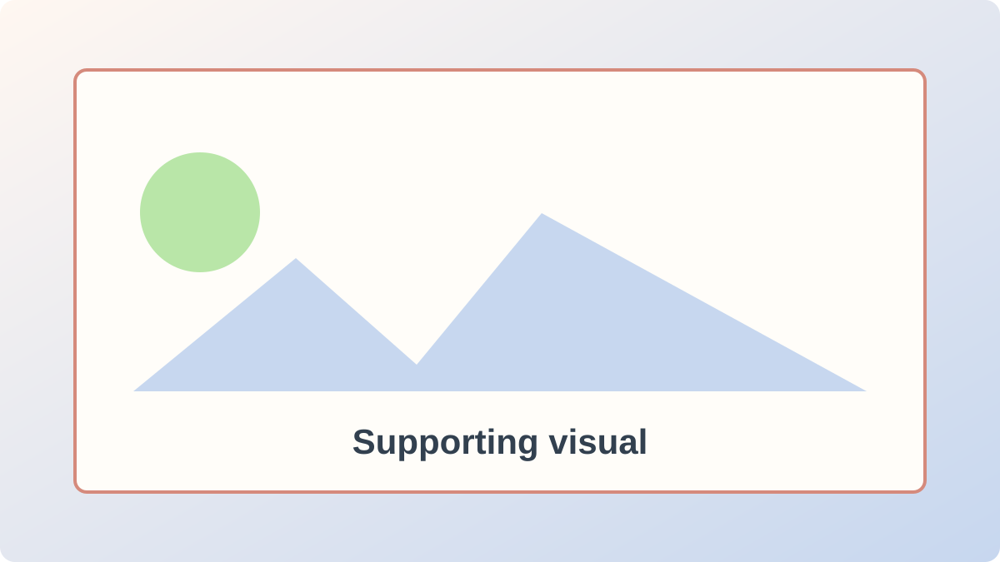

This opening area introduces the subject, establishes the problem, and tells the reader why the article is useful.

A second introductory paragraph can clarify the expected outcome, required background, or intended audience. Use **bold text** for strong emphasis, *italic text* for supporting emphasis, and descriptive links for sources.

> **Important note or warning:** Use this highlighted container for prerequisites, limitations, security concerns, or decisions that readers should not miss.

## First main section

Each level-two heading becomes an item in the article contents rail. Keep one major idea in each section and support it with evidence, examples, or practical guidance.

### Supporting detail

Level-three headings organize details inside a major section without adding another item to the contents rail.

- A concise supporting point.
- A second point with practical context.
- A final point that helps the reader decide what to do next.

## Images and visual evidence

Images should include useful alternative text, captions when needed, and credits or permissions in the submission form.



## Optional video

Use an approved YouTube or Vimeo URL when a demonstration is more useful than text.

```video-placeholder
Responsive video embed appears here
```

## Structured information

Tables work well for comparisons, decisions, limits, or configuration summaries.

| Information | Example value | Contributor guidance |
| --- | --- | --- |
| Category | Primary topic | Choose the closest available topic |
| Image | Supporting visual | Include alternative text and credits |
| Video | YouTube or Vimeo | Include a descriptive title |

## Code or technical example

Use a fenced code block for commands, configuration, or source code.

```text
[Example command, configuration, or code appears here.]
```

## Key takeaways

- Summarize the most important decision.
- Repeat the most reusable lesson.
- Give the reader one clear next step.
