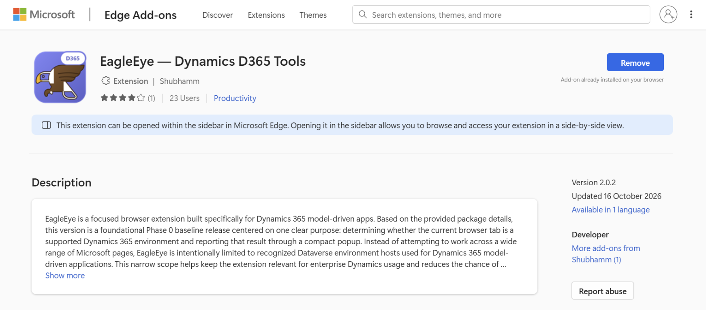
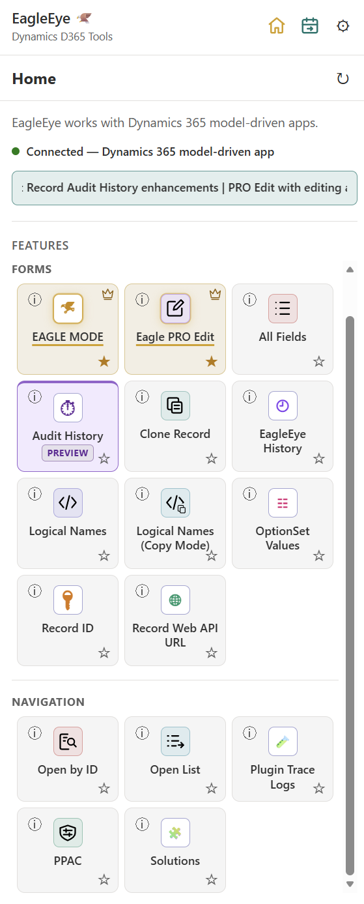
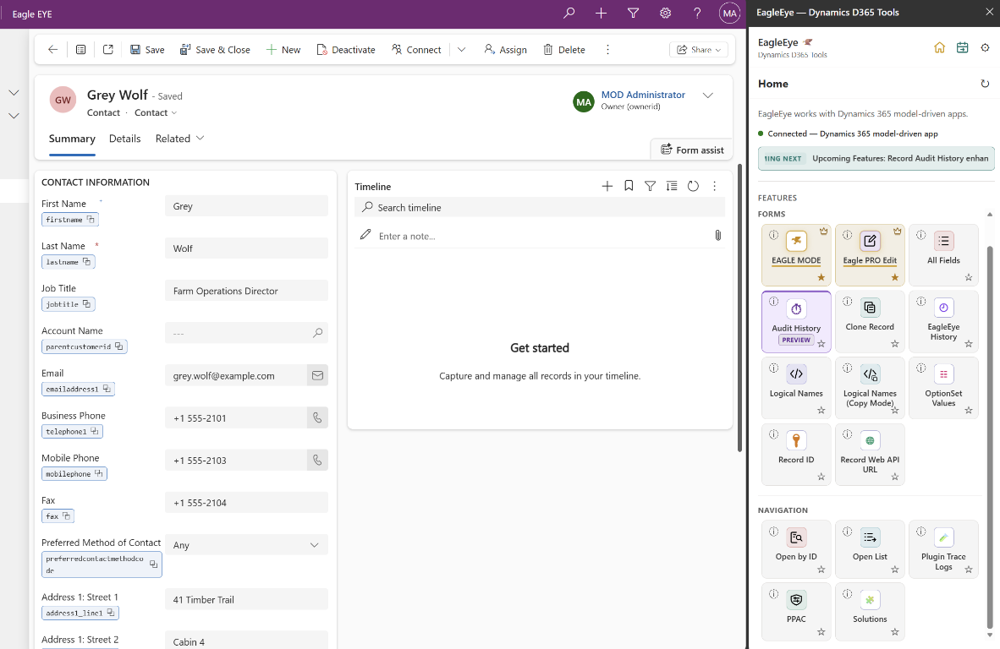
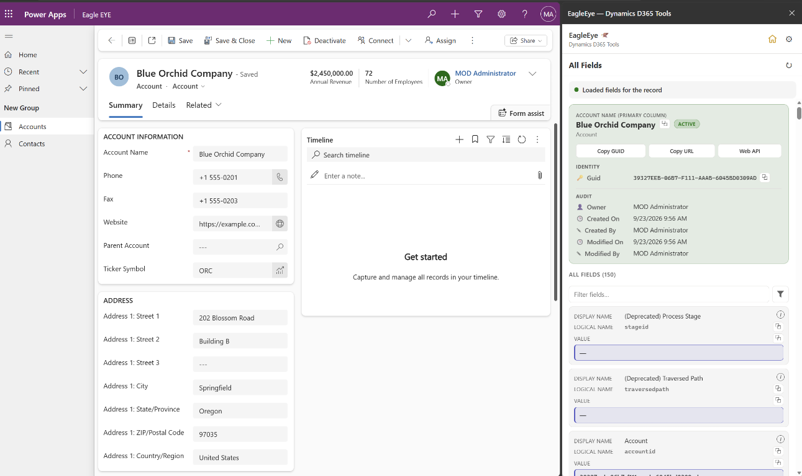
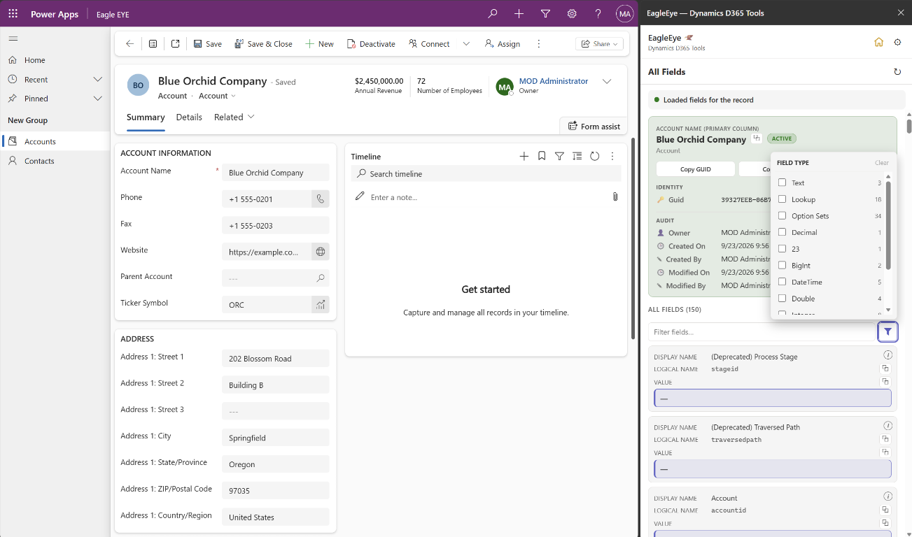
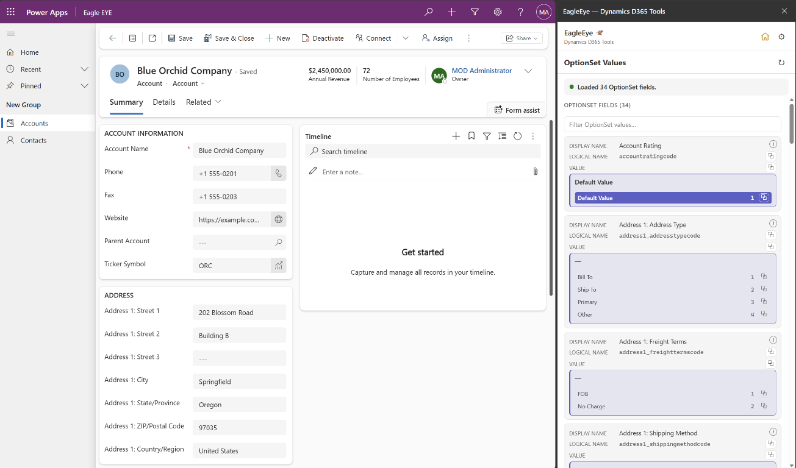
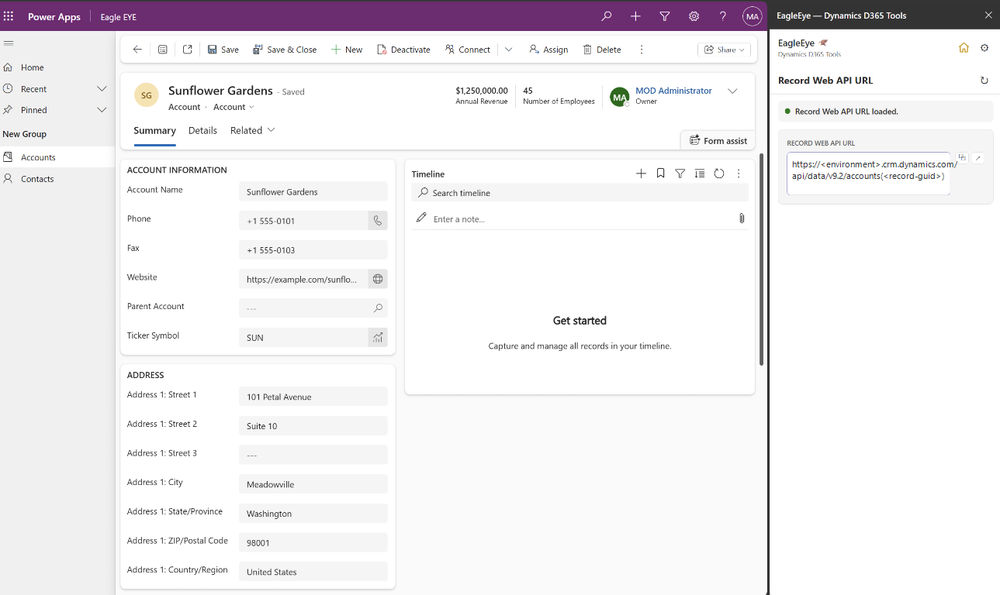
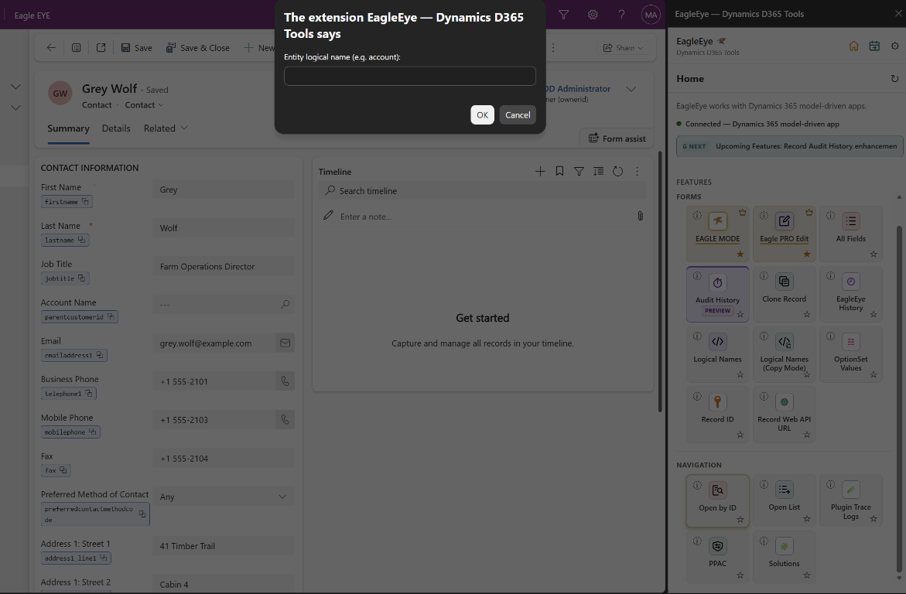
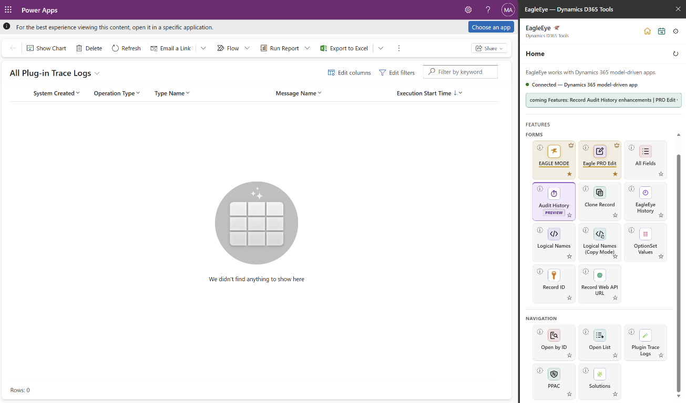

The form shows **Account Name**. Your flow needs `name`. A plugin trace has a record GUID. An integration needs the integer behind **Active**. The usual fix is a round trip through another tab, a metadata page, or a hand-built URL.

**EagleEye — Dynamics D365 Tools** puts those record-level answers beside the open model-driven app. It’s a Microsoft Edge extension: open a record, open EagleEye, and use a tool without losing your place.

> **In short:** inspect the record, discover schema names and Choice values, copy IDs and Web API URLs, or jump to a Dynamics area from the same environment.

**Get EagleEye:** [Open the Microsoft Edge Add-ons listing](https://microsoftedge.microsoft.com/addons/detail/eagleeye-%E2%80%94-dynamics-d365-/gphpjheamaiiacfgadcnkhjhpfmmicbf)  
**See it in action:** [Watch the EagleEye tour](https://youtu.be/Jsz-ZxtSmJ4)

##video https://youtu.be/Jsz-ZxtSmJ4 | EagleEye product tour



*This listing screenshot shows version 2.0.2, updated 16 October 2026, and indicates that the add-on is installed in this browser.*

The examples below use Microsoft sample accounts, including Blue Orchid Company and Sunflower Gardens. Screenshots keep the model-driven app on the left and EagleEye on the right.

## Quick start

1. Open a record in a Dynamics 365 model-driven app in Microsoft Edge.
2. Open EagleEye from the Edge toolbar. In Settings, enable **Open sidebar on icon click** if you want the side panel directly.
3. Check the **Connected** status, then choose a card under **Forms** or **Navigation**.

EagleEye is intentionally scoped to supported Dynamics model-driven hosts. On another site, it reports that it is not connected rather than trying to run against an unrelated page.



Use search to find a card, sort A–Z or Z–A, and star favorites to keep them near the top. Each card’s info button gives a short description before you run it. The panel can stay open while you move between records; use refresh to read the active tab again.

### Refreshed feature icons

The updated cards use clear, color-coded icons: a red list for **All Fields**, stacked records for **Clone Record**, code brackets for **Logical Names**, code plus copy for **Logical Names (Copy Mode)**, a pink list for **OptionSet Values**, an amber key for **Record ID**, and a green globe for **Record Web API URL**. Navigation has a record/search icon for **Open by ID**, a list-and-arrow for **Open List**, a test tube for **Plugin Trace Logs**, a shield for **PPAC**, and a puzzle piece for **Solutions**.

**Audit History** stands out with a purple stopwatch icon and a purple **PREVIEW** badge. Eagle Mode and Eagle PRO Edit have highlighted cards and crown markers. Feature names remain visible under every icon, so the interface does not depend on color or icon recognition alone.

## Start with the task

| You need to… | Use… | What it saves you |
| --- | --- | --- |
| Find the schema name for a form field | **Logical Names** or **Logical Names (Copy Mode)** | Guessing from the display label or opening metadata tools |
| See all values on the current record | **All Fields** | Switching tabs or manually inspecting fields one by one |
| Review recent changes to the current record | **Audit History (Preview)** | Leaving the record to locate audit information elsewhere |
| Map a Choice label to its stored integer | **OptionSet Values** | Guessing the number in a flow, plugin, or integration |
| Share a record reference or call its endpoint | **Record ID** or **Record Web API URL** | Selecting a GUID or assembling the endpoint by hand |
| Test a form with hidden or locked controls | **Eagle Mode** | Asking for a temporary form redesign |
| Open a record from a GUID or investigate a plugin | **Open by ID** or **Plugin Trace Logs** | Reconstructing a navigation URL |

## A practical developer workflow

Say a flow or plugin is behaving differently from what the form suggests:

1. Open the affected record and use **All Fields** to search by display name, logical name, or value. Narrow by field type if the record is large.
2. If the field is a Choice, open **OptionSet Values** and check the label-to-integer mapping.
3. Use **Logical Names (Copy Mode)** to copy the schema name into your code or query. Copy the **Record ID** when you need a precise test reference.
4. Open **Plugin Trace Logs** from Navigation to investigate a server-side failure. EagleEye takes you to the trace-log list; it doesn’t diagnose or modify the trace itself.

This is where the side panel helps most: the app record stays available while you gather the names and values needed to reproduce the issue.

## Forms

These eleven tools inspect or act on the record in the active model-driven app tab, including the read-only Audit History preview.

### Eagle Mode

One click makes every field optional, visible, and enabled, and expands every tab and section. Toggle again and the form goes back to the way the maker designed it.

Use it to inspect a hidden section or test a control that is currently locked. The change is in-page only; it does not change the form design. If you save the record yourself, normal record-save behavior still applies. Eagle Mode is highlighted on the home grid and is a default favorite.

**Developer benefit:** Inspect more of the form in one pass without asking a maker to redesign it just for a test.

### Logical Names

Logical Names stamps each field's schema name under its label. It covers tabs, sections, and header fields, not only the tab you happen to be looking at. Toggle again to clear the badges.

**Developer benefit:** See the exact schema name where you are working, without switching to a maker or metadata screen.

### Logical Names (Copy Mode)

Copy Mode is the same overlay, plus a copy icon on every field. That is the difference between retyping `parentaccountid` and pasting it.

The screenshot below shows **Logical Names (Copy Mode)** active on a contact form: schema names appear beneath the field labels, with a copy control beside each one.



**Developer benefit:** Copy a schema name directly into a flow, query, or plugin instead of retyping or looking it up elsewhere.

### All Fields

All Fields loads every column on the current record through the Web API into a searchable table. Filter by display name, logical name, or value. Narrow by field type. Each row shows the display name, the logical name, and the formatted value. Values, the record GUID, and the record URL are one-click copyable.

**First, scan the record:** In the Blue Orchid Company example below, EagleEye reports 150 fields. Each field card puts its display name, logical name, and value together; the account summary keeps its primary name, status, owner, and audit details in view too.



**Then narrow the list:** Search across the display name, logical name, or value—or open the field-type filter to focus on the data you need. The menu shows field types and counts, including Text, Lookup, Option Sets, Decimal, BigInt, DateTime, and Double. The screenshot below shows the selector open; no type is selected in this example.



**Developer benefit:** Answer “what is actually stored on this record?” and copy a value without leaving the form or opening another tool.

### ⏱ Audit History (Preview)

Audit History is a read-only preview for saved records. Opening it loads the latest retained entry. Use **Most recent** to reload that entry or **Recent 3** to request up to three recent entries, newest first. **Full history** is marked **Soon** and is not available in this preview. The record header shows the saved primary value, table, Status Reason when available, and GUID; it does not reflect unsaved form edits.

Each entry shows who changed the record, the event, local time, and the original recorded UTC time. Expand an entry to load field details on demand and compare **+ New** and **- Old** values, alongside display and logical names. Change labels identify additions, removals, modifications, and other recorded changes. Empty values, zero, and false remain distinguishable; missing old values stay blank, and Dataverse may truncate long values.

The layout adapts to the sidebar width: a stacked list when narrow, or a Field / + New / - Old table when wide. In the stacked layout, each field has one **Copy** action for its names, both values, changed-by user, event, and local time; it does not copy the whole event. The wide table has no copy controls.

Audit History is separate from **EagleEye History**, which tracks cloned records on this device. It does not edit, restore, undo, or export changes. It can show only retained audit data the signed-in user can read; auditing must have been enabled for the environment, table, and relevant columns when changes occurred. Loaded entries are not cached or polled in the background and are cleared when you leave Audit History.

**Developer benefit:** Inspect the latest recorded changes beside the open record without turning a quick investigation into another navigation workflow.

### OptionSet Values

OptionSet Values lists every Choice on the record with the label you see and the integer Dataverse stores. Imports, integrations, and plugins consume the integer. The label is what the form shows. Those two are not the same thing, and guessing is how mapping bugs start.

On the same account, EagleEye loaded 34 OptionSet fields. Address 1: Address Type shows Bill To = 1, Ship To = 2, Primary = 3, Other = 4. Address 1: Freight Terms shows FOB = 1 and No Charge = 2. Empty choices stay visible, so you can see the map even when the current record has no value selected. Each value is copyable.



**Developer benefit:** Confirm the exact integer behind a Choice label before a mapping, import, or integration turns into a production bug.

### Record ID

Record ID shows the current record GUID and copies it in one click. No more selecting the wrong half of the id from the address bar.

**Developer benefit:** Paste a precise record reference into a support message, test note, or query.

### Record Web API URL

Record Web API URL builds the OData endpoint for this record. Copy it, or open it in a new tab and read the raw record. Useful when you want the Web API shape without hand-assembling `api/data/v9.2`.



For example, the copied record URL can be used as the base for a focused request:

```http
GET https://<environment>.crm.dynamics.com/api/data/v9.2/accounts(<record-guid>)?$select=name,accountnumber
```

**Developer benefit:** Start from the correct record endpoint, then add the OData options your test or tool needs.

### Clone Record

Clone Record asks first, then creates a shallow copy of the current record. It copies the record's own scalar fields and single-valued lookups. It renames the copy `EE-Clone-{timestamp} - {name}`, saves it, logs it to EagleEye History, and offers to open it in a new tab.

It does not clone many-to-many associations, child records, activities, or notes. Treat it as a fast test copy, not a full duplicate of the related graph.

**Developer benefit:** Make a quick, clearly named test copy when you need another record to work with. Check related data separately; it is not copied.

### EagleEye History

EagleEye History is a device-local log of those clones. Open one, remove one, or clear the list. It stores references, not record data, and it never syncs to another browser or another machine.

**Developer benefit:** Find a recent clone again without searching the entity list.

### Eagle PRO Edit

Eagle PRO Edit is the privileged look at fields that are not on the form, including string, boolean, and choice columns the maker left off the screen. It is limited to System Administrator and System Customizer. The current release is a read-only preview: it discovers the fields and shows them. It does not write. When writes arrive, they will bypass form scripts and business rules, so the role gate stays.

PRO Edit is highlighted on the home grid next to Eagle Mode, because it is the tool you reach for when the answer is in the record and not on the form.

**Developer benefit:** Preview fields that the current form leaves out, while keeping the present release read-only and role-gated.

## Navigation

These five tools jump you somewhere else, always from the environment you already have open. They are the second group on the home grid.


### Open by ID

Prompts for an entity logical name and a record GUID, then opens that record in a new tab. Paste the id a colleague sent you. Do not rebuild the `pagetype=entityrecord` URL by hand.



**Developer benefit:** Go straight to a known record when all you have is its ID.

### Open List

Prompts for an entity logical name and opens its list view in a new tab. One prompt instead of hunting the sitemap.

**Developer benefit:** Jump to an entity’s records without digging through app navigation.

### Plugin Trace Logs

Opens the Plug-in Trace Log list in a new tab. The first stop when a plugin misbehaves and you do not want to remember the entity name.



**Developer benefit:** Start plugin troubleshooting from the record you were already inspecting.

### PPAC

Opens the Power Platform admin center (`admin.powerplatform.microsoft.com`) in a new tab. Environment admin, without losing the app you were just in.

**Developer benefit:** Open environment administration without losing your place in the model-driven app.

### Solutions

Opens the environment's Solutions list in a new tab. The maker surface, from the record you were inspecting.

**Developer benefit:** Move from record-level investigation to solution work in one step.

## Controls that stay out of the way

The home screenshot is also the control surface.

- **Connected status.** Green when the active tab is a model-driven app. A plain message when it is not. The same check runs before every tool, so a panel left open on the wrong tab does not pretend it can still act.
- **Search.** Filters the feature list by name.
- **A–Z sort.** Flips to Z–A. Favorites stay above the rest of their group.
- **Stars.** Your favorites sync. Eagle Mode starts starred so the unlock is one click away on a new install.
- **Grid or list.** The screenshots use the 3-column grid. Switch to a list in Settings if you prefer rows.
- **Info buttons.** Each card has a short explanation before you run it.
- **Dark theme.** Settings switches the panel between light and dark.
- **Open sidebar on icon click.** Skip the popup and land in the panel.

Settings also holds the direct-load toggle, the grid toggle, and the theme toggle. The popup, when you use it, shows the same connected or not-connected status, the detected host, and the same feature list. Popup and panel read one registry, so they cannot drift apart.

## Compatibility and privacy

EagleEye matches official Dynamics 365 model-driven hosts, and only those. HTTPS is required. The Power Apps maker portal and the marketing site are intentionally excluded.

| Cloud | Host pattern |
| --- | --- |
| Commercial and GCC | `<org>.crm#.dynamics.com` (GCC uses `crm9`) |
| US Government, GCC High | `<org>.crm.microsoftdynamics.us` |

The content script re-checks the host before it runs. On any other page, it stays inactive.

The Edge Add-ons listing shown above includes the developer’s privacy declaration that no personal data is collected. EagleEye History is also described as device-local and stores record references rather than record data. For the latest store details, check the live listing.

## Boundaries to keep in mind

- **Eagle Mode** changes the current page, not the form design. Review the form before saving a record.
- **Clone Record** copies scalar fields and single-valued lookups only—not related rows, activities, notes, or many-to-many relationships.
- **EagleEye History** is device-local and keeps references to clones, not field values.
- **Audit History** is a read-only preview: **Most recent** loads one retained entry and **Recent 3** loads up to three. Full history, export, restore, and editing are unavailable.
- **Eagle PRO Edit** is a read-only preview in this release and is limited to System Administrator and System Customizer roles.
- **Scope:** EagleEye works on supported Dynamics 365 model-driven app hosts; it is not a general-purpose browser tool.

## Coming next: November and December 2026

Two features are planned for the next releases:

| Feature | November 2026 | December 2026 |
| --- | --- | --- |
| **Record Audit History** | Preview validation and feedback: latest one entry automatically, latest three on demand, with expandable Old / New field comparisons | Public-release target, following live Dataverse validation and preview feedback |
| **Eagle PRO Edit** | Editing-and-saving preview for single-line text, Yes/No, and single-select Choice fields, extending the current read-only preview | Public-release target for the supported editing workflow, following preview feedback and validation |

Audit History will show only retained audit data the signed-in user is permitted to read. PRO Edit will remain role-restricted, with review and confirmation before saving; Dataverse permissions still apply.

Audit History already exists as a limited engineering preview in the current codebase; that does not by itself mean it is available from the public store. November is the planned preview-validation window, while December remains the public-release target. Exact dates are not yet announced, and public availability is subject to readiness and store review.

## Try it on a record you already have open

Open a record in a model-driven app in Edge, pin EagleEye, and click the extension icon.

If the tab is supported, you’ll see **Connected** and the Forms and Navigation groups. Otherwise, EagleEye tells you it is not connected.

### Pick a first task

- Need to identify a field? Open **Logical Names**.
- Need the exact value behind a Choice? Open **OptionSet Values**.
- Need to see every field and search by value? Open **All Fields**.
- Need to inspect the latest recorded changes? Open **Audit History (Preview)**.
- Need to get a hidden or locked field into view for a test? Toggle **Eagle Mode**.

**Try it:** Which repetitive lookup would you like to remove from your next debugging session? Open that card first, then star it if it belongs in your daily workflow.

[Install EagleEye from Microsoft Edge Add-ons](https://microsoftedge.microsoft.com/addons/detail/eagleeye-%E2%80%94-dynamics-d365-/gphpjheamaiiacfgadcnkhjhpfmmicbf) · [Watch the short tour](https://youtu.be/Jsz-ZxtSmJ4)

#Dynamics365 #PowerPlatform #Dataverse #MicrosoftEdge #PowerApps #D365 #ModelDrivenApps #Xrm #DataverseWebAPI #BrowserExtension #CRM #LowCode #PowerPlatformCommunity #Dynamics365Developer #Dynamics365Consultant #MakerTools #EdgeAddons #ProductivityTools #TechTutorial #CodeFox
