## Roadmap

Start with how a business uses CRM. Learn to configure a secure application before writing code, then progress to development, integration, architecture review, and verified delivery.

**This first path covers Dynamics 365 CRM/customer-engagement apps, Dataverse, and Power Platform.** Finance, Supply Chain Management, Commerce, Human Resources, and Business Central will need separate paths. All lesson topics and practice goals below are planned; this page is the roadmap, not the finished course.

All 28 core parts stay visible below the overview, grouped by stage. Choose a numbered diagram box to jump to that part, or read straight through. Each part and stage completion exercise has a **Back to roadmap** link that preserves the current zoom.

The nine optional application and AI topics remain click-to-show below the diagram. Select the same optional topic again, use **Close**, or press **Escape** in its details to collapse it.

The main diagram starts with Stage 1 centered. Use **Zoom in** or **Zoom out** to resize it; **Reset view** restores 100% and centers Stage 1 again. Scroll inside the diagram to explore other branches. The controls do not resize the focused diagrams below.

The roadmap keeps the original top-to-bottom diagram style. First understand the platform, then configure and automate, develop and integrate, and finally test and deliver a solution. Build the shared Customer Onboarding and Service-Request App as you learn, and prove each milestone rather than simply finishing the reading.

The optional application and AI groups sit side by side to the right of the main learning path. Cards stay vertical inside each group to keep the diagram compact. Dashed arrows branch from the same configuration foundation; their placement does not make the application tracks prerequisites for AI learning.


Select a numbered box to jump to an always-visible core part, or an optional box to show its details. On narrower screens, scroll the diagram sideways. Optional branches are separate from the 28 core parts and are not mandatory gates before development; each topic's prerequisites define the actual dependencies.

## 1 - Understand CRM and the Platform

Understand the customer lifecycle, platform responsibilities, app/site types, and the difference between data and application components. Finish by inspecting an approved sample application and explaining what you observe, without making configuration changes.

### 01 - What is CRM?

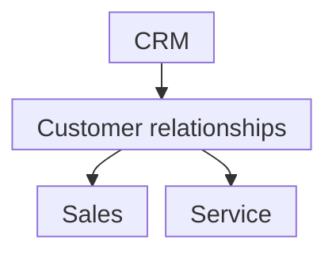

**Prerequisites:** basic computer skills. No Dynamics or programming experience is assumed.

**Planned topics:**

- CRM means Customer Relationship Management: its purpose and the customer lifecycle of enquiry, sale, onboarding, and support.
- Customers, organizations, contacts, communication history, sales opportunities, and support requests.
- Why businesses need shared information instead of disconnected spreadsheets.
- Sales, service, and manager responsibilities.
- **Business example:** Contoso Ltd enquires about a product, buys it, and later requests support. Sales and service employees need one shared customer history.
- **Follow the lifecycle:** record the enquiry, track the potential sale, keep onboarding information, then connect support requests to the same customer and contact.
- **Understanding check:** explain what would go wrong if each employee kept a separate spreadsheet or lost the previous conversation.

#### Start here

This walkthrough starts from zero. You do not need a Dynamics environment, a license, or programming knowledge to complete it. Work through the fictional example on paper or in a simple note; actual application navigation and setup belong to later parts.

By the end, you should be able to explain why a business uses CRM, identify the customer and people involved, and describe how sales and service share useful customer information.

#### Step 1 - Understand what CRM means

CRM stands for **Customer Relationship Management**. It is how a business organizes its relationships with customers: understanding their needs, recording interactions, following up, delivering what was agreed, and helping when something goes wrong.

CRM software supports that work. Dynamics 365 provides business applications for these kinds of processes; it is not the definition of CRM itself.

1. Think of a business that sells a product or service.
2. Identify one reason it needs to remember a customer's previous conversation.
3. Explain how that information would help the next employee who speaks to the customer.

**Expected result:** describe CRM as a business approach supported by software, not just a database or a list of phone numbers.

**Microsoft Learn:** [Dynamics 365 overview](https://learn.microsoft.com/en-us/dynamics365/get-started/intro-crossapp-index); [Dynamics business-process guidance](https://learn.microsoft.com/en-us/dynamics365/guidance/business-processes/overview).

#### Step 2 - Identify the business problem

Imagine the sales team keeps enquiries in one spreadsheet, service keeps support messages in another, and individual employees keep reminders in their inboxes.

- A salesperson may not know that the customer already has an unresolved support issue.
- A service agent may ask the customer to repeat what was previously promised.
- A manager may not know who owns the next action or which requests are overdue.

Write down the missing information in each example. Then complete this sentence: **"We need shared customer information so that..."**

**Expected result:** explain the need for consistent history, clear responsibility, and timely follow-up. Installing software alone does not fix an unclear business process.

**Microsoft Learn:** [Dynamics business-process guidance](https://learn.microsoft.com/en-us/dynamics365/guidance/business-processes/overview).

#### Step 3 - Identify the customer and the related information

Use this fictional business-to-business example throughout the walkthrough:

- **Customer organization:** Contoso Ltd.
- **Customer contact:** Alex Taylor, who asks about buying devices.
- **Sales employee:** Morgan, who handles the enquiry.
- **Service employee:** Casey, who handles a later support request.

| Concept | Meaning in this example |
|---|---|
| Account | The customer organization, Contoso Ltd; not a Microsoft sign-in account |
| Contact | Alex Taylor, the person at the customer organization |
| Activity | A call, email, meeting, or task associated with the customer work |
| Lead | An initial potential customer or enquiry in a sales process |
| Opportunity | A qualified potential deal the sales team is pursuing |
| Service request or case | A customer issue that needs investigation and resolution |
| Owner and status | Who is responsible for an item and its current business state |

These are introductory business concepts. The installed application determines which records and processes are available; not every enquiry must follow one universal lead process. A custom service-request record is not automatically a licensed Dynamics 365 Customer Service case.

**Expected result:** distinguish the organization, the person, the sales work, and the support issue instead of treating them as one interchangeable item.

**Microsoft Learn:** [Dataverse data and terminology](https://learn.microsoft.com/en-us/power-apps/maker/data-platform/data-platform-intro); [Model-driven navigation, lists, and forms](https://learn.microsoft.com/en-us/power-apps/user/navigation).

#### Step 4 - Follow the customer lifecycle

Read the example in order. For each event, identify what the next employee would need to know.

1. **Enquiry:** Alex asks about ten devices. Morgan records the need, customer/contact information, and an agreed follow-up.
2. **Potential sale:** Morgan confirms the requirements and tracks the potential deal. The enquiry is not yet a completed sale.
3. **Purchase:** Contoso decides to buy. The team records the agreed outcome and the next delivery/onboarding responsibility.
4. **Onboarding:** the responsible employee tracks the promised introduction or setup assistance and confirms what was completed.
5. **Support:** Alex reports a device issue. Casey connects the issue to the relevant customer/contact and reviews permitted previous information before responding.

**Expected result:** describe **enquiry -> potential sale -> purchase -> onboarding -> support**, with connected customer history. Do not create a new customer identity merely because another interaction occurs.

**Microsoft Learn:** [Dynamics 365 Sales overview](https://learn.microsoft.com/en-us/dynamics365/sales/overview); [Customer Service overview](https://learn.microsoft.com/en-us/dynamics365/customer-service/implement/overview).

#### Step 5 - Understand employee responsibilities

| Person or team | Needs to know | Example next action |
|---|---|---|
| Sales | Customer needs, previous sales conversations, and the potential deal | Morgan follows up with Alex |
| Onboarding or delivery | What was agreed and which assistance remains outstanding | Confirm that the promised introduction happened |
| Service | The reported issue, relevant history, ownership, and resolution progress | Casey investigates and records an update |
| Manager | Work status, ownership, outstanding actions, and business outcomes | Review overdue work and arrange help |

Choose an owner and a next action for each lifecycle event. A person's business responsibility is not the same thing as a configured security role; permissions are taught later.

**Expected result:** explain who does the work, what information they need, and how the next person can continue without relying on a private conversation.

**Microsoft Learn:** [Dynamics implementation and user roles](https://learn.microsoft.com/en-us/dynamics365/guidance/roles/overview).

#### Step 6 - Build a useful interaction history

Write one fictional activity note:

> Alex asked about ten devices. Morgan discussed the requirements today and agreed to follow up on Friday. Next action: Morgan confirms the requested specification with Alex.

Check that your note answers:

1. Who was involved?
2. What happened, and when?
3. What was agreed?
4. Who owns the next action?
5. What is the follow-up date or condition?

Keep **history**, **status**, and **next action** distinct. "A call happened" describes an interaction; "awaiting a response" describes the current state; "Morgan follows up Friday" describes the next action.

**Expected result:** another authorized employee can understand the situation from the note. Use synthetic data for learning; shared history does not mean unrestricted access to every customer's information.

**Microsoft Learn:** [Timeline and activities](https://learn.microsoft.com/en-us/power-apps/user/add-activities).

#### Step 7 - Explain the value and avoid common mistakes

- **Mistake: CRM is only a sales tool.** Customer relationships also involve onboarding, service, and follow-up.
- **Mistake: every employee needs every record.** Collaboration still requires appropriate permissions and privacy.
- **Mistake: an account and a contact mean the same thing.** In this example, Contoso is the organization and Alex is the person.
- **Mistake: entering data completes the work.** A recorded request still needs an owner, action, and verified outcome.
- **Mistake: the system automatically makes information correct.** Duplicate, incomplete, or outdated information still needs attention.

Compare the spreadsheet scenario with the shared CRM approach. Explain two improvements, such as avoiding repeated questions and making outstanding work visible to the responsible team.

**Expected result:** describe practical business value without claiming that CRM guarantees sales, correct data, or unrestricted access.

**Microsoft Learn:** [Dynamics business-process guidance](https://learn.microsoft.com/en-us/dynamics365/guidance/business-processes/overview); [Dataverse ownership and role access](https://learn.microsoft.com/en-us/power-platform/admin/wp-security-cds).

#### Step 8 - Complete the beginner exercise

Create your own fictional customer scenario, or reuse Contoso. Your observation note should contain:

1. One customer organization and one named customer contact.
2. Five ordered lifecycle events: enquiry, potential sale, purchase, onboarding, and support.
3. An owner and next action for each event.
4. One interaction note containing who, what, when, agreement, and follow-up.
5. Two problems caused by disconnected information and how shared CRM information would help.

Read it back in plain language. Explain the difference between the customer, the contact, a potential deal, a support issue, and an activity. If these still feel interchangeable, repeat Steps 3-6 before moving to Part 02.

**Expected result:** a short, understandable customer story that another person can follow. This is a concept exercise, not a requirement to create tables, apps, security roles, or automation.

**Microsoft Learn:** [Dynamics business-process guidance](https://learn.microsoft.com/en-us/dynamics365/guidance/business-processes/overview); [Dataverse data and terminology](https://learn.microsoft.com/en-us/power-apps/maker/data-platform/data-platform-intro).

#### Official references for this part

- [Dynamics 365 overview](https://learn.microsoft.com/en-us/dynamics365/get-started/intro-crossapp-index)
- [Dynamics business-process guidance](https://learn.microsoft.com/en-us/dynamics365/guidance/business-processes/overview)
- [Dataverse data and terminology](https://learn.microsoft.com/en-us/power-apps/maker/data-platform/data-platform-intro)
- [Model-driven navigation, lists, and forms](https://learn.microsoft.com/en-us/power-apps/user/navigation)
- [Dynamics 365 Sales overview](https://learn.microsoft.com/en-us/dynamics365/sales/overview)
- [Customer Service overview](https://learn.microsoft.com/en-us/dynamics365/customer-service/implement/overview)
- [Dynamics implementation and user roles](https://learn.microsoft.com/en-us/dynamics365/guidance/roles/overview)
- [Timeline and activities](https://learn.microsoft.com/en-us/power-apps/user/add-activities)
- [Dataverse ownership and role access](https://learn.microsoft.com/en-us/power-platform/admin/wp-security-cds)

**Practice goal:** produce a fictional customer scenario with five lifecycle events, owners/next actions, one useful interaction note, and two explained benefits of shared information.

**Readiness check:** distinguish organization/contact/activity/sales/support concepts, explain all five lifecycle events and responsibilities, and verify that the exercise includes every requested item. No Dynamics sign-in or environment changes are needed to pass this part.

### 02 - Dynamics 365 and Power Platform

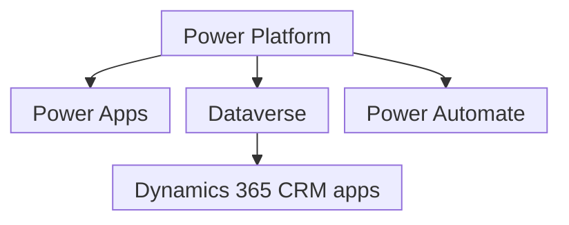

**Prerequisites:** Part 01.

**Planned topics:**

- Dynamics 365 as a family of business applications.
- Sales, Customer Service, and Field Service; CRM versus ERP scope.
- Power Apps, Power Automate, Power BI, and Power Pages.
- How Dynamics 365 CRM apps, Dataverse, and model-driven apps relate.
- Standard functionality versus configuration, customization, and development.
- Identify the app/interface layer; compare model-driven, canvas, and Power Pages experiences in Part 03.
- **Responsibilities example:** Dynamics 365 Sales supplies a sales process; Dataverse stores and secures the business data; a model-driven app presents forms and views; Power Automate can assign work or notify users.
- **What each component is not:** Dataverse is not the form, a view is not a separate database, and Power Automate is not the application's user interface.
- **Understanding check:** match "store a customer", "edit a request", "send an approval", and "analyse service performance" to the appropriate platform component.

#### Start here

Part 01 explained the business reason for CRM. This part explains where Dynamics 365 and Power Platform fit, so that product names do not become an unexplained list of tools.

You can complete this comparison without signing in, creating an environment, installing an application, or writing code. Use the same fictional Contoso customer story and write down which component is responsible for each piece of work.

#### Step 1 - Understand Dynamics 365 as an application family

Dynamics 365 is a family of business applications, not one screen, one database, or a single application that automatically contains every feature.

1. Start with the business task: selling, supporting a customer, scheduling field work, or another operation.
2. Identify the application intended for that task.
3. Distinguish a product's available business features from configuration or code your organization may add.

For example, Dynamics 365 Sales provides sales-oriented business capabilities; Customer Service provides case/service-management capabilities; Field Service supports work orders and field work. Their availability depends on the installed/provisioned product and access.

**Expected result:** explain Dynamics 365 as connected business applications, without assuming one license or environment includes all of them.

**Microsoft Learn:** [Dynamics 365 overview](https://learn.microsoft.com/en-us/dynamics365/get-started/intro-crossapp-index).

#### Step 2 - Recognize the scope of this learning path

| Business need | Application or learning branch |
|---|---|
| Track potential sales and customer relationships | Dynamics 365 Sales |
| Manage customer cases and service work | Dynamics 365 Customer Service |
| Schedule and complete on-site work | Dynamics 365 Field Service |
| Learn customer data/journeys, contact-center operations, or project work | Optional Customer Insights, Contact Center, or Project Operations branches |
| Learn finance, supply chain, commerce, human resources, or Business Central | Separate business-operations/ERP paths |

This core roadmap focuses on **Dynamics 365 CRM/customer-engagement apps, Dataverse, and Power Platform**. Do not assume every Dynamics 365 application uses the same development model or the same Dataverse architecture.

**Expected result:** identify the CRM track and recognize when a requirement belongs to another application or a separate ERP path.

**Microsoft Learn:** [Dynamics developer tracks](https://learn.microsoft.com/en-us/dynamics365/get-started/developers).

#### Step 3 - Give each platform component a clear responsibility

Power Platform provides products and capabilities for building and extending business solutions. Start by asking what each one contributes.

| Component | Main responsibility | Example in the customer story |
|---|---|---|
| Dynamics 365 business application | Ready-made business capabilities for its product area | Sales manages a qualified potential deal |
| Dataverse | Business data, table definitions, relationships, security, and supported logic | Store the customer and related request data |
| Power Apps | Application interfaces and user interactions | An employee finds and edits a permitted request |
| Power Automate | Triggered or scheduled automation and connected actions | Notify a manager or run an approval process |
| Power BI | Analytics and reporting | Analyse service trends using an authorized reporting model |
| Power Pages | Business websites, including external-user experiences | A customer uses an approved request website |
| Copilot Studio | Build and manage business agents and their connected tools | An optional assistant answers an approved knowledge question |

These components can work together, but they are not interchangeable. A view is not a second database, a cloud flow is not the application's form, and an agent is not automatically an authorized administrator.

**Expected result:** explain each component's role rather than choosing a tool merely because its name sounds familiar.

**Microsoft Learn:** [Power Platform products and capabilities](https://learn.microsoft.com/en-us/power-platform/); [Dataverse data and terminology](https://learn.microsoft.com/en-us/power-apps/maker/data-platform/data-platform-intro); [Copilot Studio overview](https://learn.microsoft.com/en-us/microsoft-copilot-studio/fundamentals-what-is-copilot-studio).

#### Step 4 - Connect the application, data, and interface

For this CRM track, understand the relationship in three layers:

1. **Business application:** Dynamics 365 CRM apps provide product-specific processes and components.
2. **Data foundation:** those CRM apps use Dataverse data and its associated definitions, relationships, and security.
3. **User experience:** model-driven apps present that data through forms, views, navigation, and other application components.

You can also build a custom model-driven application with Power Apps. That teaches the shared platform, but does not automatically provide all licensed Sales, Customer Service, or Field Service capabilities.

Canvas apps and Power Pages can participate in a solution too. Part 03 compares their app/site experiences; not every canvas app has to use Dataverse, and a website has its own access considerations.

**Expected result:** distinguish the business application, stored information, and the interface that displays it. Two interfaces can use related data without granting every user identical access.

**Microsoft Learn:** [Model-driven app overview](https://learn.microsoft.com/en-us/power-apps/maker/model-driven-apps/model-driven-app-overview); [Dataverse data and terminology](https://learn.microsoft.com/en-us/power-apps/maker/data-platform/data-platform-intro).

#### Step 5 - Walk through one connected business scenario

Imagine Contoso's contact Alex reports a support issue. Treat the following as a conceptual flow, not instructions to provision these products:

1. **Capture the work:** an employee uses the chosen model-driven app to enter a permitted request or case. Which record is used depends on the selected custom app or licensed business application.
2. **Store the information:** Dataverse holds the customer relationship, request information, ownership, and status.
3. **Automate a justified step:** an approved Power Automate flow can notify the appropriate person or request an approval.
4. **Continue the work:** an authorized employee or configured action updates the underlying record. A notification alone does not mean the issue is resolved.
5. **Review the outcome:** use an operational chart/view or a justified Power BI report to check service results. Reporting permissions must be verified separately.

An optional Power Pages site could support an external customer interaction, and an optional agent could assist with permitted knowledge or actions. They are not mandatory additions to every request-management app.

**Expected result:** trace information through the interface, data platform, automation, and reporting without treating them as separate copies of the same customer.

**Microsoft Learn:** [Power Automate introduction](https://learn.microsoft.com/en-us/power-automate/getting-started); [Power BI overview](https://learn.microsoft.com/en-us/power-bi/fundamentals/power-bi-overview).

#### Step 6 - Distinguish standard features, configuration, and development

| Approach | What it means here | Example decision |
|---|---|---|
| Use standard functionality | Use an available product feature before replacing it | Use a suitable existing view or case-management capability |
| Configure the experience | Adjust supported settings or components for the business task | Choose form fields, view filters, or a supported business rule |
| Customize the solution | Add or adapt solution components to meet a requirement | Add a justified request column or custom application component |
| Develop an extension | Write supported code or integration when simpler options are insufficient | Add necessary server-side validation or an external integration |

These terms overlap: configuration is often included within the broader idea of customization. They are not four perfectly separate product categories.

Start with the requirement, inspect standard capabilities, consider supported configuration, then justify any added code. Learning Dynamics does not mean writing a plug-in for every business rule.

**Expected result:** propose the simplest supported approach and explain why an extension is or is not necessary. Exact maker/developer procedures are taught in later stages.

**Microsoft Learn:** [Plan a Power Apps project](https://learn.microsoft.com/en-us/power-apps/guidance/planning/introduction); [Solutions and component packaging](https://learn.microsoft.com/en-us/power-apps/maker/data-platform/solutions-overview).

#### Step 7 - Recognize access and tool boundaries

- **Account, tenant, and environment:** where you sign in and where the app/data belongs are related but different concepts. Part 04 covers the access arrangement.
- **Product availability:** a visible maker portal does not prove every Dynamics application is installed or licensed.
- **Permissions:** being able to open an app does not automatically let you read all records, customize tables, or administer the environment.
- **Connections and reporting:** flows, websites, integrations, agents, and reports have their own relevant identity/access controls.
- **Tools:** maker experiences help configure apps, the Power Platform admin center supports authorized administration, and developer tools are introduced when code is needed.
- **Safety:** use synthetic learning data and approved access. Do not grant broad administrator privileges, purchase products, or create production resources merely to follow this conceptual part.

**Expected result:** identify what must be checked before a future lab: the correct environment, required application, appropriate entitlements, permissions, and approved connections.

**Microsoft Learn:** [Environment types and roles](https://learn.microsoft.com/en-us/power-platform/admin/environments-overview); [Dataverse roles and privileges](https://learn.microsoft.com/en-us/power-platform/admin/security-roles-privileges).

#### Step 8 - Complete the platform-matching exercise

For each need below, name a suitable component and write one sentence explaining its responsibility:

1. Use a ready-made sales process for a qualified potential deal.
2. Store a customer and the relationship to a request.
3. Let an employee find and edit a permitted request.
4. Notify a manager and handle an approval.
5. Analyse service performance over time.
6. Offer an approved external customer request website.
7. Build an optional assistant that uses approved knowledge and tools.

Use the responsibility table in Step 3 to check your answers. Where more than one approach is reasonable, explain the choice; an operational app chart may be sufficient instead of a separate analytics report.

Then add:

- A four-sentence explanation separating the business application, data platform, interface, and automation.
- One configuration-versus-code decision, including why the simpler approach is or is not sufficient.
- Two access assumptions that must be verified before doing an actual lab.

**Expected result:** seven reasoned component matches and a short explanation of how a connected solution works. This is not a checklist requiring you to build seven services or learn every optional branch now.

**Microsoft Learn:** [Power Platform products and capabilities](https://learn.microsoft.com/en-us/power-platform/); [Plan a Power Apps project](https://learn.microsoft.com/en-us/power-apps/guidance/planning/introduction).

#### Official references for this part

- [Dynamics 365 application family](https://learn.microsoft.com/en-us/dynamics365/get-started/intro-crossapp-index)
- [Power Platform products and capabilities](https://learn.microsoft.com/en-us/power-platform/)
- [Dataverse data and platform responsibilities](https://learn.microsoft.com/en-us/power-apps/maker/data-platform/data-platform-intro)
- [Dynamics developer tracks](https://learn.microsoft.com/en-us/dynamics365/get-started/developers)
- [Copilot Studio overview](https://learn.microsoft.com/en-us/microsoft-copilot-studio/fundamentals-what-is-copilot-studio)
- [Model-driven app overview](https://learn.microsoft.com/en-us/power-apps/maker/model-driven-apps/model-driven-app-overview)
- [Power Automate introduction](https://learn.microsoft.com/en-us/power-automate/getting-started)
- [Power BI overview](https://learn.microsoft.com/en-us/power-bi/fundamentals/power-bi-overview)
- [Plan a Power Apps project](https://learn.microsoft.com/en-us/power-apps/guidance/planning/introduction)
- [Solutions and component packaging](https://learn.microsoft.com/en-us/power-apps/maker/data-platform/solutions-overview)
- [Environment types and roles](https://learn.microsoft.com/en-us/power-platform/admin/environments-overview)
- [Dataverse roles and privileges](https://learn.microsoft.com/en-us/power-platform/admin/security-roles-privileges)

**Practice goal:** complete seven component/responsibility matches, explain the four solution layers, and record one configuration-versus-code decision and two access checks.

**Readiness check:** distinguish the business application, Dataverse data foundation, Power Apps interface, automation, reporting, website, and optional agent roles. Verify every exercise item without assuming that one license, sign-in, or product grants every capability or permission.

### 03 - Types of Apps

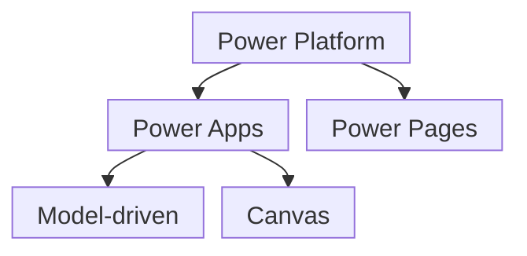

**Prerequisites:** Parts 01-02. No app creation, programming, or environment changes are required for this comparison.

**Planned topics:**

- **Model-driven apps:** start with Dataverse data and processes; configure forms, views, navigation, and business behavior. Dynamics 365 CRM apps use this model.
- **Canvas apps:** design screens and controls for a task, use Power Fx, and connect to Dataverse or other supported data sources. A canvas app does not have to use Dataverse.
- **Power Pages:** build business websites for browser-based audiences, including external users, with Dataverse integration and separate site authentication/authorization.
- **Correct terminology:** Power Apps has two app types, model-driven and canvas. Power Pages is a separate Power Platform website product, not a third Power Apps app type.
- **Business examples:** a service agent manages requests in a model-driven app; a technician uses a focused canvas screen; a customer uses an approved Power Pages website to submit or view a request.
- **Choosing an experience:** compare audience, task, data, layout, access, and licensing. Several experiences can use related business data without sharing identical permissions.
- **Security awareness:** app sharing, Dataverse roles, connection identity, and Power Pages web roles/table permissions are different controls. Hiding a field or page does not grant or deny underlying data access.

#### Start here

Part 02 explained what the platform components do. This part helps you choose the **experience through which a person performs a task**.

There are two Power Apps app types: **model-driven** and **canvas**. **Power Pages** is a separate Power Platform website product. We compare all three here because a Dynamics solution may need employee apps, focused task screens, and customer-facing websites.

This is a design and understanding exercise. No sign-in, app creation, website publication, security changes, or coding is required.

#### Step 1 - Start with the person and the task

Before choosing a tool, answer these questions:

1. **Who will use it?** An employee, technician, customer, partner, or another approved audience?
2. **What must they do?** Manage many related records, complete one focused task, or use a business website?
3. **What information is needed?** Existing Dataverse records, another approved data source, or several connected sources?
4. **What must the interface support?** Forms and record lists, a tailored screen, or website pages and navigation?
5. **What access is allowed?** Which records and actions should be available to that person?

Use fictional Contoso Ltd throughout the comparison. An employee managing requests, a technician completing a task, and Alex checking a customer request may need different interfaces even when the underlying business information is related.

**Expected result:** write a short user/task description before selecting an app or website. Do not choose solely because a product is familiar.

**Microsoft Learn:** [Plan a Power Apps project](https://learn.microsoft.com/en-us/power-apps/guidance/planning/introduction).

#### Step 2 - Understand model-driven apps

A model-driven app starts with a **Dataverse data model** and uses configured application components to present the information.

- **Forms** let a user work with an individual record.
- **Views and grids** let a user find and review lists of records.
- **Navigation and related records** help the user move through connected business information.
- **Business components and processes** support the selected workflow.

For example, a service employee might find an open request, open its form, inspect its customer relationship, and update permitted information.

The platform provides much of the standard interface structure. You configure relevant components rather than positioning every screen element as if drawing a blank page. Model-driven apps can work across supported browser/mobile experiences; they are not only desktop apps.

**Expected result:** recognize the data/process-led approach and explain why it is useful for record-rich business work. A configured form does not replace Dataverse permissions.

**Microsoft Learn:** [Model-driven app overview](https://learn.microsoft.com/en-us/power-apps/maker/model-driven-apps/model-driven-app-overview).

#### Step 3 - Understand canvas apps

A canvas app starts with a flexible screen-design experience. The maker chooses screens, controls, layout, and behavior, using supported data connections and **Power Fx** formulas.

1. Identify the focused task, such as reviewing a technician's assigned work.
2. Sketch the controls the person needs: a list, a detail area, an input, or an action.
3. Identify the source of the business information.
4. Consider validation, errors, accessibility, and behavior on the intended devices.

A canvas app can connect to Dataverse, SharePoint, or other supported sources. It does not have to use Dataverse, and displaying data on a screen does not make the screen its permanent storage location.

This flexibility also creates design responsibilities. Responsive behavior, correct formulas, data-query limits, and meaningful failure feedback need to be designed and tested; a tailored screen is not automatically a complete business solution.

**Expected result:** explain the screen/task-led approach without confusing the app interface with its data source. Detailed Power Fx and app-building procedures come later.

**Microsoft Learn:** [Canvas app overview](https://learn.microsoft.com/en-us/power-apps/maker/canvas-apps/getting-started).

#### Step 4 - Understand Power Pages websites

Power Pages is used to build and administer business websites, including experiences for external customers and partners.

Imagine Alex needs an approved browser-based site to submit a request or view an allowed status. The experience may include:

- Website pages and navigation.
- Forms or lists connected to Dataverse information.
- A configured sign-in experience where required.
- Appropriate web roles and table permissions controlling record access.

A website is not simply a model-driven app with a public link. Site access, user identity, record permissions, content, and licensing must be considered separately.

Anonymous access is a deliberate design/security decision, not a shortcut for avoiding permission configuration. This introductory part does not ask you to publish a site or expose any customer data.

**Expected result:** identify Power Pages as a website product and explain why an external request experience needs explicitly designed access controls.

**Microsoft Learn:** [Power Pages overview](https://learn.microsoft.com/en-us/power-pages/introduction); [Power Pages table permissions](https://learn.microsoft.com/en-us/power-pages/security/table-permissions).

#### Step 5 - Compare the three approaches

| Question | Model-driven app | Canvas app | Power Pages |
|---|---|---|---|
| What is it? | A Power Apps app type | A Power Apps app type | A separate Power Platform website product |
| What drives the design? | Dataverse data, relationships, and configured components | Screens, task flow, controls, and formulas | Website pages, user journeys, and site components |
| Where does business data come from? | Dataverse is required | Dataverse or other supported data sources | Dataverse-backed business experiences and supported site capabilities |
| What does the user typically see? | Forms, views, grids, and record navigation | A tailored app screen or sequence of screens | Browser-based website pages, forms, and lists |
| What is a common fit? | Record-rich employee processes | Focused or tailored business tasks | Customer/partner website interactions |
| What must be checked for access? | App access and Dataverse privileges | App sharing plus relevant data/connection permissions | Site identity, web roles, and table permissions |
| What still needs testing? | Components, process behavior, permissions, and supported devices | Formulas, data operations, queries, layout, permissions, and devices | Pages, forms, identity, record access, and browser behavior |

These are common fits, not absolute audience rules. Suitably configured/licensed Power Apps can support guest scenarios, and a business website is not defined only by whether its audience is internal or external.

**Expected result:** compare data, interface, task, and permissions together. Do not conclude "mobile means canvas" or "external automatically means public."

**Microsoft Learn:** [Power Apps app types](https://learn.microsoft.com/en-us/power-apps/powerapps-overview); [Power Pages overview](https://learn.microsoft.com/en-us/power-pages/introduction).

#### Step 6 - Follow one customer request through different experiences

| Person and task | Possible experience | Access that must be verified |
|---|---|---|
| An employee manages requests and related customer information | Model-driven service-request app | Relevant app and Dataverse record/action privileges |
| A technician completes a focused assigned-work task | A justified canvas app or existing suitable app experience | Assigned data, supported connection identity, and allowed updates |
| Alex submits or checks an allowed customer request | An approved Power Pages website | Site sign-in where required and the permitted customer-record scope |

These interfaces can use related Dataverse data when designed to do so. They do not automatically share identical permissions, and creating another interface does not require creating a duplicate customer database.

For each row, explain what should happen if the user tries to access an unrelated customer's record or make an unauthorized update.

**Expected result:** describe different user experiences over connected business information, with explicit allowed/denied boundaries rather than assumed access.

**Microsoft Learn:** [Dataverse table relationships](https://learn.microsoft.com/en-us/power-apps/maker/data-platform/create-edit-entity-relationships); [Power Pages table permissions](https://learn.microsoft.com/en-us/power-pages/security/table-permissions).

#### Step 7 - Choose the simplest experience and avoid mistakes

- **Mistake: Power Pages is the third Power Apps app type.** It is a separate website product.
- **Mistake: canvas always requires Dataverse.** It can use other supported data sources.
- **Mistake: model-driven apps cannot work on mobile.** They support appropriate mobile/browser experiences; test the intended use.
- **Mistake: hiding a button or column secures data.** Access must be enforced through the relevant platform/source controls.
- **Mistake: a new app gives every user the right license or permission.** Availability, entitlements, sharing, and data access still need checking.
- **Mistake: every project must build all three.** Reuse a suitable standard form/view or existing app before adding another surface.

Choose by the actual requirement. A standard model-driven form may already solve the technician's task; a canvas app is justified only if its tailored experience adds necessary value.

**Expected result:** explain both your chosen option and why you are not adding unnecessary apps or websites.

**Microsoft Learn:** [Canvas app and data sharing](https://learn.microsoft.com/en-us/power-apps/maker/canvas-apps/share-app); [Dataverse ownership and role access](https://learn.microsoft.com/en-us/power-platform/admin/wp-security-cds).

#### Step 8 - Complete the app-type decision exercise

Write a decision for each of these three fictional needs:

1. Employees must manage customers, requests, ownership, and related activities.
2. A technician needs a focused screen for an assigned task.
3. A customer needs an approved browser-based request-submission/status experience.

For each decision, record **six items**:

- Audience.
- Task.
- Required data source.
- Intended interface.
- Allowed/denied access to check.
- Chosen app/site approach and the reason.

Then explain one alternative you considered and why it is less suitable or unnecessary. Finish by stating the two Power Apps app types and the separate role of Power Pages.

**Expected result:** three reasoned decisions with all six fields, one alternative comparison, and correct terminology. This is not a requirement to build or publish all three experiences.

**Microsoft Learn:** [Plan a Power Apps project](https://learn.microsoft.com/en-us/power-apps/guidance/planning/introduction); [Power Apps app types](https://learn.microsoft.com/en-us/power-apps/powerapps-overview).

#### Official references for this part

- [Model-driven app overview](https://learn.microsoft.com/en-us/power-apps/maker/model-driven-apps/model-driven-app-overview)
- [Canvas app overview](https://learn.microsoft.com/en-us/power-apps/maker/canvas-apps/getting-started)
- [Power Pages overview](https://learn.microsoft.com/en-us/power-pages/introduction)
- [Power Pages table permissions](https://learn.microsoft.com/en-us/power-pages/security/table-permissions)
- [Plan a Power Apps project](https://learn.microsoft.com/en-us/power-apps/guidance/planning/introduction)
- [Power Apps app types](https://learn.microsoft.com/en-us/power-apps/powerapps-overview)
- [Dataverse table relationships](https://learn.microsoft.com/en-us/power-apps/maker/data-platform/create-edit-entity-relationships)
- [Canvas app and data sharing](https://learn.microsoft.com/en-us/power-apps/maker/canvas-apps/share-app)
- [Dataverse ownership and role access](https://learn.microsoft.com/en-us/power-platform/admin/wp-security-cds)

**Practice goal:** produce three app/site decisions, each covering audience, task, data, interface, access, and justification, plus one explained alternative.

**Readiness check:** distinguish model-driven, canvas, and Power Pages accurately; explain their data/UI/access differences; and verify every decision-exercise item. No app creation, website publication, or environment changes are needed to pass.

### 04 - Accounts and environments

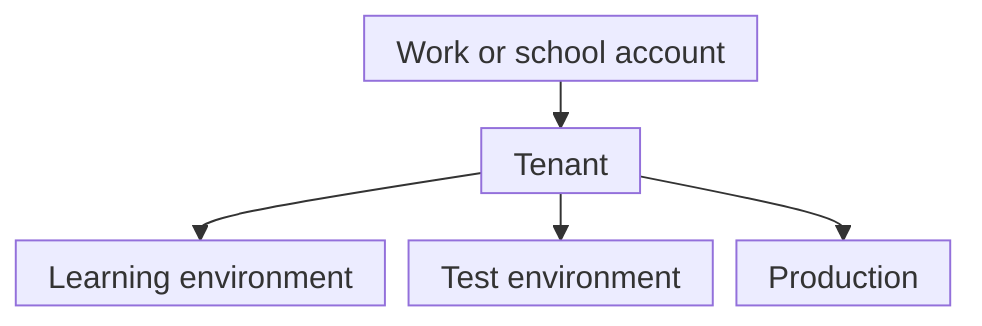

**Prerequisites:** Parts 01-02 and an approved access arrangement.

**Planned topics:**

- Work/school accounts, tenants, environments, and applications.
- Learning, development, test, and production purposes.
- Environment selection and checking where changes will happen.
- Licensing versus permissions; installed application availability.
- Maker, customizer, administrator, and ordinary user responsibilities.
- Maker/admin portals and access troubleshooting.
- **Access checklist:**
  - Confirm the work/school account and correct tenant.
  - Record the learning environment's name and purpose; check that it is not production.
  - Confirm Dataverse and the required application are available.
  - Check both licensing and permissions; neither automatically supplies the other.
  - Identify which actions are allowed and which require administrator assistance.
  - Stop and request help for missing access instead of granting blanket administrator rights.
- **Example:** a user may be able to sign in and open an app but still lack permission to create a table or read another owner's records.

#### Start here

The earlier parts explained CRM, platform responsibilities, and app types. This part helps you identify **which account, organization, environment, and application you are allowed to use**.

You can read the concepts without access, but the sign-in/inspection steps require an approved, available environment and appropriate entitlements. This walkthrough does not authorize creating environments, purchasing licenses, changing security, or working in production.

Sign in personally. Never share passwords, authentication codes, recovery codes, tokens, or session cookies with a helper.

#### Step 1 - Separate account, tenant, environment, and customer record

| Term | What it means here |
|---|---|
| Work or school account | The Microsoft identity used to sign in to the organization's services |
| Tenant | The organization's Microsoft Entra identity/service boundary under which environments are created |
| Environment | A workspace containing its own relevant apps, flows, connections, and optional Dataverse database |
| CRM account | A business customer record, such as Contoso Ltd; not your Microsoft sign-in identity |

One tenant can contain several environments. One environment can contain several applications; opening an app is not the same as selecting the tenant or creating a new database.

Write a simple description of the relationship: **"I sign in using an approved account, in the correct organization, to use a specified environment and application."**

**Expected result:** distinguish sign-in identity, organization boundary, working environment, and customer information.

**Microsoft Learn:** [Environment types and roles](https://learn.microsoft.com/en-us/power-platform/admin/environments-overview).

#### Step 2 - Confirm the approved learning arrangement

Before opening a maker or admin experience, obtain the learning arrangement from the responsible administrator, sponsor, or environment owner:

1. Which account and tenant should you use?
2. Which environment name and identifier/URL belong to the learning task?
3. What is its purpose and who owns/supports it?
4. Which application and synthetic sample data are available?
5. Which actions are approved now, and which require a separate request?

For Stage 1, the practical goal is safe inspection, not table creation, security changes, automation, or production work. Do not use the default environment or a production app merely because it is the only one you can see.

If no suitable environment is available, record the access task as **Blocked** and request an approved arrangement. Reading concepts can continue, but it does not complete the environment-dependent readiness check.

**Expected result:** identify a specific approved learning target and responsible owner, rather than guessing which environment is safe.

**Microsoft Learn:** [Environment types and roles](https://learn.microsoft.com/en-us/power-platform/admin/environments-overview); [Plan a Power Apps project](https://learn.microsoft.com/en-us/power-apps/guidance/planning/introduction).

#### Step 3 - Understand environment purposes and current setup limits

| Environment type | Typical purpose | Learning caution |
|---|---|---|
| Production | Real business workloads | Not the default place to experiment or change configuration |
| Sandbox | Nonproduction development and testing | Still needs explicit access, synthetic data, and approved actions |
| Developer | Development/test use under the applicable plan and policies | Check current managed-environment, licensing, and provisioning requirements |
| Trial | Temporary evaluation | Check expiry, product availability, limits, and what happens to the work |
| Default | A tenant's shared default workspace | Do not assume it is private, dedicated to training, or appropriate for every task |

**Managed Environments** describes governance capabilities; it is not simply another word for production or a guarantee that a workspace is suitable for this lesson.

**Current setup note, checked 2026-11-27:** Microsoft states that, from **November 15, 2026**, Developer Plan signup no longer automatically creates a developer environment, and new unmanaged developer environments cannot be created. Unmanaged developer environments are deprecated. Ask the administrator about an approved managed developer environment or another appropriate development/test environment.

The current guidance also states that Developer Plan use rights do not cover running assets in a managed developer environment without the required premium licensing. Do not convert an environment, enable paid capabilities, or change tenant policies just to follow an older tutorial.

**Expected result:** explain the selected environment's actual type and purpose, and use current guidance instead of assuming a free signup supplies every learning capability.

**Microsoft Learn:** [Environment types and roles](https://learn.microsoft.com/en-us/power-platform/admin/environments-overview); [Current Developer Plan guidance](https://learn.microsoft.com/en-us/power-platform/developer/plan).

#### Step 4 - Sign in safely with the correct identity

If your arrangement includes maker access, use the official [Power Apps maker portal](https://make.powerapps.com). If you are an application user only, use the approved application link supplied by the owner instead of trying to obtain maker/admin access.

1. Sign in using the approved work/school account.
2. Complete your organization's authentication requirements personally.
3. Check the displayed account and organization/tenant context.
4. If the wrong account or tenant is selected, use the supported account/organization switching experience or sign out and sign back in as appropriate.
5. If sign-in or organizational access is denied, stop and contact the responsible owner/IT team.

Do not create a new tenant, bypass an organizational policy, or supply authentication codes to another person as a workaround.

**Expected result:** confirm the intended identity and organization without exposing credentials or weakening access controls.

**Microsoft Learn:** [Model-driven navigation, lists, and forms](https://learn.microsoft.com/en-us/power-apps/user/navigation).

#### Step 5 - Select and verify the environment

In the maker experience, use the environment selector to choose the approved environment by name. Labels and placement can vary with the interface; confirm the environment rather than relying only on an old screenshot.

1. Match the selected environment name to the approved arrangement.
2. Verify its identifier/URL and purpose using the available environment details or confirmation from the owner.
3. Check that the relevant app belongs to the intended environment.
4. Keep development/test and production contexts separate; a similar app name is not enough.
5. If the environment is missing, disabled, or ambiguous, stop rather than choosing another workspace.

Authorized administrators can inspect environment information through the [Power Platform admin center](https://admin.powerplatform.microsoft.com), including its **Manage** area. Ordinary learners do not need an admin role merely to satisfy this part.

**Expected result:** know where you are working and verify the target before any later configuration action.

**Microsoft Learn:** [Environment types and roles](https://learn.microsoft.com/en-us/power-platform/admin/environments-overview); [Power Platform admin center](https://learn.microsoft.com/en-us/power-platform/admin/admin-documentation).

#### Step 6 - Verify Dataverse and the required application

An environment can have zero or one Dataverse database. An environment's existence does not prove Dataverse or the relevant Dynamics application is available.

1. Confirm Dataverse availability through information you are authorized to inspect, or ask the environment owner.
2. Find the approved application in the permitted app experience/list, or use its supplied link.
3. Open the app and confirm it is the expected learning application and environment.
4. Inspect only approved sample information; do not create or modify records unless that action is separately authorized.
5. Record missing product, data, or app access instead of provisioning a database or installing an application yourself.

A Power Apps development arrangement does not automatically provide installed Dynamics 365 Sales, Customer Service, or Field Service capabilities. Product-specific lessons need the relevant application and entitlements.

**Expected result:** verify the data/application capabilities needed for the upcoming lesson, with explicit unresolved issues if anything is missing.

**Microsoft Learn:** [Current Developer Plan guidance](https://learn.microsoft.com/en-us/power-platform/developer/plan); [Model-driven app overview](https://learn.microsoft.com/en-us/power-apps/maker/model-driven-apps/model-driven-app-overview).

#### Step 7 - Separate licensing from permissions and troubleshoot safely

| Check | What it answers |
|---|---|
| Product entitlement/licensing | Is this use of the product/capability covered by the approved arrangement? |
| Application access | Can this user open the particular app? |
| Dataverse privileges and access | Which tables, records, columns, and actions can this user access? |
| Maker/customizer/admin permissions | Which configuration or administrative actions are permitted? |

Environment Maker or Environment Admin access does not, by itself, mean automatic access to an existing Dataverse database. Different experiences and actions may need separate permissions.

| Symptom | Checks to request or perform within your access |
|---|---|
| Cannot sign in | Correct identity/tenant, authentication requirements, account status, and organizational policy |
| Expected environment is absent | Correct tenant, environment availability, membership/access, and owner confirmation |
| Expected app is absent | Correct environment, installed/available product, and assigned app access |
| App opens but records are denied | Relevant Dataverse privileges, record access, ownership/sharing, and column restrictions |
| Maker data/configuration features are unavailable | Dataverse availability and the required maker/customizer permissions |
| Developer Plan signup did not create an environment | Current provisioning rules from Step 3; request an approved environment instead of repeating signup |

Record the symptom and a sanitized error description for the owner. Do not copy authentication tokens or expose customer data in screenshots/logs, and do not solve every issue by requesting blanket administrator privileges.

**Expected result:** classify an access problem accurately and identify who can resolve it without silently treating denied or missing access as success.

**Microsoft Learn:** [Dataverse roles and privileges](https://learn.microsoft.com/en-us/power-platform/admin/security-roles-privileges); [Environment types and roles](https://learn.microsoft.com/en-us/power-platform/admin/environments-overview).

#### Step 8 - Produce the environment-readiness record

Create a short local observation record with **eight items**:

1. Approved account and tenant context.
2. Environment name, identifier/URL, and actual type.
3. Learning purpose and responsible owner/support contact.
4. Confirmed Dataverse availability.
5. Required application name/link and observed availability.
6. Licensing/entitlement and permission checks relevant to the current task.
7. Allowed actions and actions that must not be performed without further approval.
8. **Ready** or **Blocked**, with unresolved issues and their responsible owner.

Use synthetic/sample information only. Keep identifiers local where appropriate and share redacted summaries, not secrets or customer records.

**Expected result:** an evidence-based readiness decision. Missing environment, application, licensing, or permissions remains Blocked until resolved; it is not a reason to create production resources or broaden privileges.

**Microsoft Learn:** [Environment types and roles](https://learn.microsoft.com/en-us/power-platform/admin/environments-overview); [Dataverse roles and privileges](https://learn.microsoft.com/en-us/power-platform/admin/security-roles-privileges).

#### Official references for this part

- [Power Platform environments and roles](https://learn.microsoft.com/en-us/power-platform/admin/environments-overview)
- [Current Power Apps Developer Plan guidance](https://learn.microsoft.com/en-us/power-platform/developer/plan)
- [Power Platform admin center overview](https://learn.microsoft.com/en-us/power-platform/admin/admin-documentation)
- [Plan a Power Apps project](https://learn.microsoft.com/en-us/power-apps/guidance/planning/introduction)
- [Model-driven navigation, lists, and forms](https://learn.microsoft.com/en-us/power-apps/user/navigation)
- [Model-driven app overview](https://learn.microsoft.com/en-us/power-apps/maker/model-driven-apps/model-driven-app-overview)
- [Dataverse roles and privileges](https://learn.microsoft.com/en-us/power-platform/admin/security-roles-privileges)

**Practice goal:** identify and inspect the approved environment/application, then complete the eight-item readiness record with a clear Ready or Blocked outcome.

**Readiness check:** verify identity/tenant, environment type/purpose, Dataverse, app availability, entitlements, and allowed actions. Keep unresolved access explicitly Blocked; do not share secrets, change security, provision resources, or work in production to make the check pass.

### 05 - What is Dataverse?

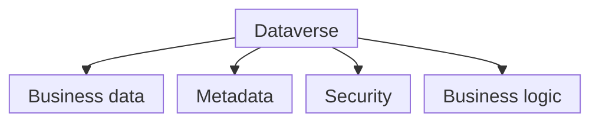

**Prerequisites:** Parts 01-04.

**Planned topics:**

- Dataverse as a managed platform for business data, metadata, relationships, security, and logic.
- Business data versus metadata.
- How applications and automation use shared data.
- Dataverse versus an app, spreadsheet, or solution.
- Standard/custom tables, ownership, auditing, and APIs at an introductory level.
- Older terminology: entity/table and attribute/column.
- **Data example:** a service-request record contains a customer reference, a title, and a current priority such as High.
- **Metadata example:** the Service Request table definition, its column types, the allowed Priority choices, and its relationship to a customer describe the structure rather than one customer's values.
- **Component comparison:** forms display records, apps organize the working experience, and solutions primarily package configuration. A solution is not a general backup of customer records.
- **Understanding check:** classify a request's current priority as data, and the permitted priority choices as metadata.

#### Start here

Dataverse is the managed business-data platform used in this CRM learning path. It stores business information and the definitions, relationships, security, and supported logic that help applications work with that information.

This part is about understanding, not creating a database or configuring tables. Use the fictional examples below; inspect an existing sample only if your Part 04 arrangement permits it. Detailed data components come in Part 06.

#### Step 1 - Understand the problem Dataverse helps solve

Return to Contoso's customer and service-request story. The application needs more than a place to display a customer's name:

1. Store the customer, contact, and request information consistently.
2. Define what each kind of information contains.
3. Connect related information without inventing a separate customer for every request.
4. Control which users and processes can read or change it.
5. Support appropriate validation and business behavior.

Dataverse supplies platform capabilities for these needs. It is not the app's form, a private spreadsheet, or simply an unrestricted SQL database for learners to administer directly.

**Expected result:** explain Dataverse as a managed business-data platform, including structure, relationships, security, and supported logic.

**Microsoft Learn:** [Dataverse data and terminology](https://learn.microsoft.com/en-us/power-apps/maker/data-platform/data-platform-intro).

#### Step 2 - Recognize the basic building blocks

| Building block | Meaning | Fictional example |
|---|---|---|
| Table | A defined kind of business information | Customer or Service Request |
| Column | An attribute of that kind of information | Request title or Priority |
| Record or row | One individual entry and its values | One request about a device issue |
| Relationship | A defined connection between tables | Requests relate to a customer |
| Metadata | Definitions describing the structure or behavior | A Priority column's type and allowed choices |

The table is not one customer's entry; the column is not the value currently stored in it; and the record is not the whole application.

Dataverse has standard tables, and an approved solution can add custom ones where needed. The sample Service Request is a learning design, not a promise that every environment already contains that table or a licensed Customer Service case-management app.

**Expected result:** identify the kind of information, an attribute, one entry, and a relationship without making configuration changes.

**Microsoft Learn:** [Dataverse data and terminology](https://learn.microsoft.com/en-us/power-apps/maker/data-platform/data-platform-intro).

#### Step 3 - Separate business data from metadata

Consider a fictional request linked to the customer record displayed as Contoso Ltd:

| Item | Classification | Why |
|---|---|---|
| The stored title "Device startup issue" | Data | It is a value on this individual request |
| This request's current priority High | Data | It is the value selected for this request |
| This request's reference to the Contoso customer record | Data | It identifies the related customer for this request |
| The permitted Priority choices Low, Normal, and High | Metadata | They define the allowed options |
| The Priority column being a Choice column | Metadata | It defines the column's structure/type |
| The defined request-to-customer relationship | Metadata | It defines how those kinds of records can be linked |

Changing a request's priority changes **data**. Redesigning the Priority column or its choices changes **metadata/configuration** and can affect more than one record. This lesson does not authorize either change.

**Expected result:** classify the three stored values/references as data and the three structural definitions as metadata, with a reason for each.

**Microsoft Learn:** [Table names, keys, and metadata](https://learn.microsoft.com/en-us/power-apps/developer/data-platform/entity-metadata); [Dataverse column data types](https://learn.microsoft.com/en-us/power-apps/maker/data-platform/types-of-fields).

#### Step 4 - Follow related records rather than repeated names

Imagine one customer record for Contoso and two related requests:

- Request A: Device startup issue.
- Request B: Delivery follow-up.
- Both reference the same Contoso customer record.

The labels A and B are teaching labels, not examples of Dataverse's technical record-identifier format. The important point is that each record has its own identity, and a customer lookup references a record rather than merely repeating its display name.

1. Identify the customer record.
2. Identify each separate request.
3. Explain the connection from each request to the customer.
4. Describe why the customer's name alone should not be treated as a unique identifier.

**Expected result:** explain one customer with multiple related requests without making duplicate customer records the default design.

**Microsoft Learn:** [Dataverse table relationships](https://learn.microsoft.com/en-us/power-apps/maker/data-platform/create-edit-entity-relationships).

#### Step 5 - Understand security, logic, and auditing

- **Security:** roles, privileges, ownership, teams, sharing, and relevant column protections help determine access. Different users can have different allowed records or actions.
- **Combined privileges:** access can come from more than one role or team; do not assume an additional restrictive-looking role removes access granted elsewhere.
- **Logic and validation:** supported platform/configuration/code mechanisms can enforce appropriate behavior. Not every form action or business rule applies through every entry point; scope and enforcement must be tested.
- **Auditing:** available audit capabilities need appropriate configuration, privileges, and retention decisions. Do not assume every interaction is automatically captured in a complete audit log.
- **Governance:** managed storage does not eliminate environment, capacity, privacy, identity, or operational responsibilities.

Hiding a column on a form is a presentation choice, not proof that the underlying value is secured. The security/configuration lessons teach how to implement and verify the appropriate controls; this part only identifies their purpose.

**Expected result:** explain why sharing one data platform does not mean unrestricted access or automatically correct validation.

**Microsoft Learn:** [Dataverse ownership and role access](https://learn.microsoft.com/en-us/power-platform/admin/wp-security-cds); [Dataverse column security](https://learn.microsoft.com/en-us/power-platform/admin/field-level-security); [Business rules and scope](https://learn.microsoft.com/en-us/power-apps/maker/data-platform/data-platform-create-business-rule); [Dataverse auditing](https://learn.microsoft.com/en-us/power-platform/admin/manage-dataverse-auditing).

#### Step 6 - Distinguish Dataverse from the components around it

| Component | What it does | What it is not |
|---|---|---|
| Dataverse | Stores/manages business data and its platform definitions/services | The application's screen |
| Form | Presents an individual record and supported user interactions | A separate customer database |
| Application | Organizes the working experience and relevant components | Proof that every user can access every record |
| Cloud flow | Performs configured automation through permitted connections/actions | The permanent form or data model |
| Solution | Packages apps/configuration/customization components for lifecycle management | A general backup of customer records |
| Spreadsheet or report | Presents, analyses, or exchanges data in an appropriate scenario | Automatic inheritance of every app's data-access restriction |

An authorized app interaction may update a Dataverse record, and another interface can use the same underlying information. What a user sees still depends on access, filters, refresh, and the selected data connection.

**Expected result:** explain where business data lives, what displays it, what acts on it, and what packages the configuration.

**Microsoft Learn:** [Solutions and component packaging](https://learn.microsoft.com/en-us/power-apps/maker/data-platform/solutions-overview); [Model-driven navigation, lists, and forms](https://learn.microsoft.com/en-us/power-apps/user/navigation).

#### Step 7 - Correct common beginner assumptions

- **Mistake: a new form creates a new database.** A form defines how information is presented; it does not make an independent copy of every record.
- **Mistake: a solution export backs up all customer data.** Component packaging and data migration/backup are different responsibilities.
- **Mistake: the same display name means the same record.** Record identity and relationships matter.
- **Mistake: maker or app access gives all data access.** Permissions for records and operations still need verification.
- **Mistake: Dataverse installs every Dynamics application.** A data platform and licensed product capabilities are different.
- **Mistake: older terms describe a different system.** Entity/table, attribute/column, and record/row terminology can refer to the same underlying concepts; some APIs retain older names.

Use supported application and developer interfaces when appropriate. Do not create a database, change columns, grant roles, or assume direct database-administration rights to complete this concept exercise.

**Expected result:** recognize the platform/component boundaries before attempting later configuration or development.

**Microsoft Learn:** [Table names, keys, and metadata](https://learn.microsoft.com/en-us/power-apps/developer/data-platform/entity-metadata); [Dataverse ownership and role access](https://learn.microsoft.com/en-us/power-platform/admin/wp-security-cds).

#### Step 8 - Complete the Dataverse understanding exercise

Create a short fictional worksheet with **four outputs**:

1. **Six classifications:** classify all six items from Step 3 as data or metadata and explain each answer.
2. **One relationship explanation:** describe one Contoso customer record linked to two separate requests, without relying only on the customer's display name.
3. **Four component distinctions:** explain Dataverse, a form, an application, and a solution in your own words.
4. **One access consideration:** describe why two users or interfaces might not have identical access to the same underlying information.

If approved sample access is available, use read-only observations to support the explanation. If it is not, use the fictional example; do not treat this worksheet as evidence that missing Part 04 environment access has been resolved.

**Expected result:** a complete four-output worksheet showing the difference between stored values, definitions, relationships, presentation, and access. No table creation, data edits, security changes, or automation is required.

**Microsoft Learn:** [Dataverse data and terminology](https://learn.microsoft.com/en-us/power-apps/maker/data-platform/data-platform-intro); [Dataverse table relationships](https://learn.microsoft.com/en-us/power-apps/maker/data-platform/create-edit-entity-relationships).

#### Official references for this part

- [Dataverse introduction and terminology](https://learn.microsoft.com/en-us/power-apps/maker/data-platform/data-platform-intro)
- [Dataverse role and ownership-based access](https://learn.microsoft.com/en-us/power-platform/admin/wp-security-cds)
- [Solutions and component packaging](https://learn.microsoft.com/en-us/power-apps/maker/data-platform/solutions-overview)
- [Table names, keys, and metadata](https://learn.microsoft.com/en-us/power-apps/developer/data-platform/entity-metadata)
- [Dataverse column data types](https://learn.microsoft.com/en-us/power-apps/maker/data-platform/types-of-fields)
- [Dataverse table relationships](https://learn.microsoft.com/en-us/power-apps/maker/data-platform/create-edit-entity-relationships)
- [Dataverse column security](https://learn.microsoft.com/en-us/power-platform/admin/field-level-security)
- [Business rules and scope](https://learn.microsoft.com/en-us/power-apps/maker/data-platform/data-platform-create-business-rule)
- [Dataverse auditing](https://learn.microsoft.com/en-us/power-platform/admin/manage-dataverse-auditing)
- [Model-driven navigation, lists, and forms](https://learn.microsoft.com/en-us/power-apps/user/navigation)

**Practice goal:** produce six data/metadata classifications, a related-record explanation, four component distinctions, and one access consideration using fictional or approved read-only sample information.

**Readiness check:** explain Dataverse's purpose, distinguish data from metadata, identify record relationships, and verify all four worksheet outputs. Do not confuse conceptual understanding with provisioned access or perform configuration changes to pass this part.

### 06 - Data components

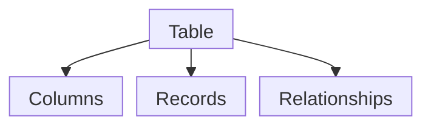

**Prerequisites:** Part 05.

**Planned topics:**

- **Tables:** structured kinds of information; standard versus custom tables.
- **Columns:** attributes, data types, required values, defaults, choices, and lookups.
- **Records:** individual rows and values; identifiers, ownership, and status.
- **Relationships:** one-to-many, many-to-one, many-to-many, and related-record references.
- Display names versus schema/logical names.
- Introductory keys, duplicate prevention, date/time behavior, and data quality.
- **Table / column / record:** Contact is a table, Email is a column, and one particular person's contact entry is a record.
- **Choice / lookup:** High is a Priority choice; the Customer lookup references an existing customer record.
- **Display / technical names:** users see a friendly label; developers use stable schema/logical identifiers. These names have different purposes.
- **Primary name / record identifier:** a readable name helps users recognize a record and is not necessarily unique; the record identifier distinguishes that individual entry.
- **Relationship example:** one customer can have many service requests, so each request references its customer instead of copying the entire customer profile.

#### Start here

Part 05 explained Dataverse as a platform. This part explains **how business information is organized inside it**, so that a table, column, value, record, and relationship do not become interchangeable terms.

Use a fictional worksheet. You are not creating tables, changing column types, importing data, or configuring relationships yet. Later data-modeling lessons cover those procedures with approved environment access.

#### Step 1 - Turn the business story into kinds of information

Return to Contoso's customer/request scenario and identify:

1. **Customer organization:** Contoso Ltd.
2. **Customer person:** Alex Taylor.
3. **Business work:** a service request about a device issue.

These represent different kinds of information. In an appropriate Dataverse design, existing Account and Contact tables may cover the customer concepts; the request design depends on the selected application and requirements.

Do not automatically create a new table for every sentence or replace useful standard tables. A fictional custom Service Request design is not a claim that every environment already contains that table or licensed case-management features.

**Expected result:** identify customer, contact, and request information separately before deciding how to model them.

**Microsoft Learn:** [Dataverse data and terminology](https://learn.microsoft.com/en-us/power-apps/maker/data-platform/data-platform-intro); [Plan a Power Apps project](https://learn.microsoft.com/en-us/power-apps/guidance/planning/introduction).

#### Step 2 - Separate table, column, record, and value

| Item | What it represents |
|---|---|
| Contact table | The defined kind of information for people |
| Email column | An attribute that a contact record can contain |
| Alex Taylor's contact record | One individual person's entry |
| The email value on that record | The actual information stored for that entry |
| Service Request table | The proposed kind of information for requests |
| One device-issue request | An individual request record, not the whole table |

A table definition tells you what attributes are available; a record holds one entry's values. Two records can have different values in the same columns.

Explain why adding another request does not mean adding another table, and why changing one request's title does not redefine its Title column.

**Expected result:** identify a table, a column, an individual record, and a stored value using a concrete example.

**Microsoft Learn:** [Dataverse data and terminology](https://learn.microsoft.com/en-us/power-apps/maker/data-platform/data-platform-intro).

#### Step 3 - Choose a data type that matches the meaning

| Information | Suitable introductory type | Why |
|---|---|---|
| Request title | Text | A short readable description |
| Detailed description | Multiline text | Longer explanatory content |
| Number of devices | Whole number | A count rather than a fractional quantity |
| Estimated hours | Decimal number | Work estimates may include fractions |
| Estimated cost | Currency | A monetary amount with relevant currency behavior |
| Follow-up date/time | Date and time | A scheduled point whose date/time behavior and time zone need checking |
| On-site visit needed | Yes/No | A defined two-option answer |
| Priority | Choice | One value from a defined list |
| Customer reference | Lookup | A reference to an existing related record |
| Supporting document | File | A supported file value, not just text containing a filename |

The data type is part of the column definition; the selected or entered value belongs to a record. Defaults, required-value settings, formats, and validation also need appropriate design.

Do not assume a display format alone solves date/time behavior, that every number should be currency, or that marking a field required on a form enforces the same rule through every entry point. Actual configuration and tests come later.

**Expected result:** justify a type for each kind of information instead of using text for everything.

**Microsoft Learn:** [Dataverse column data types](https://learn.microsoft.com/en-us/power-apps/maker/data-platform/types-of-fields); [Date/time behavior and format](https://learn.microsoft.com/en-us/power-apps/maker/data-platform/behavior-format-date-time-field).

#### Step 4 - Distinguish choices from lookups

| Component | What the user selects | Example |
|---|---|---|
| Choice | One defined option | Priority: Low, Normal, or High |
| Choices | Multiple defined options, where the requirement justifies them | Several applicable options from a fixed list |
| Lookup | A related record | The existing Contoso account record |

A priority is not normally another customer record. A customer lookup is not simply a text box repeating the customer's name.

Use a related table when the referenced item has its own business information or relationships. A fixed list of simple options and a collection of business records solve different needs.

Some platform lookup types can reference more than one table type; inspect the actual definition rather than assuming every field named Customer targets a custom Customer table. In this worksheet, the customer reference points to an account record.

**Expected result:** explain why Priority is a choice and the customer reference is a lookup, and recognize that Choices is different from a single Choice.

**Microsoft Learn:** [Dataverse column data types](https://learn.microsoft.com/en-us/power-apps/maker/data-platform/types-of-fields); [Dataverse table relationships](https://learn.microsoft.com/en-us/power-apps/maker/data-platform/create-edit-entity-relationships).

#### Step 5 - Read relationships from both sides

| Perspective | Meaning | Fictional example |
|---|---|---|
| One-to-many (1:N) | One record can relate to many records | One account has several requests |
| Many-to-one (N:1) | Each referencing record points to one related record | Each request's customer lookup points to its account |
| Many-to-many (N:N) | Records can have multiple peer associations in both directions | A request can have several tags, and a tag can describe several requests |

The many-to-one view is the referencing side of the same one-to-many relationship, not a separate unrelated connection.

1. Identify the referenced customer record.
2. Identify the separate request records.
3. Describe the lookup from a request to its customer.
4. Explain a many-to-many example without confusing it with selecting several options in a Choices column.

Relationship behavior, including cascading actions, needs deliberate configuration. Do not infer deletion, assignment, or permission behavior just because records are related.

**Expected result:** explain one account with multiple requests, the corresponding request lookup, and a distinct many-to-many scenario.

**Microsoft Learn:** [Dataverse table relationships](https://learn.microsoft.com/en-us/power-apps/maker/data-platform/create-edit-entity-relationships).

#### Step 6 - Separate readable names from technical identity

| Name or identifier | Purpose | Standard Account example |
|---|---|---|
| Display name | A friendly, potentially localized label for people | Account |
| Schema name | The component's schema identifier | `Account` |
| Logical name | The identifier used by relevant platform APIs | `account` |
| Entity set name | The collection name used by the Dataverse Web API | `accounts` |
| Primary name value | Helps a user recognize an individual record | Contoso Ltd |
| Record identifier | Distinguishes that individual entry | The record's unique identifier, not the text Contoso Ltd |

The example names do not mean you should derive every API collection name by pluralizing a label. Inspect the actual definitions when development begins.

A primary name is not necessarily unique. Two accounts can have the same displayed name while remaining separate records with different identifiers. Custom component names use the intended solution publisher's conventions; creating a publisher belongs to the solution lessons.

Alternate keys and duplicate-detection approaches serve defined business needs, but do not automatically make every name unique or eliminate every duplicate. Their configuration and verification come later.

**Expected result:** distinguish display, schema/logical, collection, primary-name, and record-identity purposes without guessing identifiers from visible labels.

**Microsoft Learn:** [Table names, keys, and metadata](https://learn.microsoft.com/en-us/power-apps/developer/data-platform/entity-metadata); [Alternate keys](https://learn.microsoft.com/en-us/power-apps/maker/data-platform/define-alternate-keys-reference-records).

#### Step 7 - Check candidate data and avoid unsafe assumptions

Before entering or importing information in a later approved lab, review candidate values:

| Candidate problem | Why it needs attention |
|---|---|
| Priority is Extreme, but allowed choices are Low/Normal/High | The value does not match the defined options |
| Number of devices is 2.5 | A count designed as a whole number does not accept fractional meaning |
| Customer text matches two accounts named Contoso Ltd | The intended related record is ambiguous; the display name is not enough |
| Follow-up is written only as "next Friday" | The intended date, time, and context are unresolved |
| Request title is missing although the design requires it | The business requirement and its actual enforcement need checking |

Ownership and status also need context. Not every table has the same ownership model; an owner value does not by itself prove that only the owner can access the record. Status and Status Reason are related platform concepts, not interchangeable with a custom Priority choice.

Use approved synthetic data. Do not change a column type, clear records, modify cascading behavior, or grant broader access to make a bad sample fit.

**Expected result:** identify invalid or ambiguous candidate data and the checks required, without pretending those values were accepted into Dataverse.

**Microsoft Learn:** [Duplicate-detection rules](https://learn.microsoft.com/en-us/power-platform/admin/set-up-duplicate-detection-rules-keep-data-clean); [Dataverse column data types](https://learn.microsoft.com/en-us/power-apps/maker/data-platform/types-of-fields); [Dataverse roles and privileges](https://learn.microsoft.com/en-us/power-platform/admin/security-roles-privileges).

#### Step 8 - Complete the data-component worksheet

Produce **four outputs**:

1. **Information inventory:** identify account/customer, contact, and request information, noting any standard-table reuse or hypothetical custom-table assumption.
2. **Data dictionary:** propose at least six columns, each with its label, type, sample value/reference, and validation consideration. Include a text value, a count, a choice, a lookup, and a date/time example.
3. **Related-record sketch:** show two separate requests related to one customer/contact, label the 1:N/N:1 perspectives, and describe one separate N:N example.
4. **Quality and identity checks:** explain two invalid/ambiguous candidate inputs and why a primary/displayed name does not replace the record identifier.

This is a worksheet, not a table-creation or import task. If approved read-only metadata is available, compare the design with actual definitions without changing them.

**Expected result:** four complete outputs showing table/column/record distinctions, appropriate types, relationship meaning, and data-quality/identity awareness.

**Microsoft Learn:** [Dataverse column data types](https://learn.microsoft.com/en-us/power-apps/maker/data-platform/types-of-fields); [Dataverse table relationships](https://learn.microsoft.com/en-us/power-apps/maker/data-platform/create-edit-entity-relationships).

#### Official references for this part

- [Dataverse column data types](https://learn.microsoft.com/en-us/power-apps/maker/data-platform/types-of-fields)
- [Table relationships](https://learn.microsoft.com/en-us/power-apps/maker/data-platform/create-edit-entity-relationships)
- [Table names, keys, and metadata](https://learn.microsoft.com/en-us/power-apps/developer/data-platform/entity-metadata)
- [Dataverse data and terminology](https://learn.microsoft.com/en-us/power-apps/maker/data-platform/data-platform-intro)
- [Plan a Power Apps project](https://learn.microsoft.com/en-us/power-apps/guidance/planning/introduction)
- [Date/time behavior and format](https://learn.microsoft.com/en-us/power-apps/maker/data-platform/behavior-format-date-time-field)
- [Alternate keys](https://learn.microsoft.com/en-us/power-apps/maker/data-platform/define-alternate-keys-reference-records)
- [Duplicate-detection rules](https://learn.microsoft.com/en-us/power-platform/admin/set-up-duplicate-detection-rules-keep-data-clean)
- [Dataverse roles and privileges](https://learn.microsoft.com/en-us/power-platform/admin/security-roles-privileges)

**Practice goal:** complete the four-output worksheet with at least six proposed columns, two related requests, a distinct many-to-many example, and two explained quality checks.

**Readiness check:** distinguish tables/columns/records/values, justify types and Choice/Choices/Lookup use, explain relationship perspectives, and separate readable names from identifiers. Verify every worksheet item without creating tables or changing data/security.

### 07 - Application components

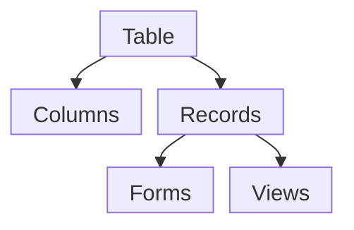

**Prerequisites:** Parts 01-06 and access to a model-driven application.

**Planned topics:**

- **Data fundamentals:** what tables, columns, records, relationships, and lookups mean.
- **Application fundamentals:** how forms, views, grids, navigation, commands, charts, and dashboards present shared data.
- Navigation, record creation, editing, deactivation, and status changes.
- Search, filtering, sorting, and views.
- Accounts, contacts, lookups, and related records.
- Activities, timelines, notes, and attachments.
- Ownership, assignment, permission errors, and everyday user responsibilities.
- **Same-record walkthrough:** inspect one sample service request on its form, locate it in an Open Requests view, and inspect related records through a subgrid or timeline.
- **Form / view comparison:** a form presents one record; a view selects records and columns for a list. They use the same underlying data rather than independent copies.
- **Security awareness:** hiding a column on a form is not a security rule, and different users may have different access to the same underlying records.
- **Understanding check:** identify the interface component and the data component separately when navigating the sample app.

#### Start here

The earlier parts explained the business, platform, and data. This part shows how a person **finds and works with information through a model-driven application**.

Use the approved application and synthetic sample records from Part 04. The default walkthrough is read-only inspection. Learn what create/edit/assign/status commands mean, but perform writes only when the owner has explicitly approved the action and sample data.

If application or record access is missing, record the issue as Blocked and request help. Do not customize the app, create tables, change security, or use production records to complete this beginner inspection.

#### Step 1 - Recognize the application components

| Component | What it helps the user do |
|---|---|
| App navigation | Move between the app's areas, pages, tables, and dashboards |
| View | Define a list of records, displayed columns, and filters |
| Grid | Display the record list and supported list interactions |
| Form | Work with an individual record |
| Lookup or quick-view experience | Reference or display related-record information |
| Subgrid | Show a record list within another record's form |
| Timeline | Present configured notes, posts, and activities associated with a record |
| Command bar | Offer supported actions for the current list or record |
| Chart or dashboard | Present configured visual summaries and work information |

These are interface components. The table, column, record, and relationship concepts from Part 06 describe the underlying information.

**Expected result:** distinguish what presents the information from the data it presents.

**Microsoft Learn:** [Application-component glossary](https://learn.microsoft.com/en-us/power-apps/maker/model-driven-apps/model-driven-app-glossary).

#### Step 2 - Open the correct app and find the relevant page

1. Open the approved app link or select the assigned application.
2. Confirm the app name, account, and environment against the Part 04 arrangement.
3. Use the app's navigation to find the relevant table/page, such as Accounts, Contacts, or the available request/case area.
4. Note which areas/pages are present; app configuration and permissions affect what is available.
5. If the expected page is absent, verify the target and ask the owner rather than editing navigation.

The same Dataverse table can appear in more than one app or area. Switching applications does not automatically create another copy of its records.

**Expected result:** reach the intended page in the approved app and explain how app navigation differs from changing environment or creating a table.

**Microsoft Learn:** [Model-driven navigation, lists, and forms](https://learn.microsoft.com/en-us/power-apps/user/navigation).

#### Step 3 - Inspect a view and its grid

Find an approved sample customer or request through an available view:

1. Record the selected view's name and the kind of records it shows.
2. Identify three displayed columns.
3. Use a permitted temporary search, filter, or sort to locate the sample.
4. Observe how the list changes without assuming the underlying records were created or deleted.
5. Clear temporary filtering when needed and find the record again.

An Open Requests view is an example, not a promise that every app has that exact name. Use the configured equivalent and do not create or save a public view just to match the tutorial.

If the list is empty, consider filtering, record access, available data, and whether you are in the correct app/environment. An empty list is not evidence that all records were deleted.

**Expected result:** explain a view's selection/columns and a grid's display, and find the sample through permitted list interactions.

**Microsoft Learn:** [Model-driven navigation, lists, and forms](https://learn.microsoft.com/en-us/power-apps/user/navigation).

#### Step 4 - Open the same record on its form

Select the sample record's supported link to open its form.

1. Identify the record's readable name and enough approved information to recognize the same entry later.
2. Inspect available tabs, sections, fields/controls, and notifications.
3. Identify the customer/contact lookup or other relevant related information.
4. Notice required/read-only indicators where present, without trying to unlock or edit fields.
5. Return to the view and confirm that you are looking at the same record.

The form presents an individual record; the view lists records. They are not separate databases. Different forms may display different columns while using the same underlying record.

**Expected result:** trace one record between its form and view and separate the displayed interface from the stored values.

**Microsoft Learn:** [Model-driven navigation, lists, and forms](https://learn.microsoft.com/en-us/power-apps/user/navigation).

#### Step 5 - Inspect lookups and related-record experiences

Use an available permitted relationship in the sample app:

- **Lookup:** identify the related record being referenced, such as the customer account.
- **Quick view:** where configured, inspect selected information from a related record.
- **Subgrid:** identify which kind of records the embedded list displays and how they relate to the current record.
- **Related navigation:** where available, open a permitted related-record list using the app's supported navigation.

Not every form includes every component. Note unavailable features and use the agreed sample app; do not add subgrids, controls, or relationships during this inspection.

Related-record navigation still respects access. If a link opens an access-denied message, record the issue; do not assume the relationship grants permission or ask for unrestricted administrator access.

**Expected result:** identify a real relationship and its presentation component rather than treating all visible information as copied text on one form.

**Microsoft Learn:** [Dataverse table relationships](https://learn.microsoft.com/en-us/power-apps/maker/data-platform/create-edit-entity-relationships); [Application-component glossary](https://learn.microsoft.com/en-us/power-apps/maker/model-driven-apps/model-driven-app-glossary).

#### Step 6 - Read activities, notes, and the timeline

Inspect an existing permitted activity or note associated with the sample record, if that experience is configured.

1. Identify the item type, such as a task, phone call, email, appointment, or note.
2. Identify who was involved, when it happened, and what business work it describes.
3. Distinguish that history item from the request's current status and next action.
4. Note any configured timeline filters or visibility limitations.
5. Keep attachments and customer information within the approved learning scope.

A timeline displays configured information; it is not proof of a complete audit history or every customer interaction. Different users/configurations may show different items.

Do not send emails, create activities, add attachments, or post notes merely to make the timeline look like an example.

**Expected result:** explain a permitted history item and how it helps another employee understand the customer work.

**Microsoft Learn:** [Timeline and activities](https://learn.microsoft.com/en-us/power-apps/user/add-activities).

#### Step 7 - Understand commands, ownership, and status before acting

| Operation | What it can do | Inspection boundary |
|---|---|---|
| Create or New | Add a record | Do not create data without approved write practice |
| Edit or Save | Update record information | Changes may be saved explicitly or by configured autosave |
| Assign | Change ownership | Requires appropriate permissions and can affect access/work |
| Activate or Deactivate | Change an applicable record's active state | Not the same as deleting the record |
| Resolve or Close | Perform an application-specific lifecycle action | Availability and effect depend on the app/table/process |
| Delete | Remove data | Not part of this inspection |
| Export | Copy information into another file or system | Needs separate approval and data-handling consideration |

A visible command is not proof that every operation is authorized or appropriate. Observe its meaning without executing it to test your rights.

Owner, Status, and Status Reason describe different things, and their behavior depends on the table/application. The owner is not necessarily the only person with access; security roles, teams, sharing, and other controls also matter.

**Optional approved write practice:** if the owner explicitly authorizes a synthetic record workflow, agree the values and allowed actions first, create/edit through supported UI, verify the saved record and relationships, and find it again. Assignment, lifecycle changes, deletion, exports, and external communication need their own approval when not already in scope. Otherwise keep this walkthrough read-only.

**Expected result:** explain basic record operations, ownership, and status without causing unapproved writes or treating form visibility as security.

**Microsoft Learn:** [Model-driven navigation, lists, and forms](https://learn.microsoft.com/en-us/power-apps/user/navigation); [Dataverse roles and privileges](https://learn.microsoft.com/en-us/power-platform/admin/security-roles-privileges).

#### Step 8 - Complete the application-component observation log

Produce **six observations**:

1. Approved app name, environment context, and the page/table visited.
2. View name, three displayed columns, and a permitted search/filter/sort observation.
3. The same sample record identified on its form and in the view.
4. One lookup/related record and the interface component used to inspect it.
5. One available activity/note or related-history observation; record configuration/access limitations if the agreed sample does not expose a timeline.
6. Observed ownership/status information, one command's meaning, allowed/prohibited actions, and any unresolved access issue.

Use synthetic information and redacted identifiers where appropriate. A missing core app/record permission remains Blocked; an optional component's absence should be documented, not fixed by unapproved customization.

Explain how tables, columns, records, and relationships differ from forms, views, grids, navigation, and timeline controls.

**Expected result:** a complete six-observation log showing that you can navigate and explain the sample without making unapproved changes. Any separately approved write exercise must record what changed and how the saved result was verified.

**Microsoft Learn:** [Model-driven navigation, lists, and forms](https://learn.microsoft.com/en-us/power-apps/user/navigation); [Timeline and activities](https://learn.microsoft.com/en-us/power-apps/user/add-activities).

#### Official references for this part

- [Model-driven app navigation, lists, and forms](https://learn.microsoft.com/en-us/power-apps/user/navigation)
- [Model-driven application-component glossary](https://learn.microsoft.com/en-us/power-apps/maker/model-driven-apps/model-driven-app-glossary)
- [Timeline and activity overview](https://learn.microsoft.com/en-us/power-apps/user/add-activities)
- [Dataverse table relationships](https://learn.microsoft.com/en-us/power-apps/maker/data-platform/create-edit-entity-relationships)
- [Dataverse roles and privileges](https://learn.microsoft.com/en-us/power-platform/admin/security-roles-privileges)

**Practice goal:** inspect the approved app and complete the six-observation log; perform a synthetic write workflow only when explicitly authorized and verify its saved result.

**Readiness check:** navigate to the same record through form/view/related experiences, distinguish UI components from data, explain history/ownership/status and commands, and account for every observation/access issue. Do not change configuration, security, production data, or external communications to pass.

## Stage 1 beginner glossary

- **CRM:** Customer Relationship Management, a business approach supported by software.
- **Account:** usually a business organization in CRM; not the same as a Microsoft sign-in account.
- **Contact:** an individual person associated with customer information.
- **Tenant:** the organization's Microsoft identity/service boundary.
- **Environment:** a workspace that can contain applications, configuration, and Dataverse data.
- **Dataverse:** the managed business-data platform and its associated metadata, security, relationships, and logic.
- **Application:** the interface and navigation through which users perform work.
- **Model-driven app:** a Power Apps experience driven by Dataverse data, forms, views, and processes.
- **Canvas app:** a Power Apps experience designed through screens, controls, and Power Fx.
- **Power Pages:** a separate Power Platform product for business websites, not a third Power Apps app type.
- **Solution:** a package primarily containing configuration and customization components.
- **Table / entity:** a structured kind of information.
- **Column / attribute:** an attribute stored for that kind of information.
- **Record / row:** an individual entry with its own values and identifier.
- **Choice:** a defined set of selectable values.
- **Lookup:** a column referencing another record.
- **Relationship:** the defined connection between tables.
- **Form:** an interface for an individual record.
- **View:** a definition of a record list, its columns, and its filters.
- **Grid / subgrid:** a record-list display, either in a main list or within another record's form.
- **Primary name / record identifier:** a readable label versus the identifier of an individual record.
- **Security role:** a set of privileges and access levels, not merely a job title.

## Stage 1 completion exercise

Use an approved sample application and synthetic data. This exercise is an inspection task: do not create custom tables, change security, automate processes, or work in production.

1. Confirm and record the correct account, tenant, and learning environment.
2. Find an existing sample customer/contact and an associated service request.
3. Identify the table, three columns, the individual record, and one lookup or relationship.
4. Inspect the same record on a form and in a view; explain why they are not separate copies.
5. Identify a subgrid, timeline, navigation area, or command available in the sample app.
6. Classify one stored value as data and one structural definition as metadata.
7. Explain where the data lives, which interface displays it, and why another user may have different access.
8. Describe the enquiry-to-sale-to-support business story and match its needs to Dynamics 365, Dataverse, Power Apps, and Power Automate.
9. Match an agent workspace, a focused technician screen, and an external customer website to model-driven, canvas, and Power Pages experiences; explain their access differences.

**Completion evidence:** a short observation log listing each concept, the sample observation, and any unresolved access issue. Explain the observations in your own words before proceeding to Stage 2 configuration.

## 2 - Configure, Secure and Automate

Build the solution-contained service-request application, model its data, configure its interface, and prove agent/manager access. Learn which business rules, guided processes, and cloud flows fit each need, with explicit success and failure checks.

### 08 - Solutions and customization foundations

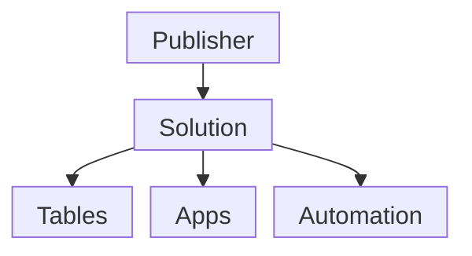

**Prerequisites:** Stage 1 (Parts 01-07) and appropriate customization permissions.

**Planned topics:**

- Publishers, prefixes, naming conventions, and component descriptions.
- Create a named unmanaged solution before substantial customization.
- Create and add components inside the intended solution.
- Dependencies, saving, and publishing.
- Managed versus unmanaged solutions, versioning, and solution layers.

#### Start here

Stage 1 explained the platform and safe inspection. This part begins the configuration foundation: organize the project in an **approved unmanaged learning solution** with the correct publisher before creating substantial customizations.

Actual publisher/solution creation needs the approved environment, entitlements, and maker/customizer permissions. Stage 1 read access is not automatically permission to configure. If those prerequisites are missing, record the practical work as Blocked; do not switch to production or grant yourself broad administrator access.

The values below are fictional teaching examples. Reuse the organization's approved publisher and naming conventions when provided. This guide does not mean environment changes have already been performed.

#### Step 1 - Confirm the target and customization permission

1. Recheck the account, tenant, environment name/identifier, and purpose recorded in Part 04.
2. Confirm that this is the approved development/learning target, not production or an unrelated shared workspace.
3. Confirm the appropriate solution/publisher permissions with the responsible owner.
4. Agree which objects you may create or add, and whether any publishing action is in scope.
5. Keep synthetic business data separate from the configuration inventory.

A solution is not an isolation or security boundary within an environment. Several makers can affect shared components; the named container does not make every change harmless.

**Expected result:** an identified learning target and explicit customization scope, or a recorded Blocked prerequisite.

**Microsoft Learn:** [Environment types and roles](https://learn.microsoft.com/en-us/power-platform/admin/environments-overview); [Dataverse roles and privileges](https://learn.microsoft.com/en-us/power-platform/admin/security-roles-privileges).

#### Step 2 - Understand the solution container

| Component | Why it may belong in a solution |
|---|---|
| Table/column definitions | Package the approved data-model configuration |
| Model-driven app | Include the application definition and relevant components |
| Forms and views | Include the configured record/list experiences |
| Solution-aware flows | Include automation definitions and relevant references |
| Supported code components | Include justified web resources, plug-ins, or other extensions when those modules are reached |

The solution primarily organizes and transports **components/configuration**, not the customer-record dataset. Creating the container does not create every planned table, app, or flow automatically.

Some standard components already exist in the environment. The project should include what it changes or requires, not every object merely because it is available.

**Expected result:** explain what the project solution contains and why it is different from a database, security role, or backup of business records.

**Microsoft Learn:** [Solutions and component packaging](https://learn.microsoft.com/en-us/power-apps/maker/data-platform/solutions-overview); [Solution concepts](https://learn.microsoft.com/en-us/power-platform/alm/solution-concepts-alm).

#### Step 3 - Choose or create the approved publisher

First check whether the organization already has a publisher you should reuse. If a new learning publisher is explicitly authorized, the maker experience provides **New publisher** when creating a solution.

| Field | Teaching example | What to verify |
|---|---|---|
| Display Name | Learning Publisher | A recognizable label following the owner's convention |
| Name | `learningpublisher` | The intended unique publisher name |
| Prefix | `learn` | An approved prefix chosen before creating custom components |
| Choice value prefix | The generated value in the form | Record the value; do not invent or override it without a requirement |
| Description | Publisher for approved learning exercises | Explain purpose and ownership |

1. Select the approved publisher, or open **New publisher** only within the authorized scope.
2. Check names and prefix before saving.
3. Save the publisher and verify it is available for the intended solution.

The prefix helps avoid component-name collisions; it is not the record owner or a security permission. Later changing a publisher prefix does not retroactively rename existing components.

**Expected result:** identify the approved publisher and actual prefix, with saved/verified information rather than an assumed default.

**Microsoft Learn:** [Create a solution and publisher](https://learn.microsoft.com/en-us/power-apps/maker/data-platform/create-solution); [Publisher concepts and prefixes](https://learn.microsoft.com/en-us/power-platform/alm/solution-concepts-alm).

#### Step 4 - Create the named unmanaged learning solution

In the approved maker experience:

1. Open **Solutions**; if it is not in the side navigation, use the available **More** navigation.
2. Select **New solution**.
3. Review the fields below using the approved values.
4. Save/create using the action presented by the current interface.
5. Find and reopen the solution to verify its details.

| Field | Teaching example | Important distinction |
|---|---|---|
| Display Name | Customer Onboarding and Service Requests | A readable label |
| Name | `CustomerOnboardingServiceRequests` | The unique solution name; choose it before the first save |
| Publisher | Approved Learning Publisher or organizational equivalent | Do not accidentally use an unrelated/default publisher |
| Version | `1.0.0.0` | Use four numeric parts: major.minor.build.revision |
| Description | Learning solution for customer onboarding and service-request exercises | Explain the business purpose |

A solution's unique name supports letters, numbers, and underscores and cannot be changed after saving. Do not use the reserved `_upgrade` term in the solution name.

Work inside this solution for later customizations. A preferred-solution setting can affect where components are stored outside an explicit solution context, but changing that setting is not required here; follow the owner's policy rather than altering shared defaults.

**Expected result:** a saved, reopenable unmanaged project solution with the intended publisher, name, version, and description.

**Microsoft Learn:** [Create a solution](https://learn.microsoft.com/en-us/power-apps/maker/data-platform/create-solution); [Solution version and lifecycle concepts](https://learn.microsoft.com/en-us/power-platform/alm/solution-concepts-alm).

#### Step 5 - Understand New, Add existing, and dependencies

| Action | Meaning | Boundary |
|---|---|---|
| New | Create a component in the current solution context | Follow the appropriate later lesson and approved scope |
| Add existing | Include an available component in the solution | This does not copy its business records or create another database |
| Remove from this solution | Remove its inclusion in the container | Not the same as deleting the object from the environment |
| Delete from this environment | Remove the actual object | Destructive; not part of this learning exercise |

For this part, the container can remain empty, or you may add a specifically approved existing component. Do not create tables or flows solely to make the inventory look complete.

Dependencies describe what another component needs. An app may require its tables/forms/views; a lookup depends on its target table; an automation may need relevant tables and connection references.

Inspect dependency information where available. When including a table, review which metadata and objects are selected rather than blindly selecting every available object. Actual packaging/deployment checks come in later modules.

**Expected result:** list the components actually included, distinguish New from Add existing, and identify any real dependencies without deleting or over-including unrelated objects.

**Microsoft Learn:** [Add and remove solution objects](https://learn.microsoft.com/en-us/power-apps/maker/data-platform/create-solution); [Solution-component dependency tracking](https://learn.microsoft.com/en-us/power-platform/alm/dependency-tracking-solution-components).

#### Step 6 - Separate saving, publishing, and exporting

| Operation | What it does | What it does not prove |
|---|---|---|
| Save | Persist the applicable definition or editor changes | That every changed component is already active for users |
| Publish | Promote applicable unpublished customizations to runtime use | That access, dependencies, or business behavior were tested |
| Export | Package solution components in the selected form | That the target environment is configured or that customer data was backed up |

Saving an empty project solution does not require **Publish all customizations**. Later component editors may require a publish step; use the correct supported action within the approved scope.

**Publish all customizations is environment-wide.** Even when opened from a solution, it can publish other pending work in that environment. Do not run it indiscriminately in a shared or production environment.

After an authorized publish, verify the actual runtime behavior rather than treating a success message as the entire test. This lesson does not ask you to export/import releases or activate flows.

**Expected result:** distinguish saved configuration, published runtime state, and packaged components, and identify when no publishing action is needed.

**Microsoft Learn:** [Saving and publishing customizations](https://learn.microsoft.com/en-us/power-apps/maker/data-platform/create-solution); [Solution lifecycle](https://learn.microsoft.com/en-us/power-platform/alm/solution-concepts-alm).

#### Step 7 - Understand unmanaged, managed, and layer behavior

| Solution form | Introductory purpose | Caution |
|---|---|---|
| Unmanaged | Author/customize in the approved development environment | The container is not an undo boundary; unmanaged customizations share an active layer |
| Managed | Deliver supported solution releases to target environments | Do not directly alter/uninstall vendor components to follow this beginner exercise |

Layering helps determine which component configuration takes effect. Some component types use merge behavior and others use the top layer; do not assume one simple "last import wins" rule explains every component.

Deleting an unmanaged solution removes the container, not a reliable rollback of its customizations. Removing/uninstalling managed components can have dependency and data consequences. Neither is a default cleanup step here.

Keep a meaningful version and change description. Source control, managed exports, updates/upgrades, pipelines, and recovery planning are expanded in the delivery stage.

**Expected result:** explain why authoring containers, deployment packages, and active component layers differ, without performing destructive layer or solution operations.

**Microsoft Learn:** [Managed/unmanaged solution concepts](https://learn.microsoft.com/en-us/power-platform/alm/solution-concepts-alm); [Solution layers and merge behavior](https://learn.microsoft.com/en-us/power-platform/alm/solution-layers-alm).

#### Step 8 - Complete the solution-foundation record

Produce an **eight-item foundation record**:

1. Approved environment and confirmed customization scope.
2. Publisher display/unique names, prefix, and observed choice value prefix where applicable.
3. Solution display name and saved unique name.
4. Actual four-part version.
5. Description and business purpose.
6. Actual included components, clearly distinguishing an empty container from planned future components.
7. Relevant dependencies and save/publish state, including why an empty solution needs no Publish all action.
8. Ready or Blocked status, unresolved issues, responsible owner, and approved next steps.

If you have only conceptual access, record a proposed plan and the missing prerequisite as Blocked; do not claim the publisher or solution was created. If creation is authorized, reopen the saved objects and verify each item.

**Expected result:** an evidence-based project foundation ready for the data-modeling lesson, with no invented components, unapproved publishes, imports, security changes, or deletions.

**Microsoft Learn:** [Create and verify a solution](https://learn.microsoft.com/en-us/power-apps/maker/data-platform/create-solution); [Solution concepts and dependencies](https://learn.microsoft.com/en-us/power-platform/alm/solution-concepts-alm).

#### Official references for this part

- [Power Platform environment types and roles](https://learn.microsoft.com/en-us/power-platform/admin/environments-overview)
- [Dataverse roles and privileges](https://learn.microsoft.com/en-us/power-platform/admin/security-roles-privileges)
- [Solutions overview](https://learn.microsoft.com/en-us/power-apps/maker/data-platform/solutions-overview)
- [Create a solution and publisher](https://learn.microsoft.com/en-us/power-apps/maker/data-platform/create-solution)
- [Solution concepts and lifecycle](https://learn.microsoft.com/en-us/power-platform/alm/solution-concepts-alm)
- [Solution-component dependencies](https://learn.microsoft.com/en-us/power-platform/alm/dependency-tracking-solution-components)
- [Solution layers and merge behavior](https://learn.microsoft.com/en-us/power-platform/alm/solution-layers-alm)

**Practice goal:** create/reopen the approved publisher and unmanaged project solution, then verify the eight foundation items; retain Blocked status when actual customization access is missing.

**Readiness check:** verify environment, publisher/prefix, solution names/version, actual component inventory, dependencies and save/publish distinctions. Do not assume deletion is rollback, publishing is a complete test, or a named solution isolates changes from other environment work.

### 09 - Dataverse data modeling

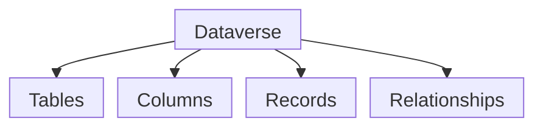

**Prerequisites:** Part 08 and the project's business scenario.

**Planned topics:**

- **Tables**
  - Standard/custom tables, ownership, primary columns, and identifiers.
  - Alternate keys, display/schema names, and duplicate prevention.
- **Columns**
  - Text, numbers, currency, yes/no, date/time, files, and images.
  - Required values, defaults, choices, and lookup columns.
  - Formula, calculated, and rollup columns, including their limitations.
  - Date/time behavior and time zones.
- **Records**
  - Rows, values, ownership, and status.
  - Map sample-data imports, resolve lookup references, and reconcile accepted/rejected records.
  - Correct invalid values and inspect duplicates without introducing advanced migration tooling.
- **Relationships**
  - One-to-many, many-to-one, and many-to-many.
  - Lookup references, related records, and cascading behavior.

#### Start here

Part 08 established the approved project solution and publisher. This part turns the fictional customer/request requirements into a **reviewed Dataverse data model**, then guides approved table/column work and a small sample-data check.

Actual configuration/import needs the appropriate table-edit and business-data permissions in the approved learning environment. Maker access alone is not proof of every required privilege. If access is missing, retain a design worksheet and mark the practical work Blocked; do not create resources elsewhere or broaden permissions.

Use synthetic data only. The examples are a custom learning app, not a replacement for licensed Dynamics application tables or processes.

#### Step 1 - Review requirements and reuse appropriate tables

| Information | Proposed starting point | Decision to record |
|---|---|---|
| Customer organization | Existing Account table where appropriate | Reuse the approved standard customer concept |
| Customer person | Existing Contact table where appropriate | Relate the person to the appropriate customer |
| Service request | Justified custom Service Request table | Use a licensed standard case/work table instead if that is the agreed product scope |
| Request category | Reference Request Category table for this example | Use a simple Choice instead if categories need no separate business data |

Write down the business questions: who reported the request, which customer it concerns, its category/priority, who owns the work, and what information must be valid.

Keep requirements separate from implementation assumptions. Do not copy an entire customer profile into each request or create duplicate Account/Contact tables merely to follow a tutorial.

**Expected result:** a four-item information inventory with justified standard/custom choices and a clear project scope.

**Microsoft Learn:** [Plan a Power Apps project](https://learn.microsoft.com/en-us/power-apps/guidance/planning/introduction); [Table types and creation](https://learn.microsoft.com/en-us/power-apps/maker/data-platform/create-edit-entities-portal).

#### Step 2 - Create only the approved custom tables in the project solution

Open the Part 08 unmanaged solution in the correct environment and confirm its publisher. Use the supported **New > Table** experience and available advanced properties; designer labels and supported features can vary.

| Table | Teaching schema example | Ownership/design intent |
|---|---|---|
| Service Request | `learn_ServiceRequest` | User/team-owned work, with a readable primary name such as Request Title |
| Request Category | `learn_RequestCategory` | Organization-owned reference data with a readable category name |

1. Agree the actual table display/plural names, schema/logical names, ownership, and primary-name design before saving.
2. Confirm the generated names use the approved publisher prefix, not an unintended default.
3. Create the approved custom tables; reuse Account/Contact rather than recreating them.
4. Reopen the definitions and record the actual names and ownership behavior.
5. Verify inclusion in the project solution.

Choose ordinary tables for this example; virtual, elastic, and custom activity tables need their own justification. Schema names and other structural choices can be constrained after creation, so do not assume they can be freely renamed or switched later.

Organization-owned reference data is not automatically unrestricted, read-only, or visible to everyone. Its permissions still need testing in the security lessons.

**Expected result:** the approved table definitions exist in the intended solution, or the practical task remains Blocked with a documented cause.

**Microsoft Learn:** [Create/edit tables and prerequisites](https://learn.microsoft.com/en-us/power-apps/maker/data-platform/create-edit-entities-portal); [Create and work in a solution](https://learn.microsoft.com/en-us/power-apps/maker/data-platform/create-solution).

#### Step 3 - Define and verify the request columns

Prepare a dictionary before using the table's **Columns > New column** experience. Reuse an appropriate existing/primary column instead of adding a duplicate.

| Column purpose | Type | Intended rule or check |
|---|---|---|
| Request title | Text / primary name | A meaningful title is required by the learning scenario |
| External request number | Text | A nonblank stable business identifier for the sample key |
| Description | Multiline text | Optional explanatory detail |
| Customer | Lookup to Account in this example | Resolve the intended customer record |
| Contact | Lookup to Contact | Verify the relevant person/customer relationship |
| Category | Lookup to Request Category | Resolve an approved category record |
| Priority | Choice | Low, Normal, High; default Normal if appropriate |
| Number of devices | Whole number | A valid count, with an agreed minimum/range |
| Follow-up time | Date and time | An agreed date/time behavior, not just a display format |
| On-site visit needed | Yes/No | A defined yes/no answer |
| Estimated cost | Currency | Appropriate currency/precision and optional-value handling |

Review display/technical names, type, length/range, requirement level, defaults, and descriptions before saving. Types and names generally cannot be changed freely afterward; do not delete/recreate data-bearing columns as an assumed fix.

Business-required and form behavior do not guarantee identical validation through every API/import path. Record the enforcement required and test the entry points actually used. Files/images and further columns should be added only when the scenario needs them.

**Expected result:** a verified column dictionary and actual definitions, including explicit validation assumptions rather than guessed defaults or duplicate fields.

**Microsoft Learn:** [Create/edit columns](https://learn.microsoft.com/en-us/power-apps/maker/data-platform/create-edit-field-portal); [Column data types](https://learn.microsoft.com/en-us/power-apps/maker/data-platform/types-of-fields).

#### Step 4 - Configure choices and related-record references

| Lookup on Service Request | Referenced table | Relationship perspective |
|---|---|---|
| Customer | Account | Many requests can reference one account |
| Contact | Contact | Many requests can reference one contact |
| Category | Request Category | Many requests can reference one category |

1. Confirm the target table and intended meaning for each lookup.
2. Use the supported column/relationship editor to create the approved references.
3. Verify the request-to-parent N:1 and parent-to-requests 1:N perspectives.
4. Review the configured cascade/referential behavior for assign, share, reparent, and delete actions; do not assume safe behavior from the relationship name alone.
5. Define Priority as a local Choice or reuse an approved shared/global choice when reuse is justified.

Status/Status Reason are not replacements for a custom Priority choice. A separate N:N relationship is appropriate only for a real many-to-many requirement; it is not the same as a multiselect Choices column.

Some visual designers do not support every relationship type or context. Use the documented appropriate editor rather than forcing the layout, modifying unrelated tables, or deleting parent records to test cascades.

**Expected result:** three justified lookup relationships and a verified priority choice, with documented cascade assumptions and no destructive relationship tests.

**Microsoft Learn:** [Table relationships](https://learn.microsoft.com/en-us/power-apps/maker/data-platform/create-edit-entity-relationships); [Choice and lookup column types](https://learn.microsoft.com/en-us/power-apps/maker/data-platform/types-of-fields).

#### Step 5 - Distinguish alternate keys from duplicate-detection rules

| Control | Purpose | Limitation to verify |
|---|---|---|
| Alternate key | Enforce/reference a defined unique business-column combination | Index activation, supported column/value constraints, and null-value behavior |
| Duplicate detection | Identify likely duplicates according to enabled/published rules | It is not a universal unique constraint or a substitute for every integration key |

For the example, an approved key on External Request Number can identify `LEARN-001` and `LEARN-002`. Use the table's **Keys > New key** experience where available and inspect the resulting status.

An alternate key is not immediately ready when saved: its supporting index is created asynchronously. Verify that it becomes Active before relying on it. Existing duplicates or unsuitable values can prevent successful activation.

Null key values do not provide the same uniqueness guarantee as populated values; required-value validation remains a separate consideration. If the key will be used in API URLs, review the documented character constraints instead of choosing arbitrary identifiers.

Run only the approved duplicate test and record the actual result. Do not remove unrelated keys/rules, clean up real customer data, or claim that all similar display names are prevented.

**Expected result:** a documented identity/duplicate strategy, active key where implemented, and verified repeated-identifier behavior.

**Microsoft Learn:** [Define keys in a solution](https://learn.microsoft.com/en-us/power-apps/maker/data-platform/define-alternate-keys-portal); [Key constraints](https://learn.microsoft.com/en-us/power-apps/developer/data-platform/define-alternate-keys-entity); [Duplicate-detection rules](https://learn.microsoft.com/en-us/power-platform/admin/set-up-duplicate-detection-rules-keep-data-clean).

#### Step 6 - Choose derived values and date/time behavior deliberately

| Column behavior | Appropriate introductory use | What to check |
|---|---|---|
| Simple stored value | A user/integration supplies the value | Type, validation, and ownership of updates |
| Formula | Supported Power Fx calculation | Available types/functions, references, and limitations |
| Calculated | Supported configured calculation | Expression/data-type and related-column constraints |
| Rollup | Aggregate related records | Filters, supported relationships, refresh timing, and permissions |

Do not build every derived-column type just to demonstrate it. A count/report or simple stored value may satisfy the current requirement. Rollups are not guaranteed to refresh immediately after every related-record update.

| Date/time behavior | Meaning to decide |
|---|---|
| User Local | Represent an instant with user-local display behavior |
| Date Only | Represent the intended calendar date without a business time-of-day |
| Time Zone Independent | Preserve a date/time value without user-local conversion |

Date/time **format** and **behavior** are separate choices. For Follow-up time, decide whether users should see the same instant in their local zones and test that meaning with approved contexts. Do not silently accept an ambiguous date such as "next Friday" in an import file.

**Expected result:** justified derived-value and date/time decisions, with explicit tests/limitations for the selected options, not unnecessary extra calculations.

**Microsoft Learn:** [Formula columns](https://learn.microsoft.com/en-us/power-apps/maker/data-platform/formula-columns); [Calculated columns](https://learn.microsoft.com/en-us/power-apps/maker/data-platform/define-calculated-fields); [Rollup columns](https://learn.microsoft.com/en-us/power-apps/maker/data-platform/define-rollup-fields); [Date/time behavior](https://learn.microsoft.com/en-us/power-apps/maker/data-platform/behavior-format-date-time-field).

#### Step 7 - Validate five candidates, import the approved subset, and reconcile

Prepare the approved customer/contact and two category records first, using existing synthetic records where available. Map lookups through actual record identities or a verified matching strategy; a repeated display name is not enough.

| Candidate | External number | Title | Customer/category | Pre-import decision |
|---|---|---|---|---|
| A | LEARN-001 | Device startup issue | Approved Contoso / Device Support | Valid candidate |
| B | LEARN-002 | Delivery follow-up | Approved Contoso / Delivery | Valid candidate |
| C | LEARN-003 |  | Approved Contoso / Device Support | Hold: missing required title |
| D | LEARN-004 | Customer check | Unresolved customer / Device Support | Hold: lookup cannot be resolved |
| E | LEARN-001 | Repeated request | Approved Contoso / Delivery | Hold: repeated identifier in this candidate batch |

These are teaching labels, not Dataverse GUIDs. Include the remaining required columns and resolved references in the actual sample file.

1. Validate all five candidates before import: two are suitable, three are held for specific reasons.
2. Use the approved supported Excel/CSV import experience for the existing table; check permissions, file/column mapping, lookup resolution, and insert/update behavior.
3. Do not enable preview import features or export real customer data simply to get a template.
4. Inspect actual job inserts, updates, errors, and the resulting records; compare against the pre-import baseline and verify relationships/values.
5. Rehearse the approved missing-value, invalid-choice, unresolved-lookup, and duplicate tests through the actual entry points used. A field accepted despite the business requirement is a validation gap, not a passed test.
6. Repeat only within approved scope and verify no unintended duplicate rows; an intentional upsert/update must be documented instead of mislabeled a rejected insert.

| Planned candidate outcome | Count | Evidence distinction |
|---|---|---|
| Prepared for approved import | 2 | Check actual insert/update outcomes and saved records |
| Held before import | 3 | Record missing-title, unresolved-lookup, and repeated-identifier reasons |
| Source candidates accounted for | 5 | Two prepared plus three held; actual import errors are reported separately |

Do not claim held candidates were rejected by Dataverse if they were never submitted. If either prepared row fails, reconcile that failure explicitly rather than reporting two successful records. Advanced migration/cutover tooling belongs to the delivery stage.

**Expected result:** every candidate is accounted for, actual job results and saved data are reconciled, and invalid/repeated inputs have documented behavior without silent failure or duplicate work.

**Microsoft Learn:** [Excel/CSV import and mapping](https://learn.microsoft.com/en-us/power-apps/maker/data-platform/data-platform-import-export); [Roles and data privileges](https://learn.microsoft.com/en-us/power-platform/admin/security-roles-privileges).

#### Step 8 - Produce the eight-item data-model evidence pack

Record **eight items**:

1. Approved environment, solution, publisher, and actual customization/data-access scope.
2. Standard/custom table decisions and actual names, ownership, and primary-name definitions.
3. Verified column dictionary, including types, requirement/default choices, and actual technical names.
4. Lookup/choice definitions, relationship perspectives, and reviewed cascade behavior.
5. Key status, duplicate strategy, and nonblank repeated-identifier test results.
6. Selected derived/date-time decisions and tests or explicitly deferred optional features.
7. Five-candidate accounting, actual import inserts/updates/errors, and saved-value/relationship reconciliation.
8. Expected/actual validation results, unresolved issues/owners, and Ready or Blocked status.

Concept-only designs must be labeled as proposals, not created schemas or completed imports. Missing access, failed key activation, unresolved mappings, or unmet required validation stays explicitly Blocked or an open acceptance issue.

**Expected result:** a reviewed, verified learning data model and evidence pack ready for app configuration, without production work, destructive cleanup, broad publishing, or invented success.

**Microsoft Learn:** [Create and review tables](https://learn.microsoft.com/en-us/power-apps/maker/data-platform/create-edit-entities-portal); [Relationship guidance](https://learn.microsoft.com/en-us/power-apps/maker/data-platform/create-edit-entity-relationships); [Import verification](https://learn.microsoft.com/en-us/power-apps/maker/data-platform/data-platform-import-export).

#### Official references for this part

- [Plan a Power Apps project](https://learn.microsoft.com/en-us/power-apps/guidance/planning/introduction)
- [Create/edit Dataverse tables](https://learn.microsoft.com/en-us/power-apps/maker/data-platform/create-edit-entities-portal)
- [Create and work in a solution](https://learn.microsoft.com/en-us/power-apps/maker/data-platform/create-solution)
- [Create/edit columns](https://learn.microsoft.com/en-us/power-apps/maker/data-platform/create-edit-field-portal)
- [Column data types](https://learn.microsoft.com/en-us/power-apps/maker/data-platform/types-of-fields)
- [Table relationships](https://learn.microsoft.com/en-us/power-apps/maker/data-platform/create-edit-entity-relationships)
- [Alternate-key creation](https://learn.microsoft.com/en-us/power-apps/maker/data-platform/define-alternate-keys-portal)
- [Alternate-key constraints](https://learn.microsoft.com/en-us/power-apps/developer/data-platform/define-alternate-keys-entity)
- [Duplicate detection](https://learn.microsoft.com/en-us/power-platform/admin/set-up-duplicate-detection-rules-keep-data-clean)
- [Formula columns](https://learn.microsoft.com/en-us/power-apps/maker/data-platform/formula-columns)
- [Calculated columns](https://learn.microsoft.com/en-us/power-apps/maker/data-platform/define-calculated-fields)
- [Rollup columns](https://learn.microsoft.com/en-us/power-apps/maker/data-platform/define-rollup-fields)
- [Date/time behavior](https://learn.microsoft.com/en-us/power-apps/maker/data-platform/behavior-format-date-time-field)
- [Excel/CSV import](https://learn.microsoft.com/en-us/power-apps/maker/data-platform/data-platform-import-export)
- [Dataverse privileges](https://learn.microsoft.com/en-us/power-platform/admin/security-roles-privileges)

**Practice goal:** model the approved customer/contact/request/category scenario, verify the selected schema and relationships, and complete the eight-item evidence pack with a reconciled five-candidate sample.

**Readiness check:** verify actual schema, ownership/names, columns, relationships, key activation and validation behavior; distinguish held candidates from actual import failures and inserts from updates. Do not mark unresolved access, mapping, duplicates, or business-validation gaps as success.

### 10 - Model-driven application configuration

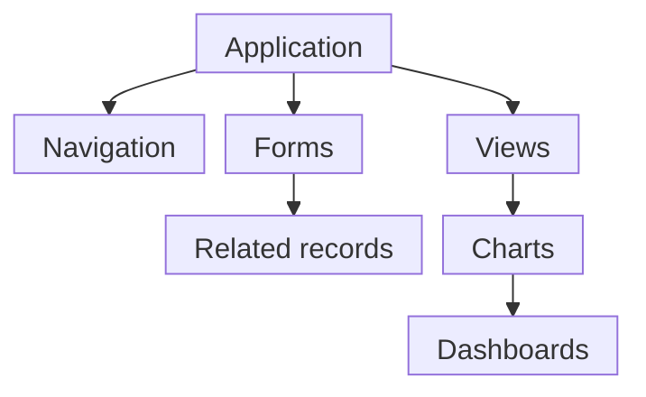

**Prerequisites:** Part 09 and the project solution.

**Planned topics:**

- **Application:** app designer, navigation, and selecting relevant components.
- **Forms:** main, quick-create, and quick-view forms; tabs, sections, and controls.
- **Related records:** subgrids, timelines, and related-record experiences.
- **Views and grids:** public/personal views, filters, and displayed columns.
- **Visualization:** charts and dashboards.
- **Commands and publishing:** supported commands, saving, publishing, and checking the application as a user. Business-rule logic is covered separately in Part 12.
- **Usability:** accessibility and mobile behavior.

#### Start here

Part 09 established the learning data model. This part turns it into a **usable model-driven app** with appropriate navigation, forms, views, related information, and verified user behavior.

Configure only the approved project solution and components. App creation/publishing and synthetic record tests need explicit scope and appropriate permissions. If runtime user roles are not ready, retain that acceptance check as pending for Part 11 instead of granting broad access.

#### Step 1 - Define the app's users and acceptance checks

Agree who uses the app and what they must accomplish: find a request, inspect its customer/context, create or update permitted work, and recognize the next action.

Verify the Part 09 table/column/relationship definitions and unresolved validation issues before designing around them. A diagram or saved schema is not proof that users can access the data.

Record the app/environment, required tables, essential fields, intended navigation, and test personas. Avoid modifying a shared/vendor app simply to reuse its name.

**Expected result:** a short app brief and measurable user tasks tied to the approved data model.

**Microsoft Learn:** [Model-driven app overview](https://learn.microsoft.com/en-us/power-apps/maker/model-driven-apps/model-driven-app-overview); [Create an app and prerequisites](https://learn.microsoft.com/en-us/power-apps/maker/model-driven-apps/create-model-driven-app).

#### Step 2 - Create the app inside the project solution

1. Open the Part 08 unmanaged project solution in the approved environment.
2. Select **New > App > Model-driven app** in the available maker experience.
3. Enter the approved name, such as Learning Service Requests, and a useful description, then select **Create**.
4. Use **Add page > Dataverse table** for the relevant tables and review the navigation order.
5. Save the definition and verify the actual app is included in the solution.

| Page | Purpose | Access/design consideration |
|---|---|---|
| Service Requests | Primary work list and record experience | Show relevant work, not every unrelated table |
| Accounts | Customer organizations | Include only the appropriate customer experience |
| Contacts | Customer people | Verify permitted relationship/context access |
| Request Categories | Reference information | Editing rights differ from merely reading categories |

App navigation is not data security. Adding a table page does not grant record privileges, and hiding a page does not revoke them.

**Expected result:** a saved app definition with the intended table pages and understandable navigation.

**Microsoft Learn:** [Create a solution-contained model-driven app](https://learn.microsoft.com/en-us/power-apps/maker/model-driven-apps/create-model-driven-app); [App navigation](https://learn.microsoft.com/en-us/power-apps/maker/model-driven-apps/app-navigation).

#### Step 3 - Design a clear main request form

Use the table's **Forms** experience or app designer to create/edit only an approved form. Select the form for the app rather than assuming every form is included.

| Form area | Example information | What to verify |
|---|---|---|
| Request overview | Title, customer, contact, category, priority | Required input and lookup context are available |
| Work details | Description, device count, visit need, follow-up, cost | Appropriate types, labels, and date/currency behavior |
| Work state | Applicable owner/status information | Do not invent unsupported lifecycle values |
| Related/history area | Justified related controls or history | Available relationships/features and permissions |

Group fields into useful tabs/sections, set clear labels, and avoid unnecessary controls. Keep essential fields accessible; hiding a required field is not a validation or security strategy.

Choose field behavior deliberately and verify which form each persona actually opens. Conditional business rules are developed separately in Part 12.

**Expected result:** a usable main form that presents the intended data and permits the required approved inputs.

**Microsoft Learn:** [Create/design forms](https://learn.microsoft.com/en-us/power-apps/maker/model-driven-apps/create-design-forms); [Design productive forms](https://learn.microsoft.com/en-us/power-apps/maker/model-driven-apps/design-productive-forms).

#### Step 4 - Add quick and related experiences only when useful

| Experience | Appropriate purpose | Boundary |
|---|---|---|
| Quick create | A supported short creation experience | Include required fields and verify table/app support |
| Quick view | Display selected related-record information | Not an edit form or a separate database |
| Subgrid/timeline | Display justified related collections/history | Configure actual relationships/features; do not show unrelated data accidentally |

A subgrid might show requests on an approved dedicated customer form, or another real related collection. The current request model does not magically create child collections simply because a control is added.

Timeline content depends on the table's supported notes/activities and configuration. Enable features only within approved scope; do not convert table types or send communications to populate an example.

If no additional experience is needed, document that choice. Do not edit a shared standard main form without reviewing its effect on other apps; a named solution alone is not isolation.

**Expected result:** justified quick/related experiences with verified data and permissions, or clearly deferred unnecessary features.

**Microsoft Learn:** [Quick-create forms](https://learn.microsoft.com/en-us/power-apps/maker/model-driven-apps/create-edit-quick-create-forms); [Quick-view forms](https://learn.microsoft.com/en-us/power-apps/maker/model-driven-apps/create-edit-quick-view-forms); [Configure subgrids](https://learn.microsoft.com/en-us/power-apps/maker/model-driven-apps/form-designer-add-configure-subgrid); [Configure timeline](https://learn.microsoft.com/en-us/power-apps/maker/model-driven-apps/set-up-timeline-control).

#### Step 5 - Configure public views and verify their filters

| Proposed view | Intended selection | Important check |
|---|---|---|
| Active Requests | Records with the agreed active status | Active is not automatically the same as unresolved business work |
| My Active Requests | Active records owned by the current user | Team-owned work may need a separate agreed view |
| Requests by Priority | Useful columns/sorting for priority review | Filters and sort order must match actual data |

Create/edit approved public views through the table/app designer. Choose columns, order, widths, sorting, and filters, then make the intended views available in the app.

Use actual status/column values from the schema. If business lifecycle fields are added later, review whether view filters need updating.

Public, personal, and system views have different purposes. A view filter is a selection convenience, not a restriction on the underlying user's data privileges.

**Expected result:** verified views that show the expected permitted sample records and do not conceal incorrect access through filtering.

**Microsoft Learn:** [Create/edit views](https://learn.microsoft.com/en-us/power-apps/maker/model-driven-apps/create-edit-views); [App sharing and data privileges](https://learn.microsoft.com/en-us/power-apps/maker/model-driven-apps/share-model-driven-app).

#### Step 6 - Introduce charts, dashboards, and commands

Where justified, create a simple table chart, such as request count by priority, and include it in the app. Add a dashboard only when it helps the agreed user task.

Verify results against the known permitted sample subset, filters, and actual field values. A chart total is not proof of correct permissions or an independently secured reporting dataset.

Keep standard commands when they satisfy the task. Modern command customization distinguishes appearance, action, and visibility; do not add JavaScript/Power Fx actions or hide destructive commands as a substitute for server-side authorization.

**Expected result:** useful, accurate visualization and understood command behavior, without unnecessary dashboards or unapproved actions.

**Microsoft Learn:** [Create/edit system charts](https://learn.microsoft.com/en-us/power-apps/maker/model-driven-apps/create-edit-system-chart); [Dashboards](https://learn.microsoft.com/en-us/power-apps/maker/model-driven-apps/create-edit-dashboards); [Command designer concepts](https://learn.microsoft.com/en-us/power-apps/maker/model-driven-apps/command-designer-overview).

#### Step 7 - Save, publish, and test the actual app experience

Save and publish the approved app/components using their supported editor actions, then **Play** the app. Do not substitute environment-wide Publish all without its own approval.

| User test | Expected evidence |
|---|---|
| Create/update a valid synthetic request | Saved values and record identity verified |
| Find the same record in a view and form | Correct selection/context rather than a duplicate entry |
| Missing/invalid input | Actual validation behavior and clear error/gap recorded |
| Related-record access | Permitted lookups work; denied data is not exposed |
| Keyboard/mobile use | Labels, navigation, focus, layout, and controls remain usable |
| Ordinary-user access | App and table privileges are verified, not just maker preview |

Check the form and view actually selected for each persona. Publishing does not create the correct user roles. If ordinary-user acceptance waits on Part 11, label it pending rather than declaring the complete app tested.

**Expected result:** saved/published state and expected/actual app tests, with unresolved usability, validation, or access issues explicit.

**Microsoft Learn:** [Save/publish and run the app](https://learn.microsoft.com/en-us/power-apps/maker/model-driven-apps/create-model-driven-app); [Sharing and runtime access](https://learn.microsoft.com/en-us/power-apps/maker/model-driven-apps/share-model-driven-app); [Screen-reader navigation](https://learn.microsoft.com/en-us/power-apps/user/screen-reader).

#### Step 8 - Complete the eight-item app-configuration record

1. Approved environment/solution, app name, and actual configuration scope.
2. Included tables and navigation order.
3. Main form, essential fields, labels, and input/validation checks.
4. Quick/related/history experiences and verified features or justified deferrals.
5. Views, columns, filters, sorting, and expected sample membership.
6. Chart/dashboard/command choices and accuracy/authorization checks.
7. Actual save/publish state and the app/form/view selected at runtime.
8. Functional, negative, accessibility/mobile, and ordinary-user results with open issues/owners.

Do not treat missing permissions, wrong view results, or an unavailable optional component as an invented success. Only actual saved definitions and tested behavior belong in completed evidence.

**Expected result:** a usable app configuration and evidence record, with user-access work clearly carried into Part 11 where needed.

**Microsoft Learn:** [Model-driven app creation](https://learn.microsoft.com/en-us/power-apps/maker/model-driven-apps/create-model-driven-app); [Forms and usability](https://learn.microsoft.com/en-us/power-apps/maker/model-driven-apps/design-productive-forms); [Views](https://learn.microsoft.com/en-us/power-apps/maker/model-driven-apps/create-edit-views).

#### Official references for this part

- [Model-driven app overview](https://learn.microsoft.com/en-us/power-apps/maker/model-driven-apps/model-driven-app-overview)
- [Create, publish, and run an app](https://learn.microsoft.com/en-us/power-apps/maker/model-driven-apps/create-model-driven-app)
- [App navigation](https://learn.microsoft.com/en-us/power-apps/maker/model-driven-apps/app-navigation)
- [Forms](https://learn.microsoft.com/en-us/power-apps/maker/model-driven-apps/create-design-forms)
- [Productive form design](https://learn.microsoft.com/en-us/power-apps/maker/model-driven-apps/design-productive-forms)
- [Quick-create forms](https://learn.microsoft.com/en-us/power-apps/maker/model-driven-apps/create-edit-quick-create-forms)
- [Quick-view forms](https://learn.microsoft.com/en-us/power-apps/maker/model-driven-apps/create-edit-quick-view-forms)
- [Subgrids](https://learn.microsoft.com/en-us/power-apps/maker/model-driven-apps/form-designer-add-configure-subgrid)
- [Timeline](https://learn.microsoft.com/en-us/power-apps/maker/model-driven-apps/set-up-timeline-control)
- [Views](https://learn.microsoft.com/en-us/power-apps/maker/model-driven-apps/create-edit-views)
- [System charts](https://learn.microsoft.com/en-us/power-apps/maker/model-driven-apps/create-edit-system-chart)
- [Dashboards](https://learn.microsoft.com/en-us/power-apps/maker/model-driven-apps/create-edit-dashboards)
- [Commands](https://learn.microsoft.com/en-us/power-apps/maker/model-driven-apps/command-designer-overview)
- [Sharing and data access](https://learn.microsoft.com/en-us/power-apps/maker/model-driven-apps/share-model-driven-app)
- [Screen-reader support](https://learn.microsoft.com/en-us/power-apps/user/screen-reader)

**Practice goal:** configure the approved service-request app and complete the eight-item record, including actual normal/negative user tests and clearly pending access work.

**Readiness check:** verify app navigation, forms/views, related information, selected visualizations/commands and usability; confirm a permitted user can create, find, and work on a request, or retain missing ordinary-user access as a pending acceptance issue rather than broadening privileges.

### 11 - Security and administration

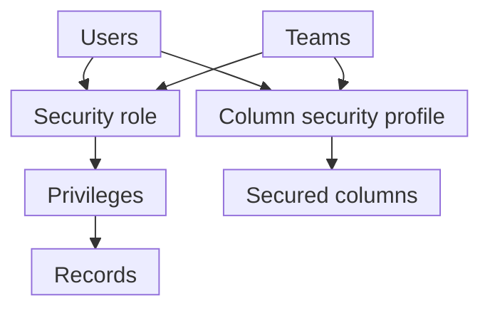

**Prerequisites:** Parts 09-10 and approved test personas with the necessary entitlements.

**Planned topics:**

- **Users and teams:** business units, owner teams, access teams, and approved test personas.
- **Roles and privileges:** access levels, least privilege, and separation of duties.
- **Record access:** ownership, assignment, sharing, and team-based access.
- **App and column access:** distinguish application access from table/record privileges; configure column-security profiles for users or teams where needed.
- **Administration and verification:** auditing, allowed/denied permission tests, and access-denied troubleshooting.

#### Start here

Part 10 configured the application. This part defines **who can use it, which data/actions they can access, and how that access is tested**.

Actual role creation/assignment, business-unit/team changes, column security, and auditing require authorized administrator participation and approved scope. Do not grant learners System Administrator simply to finish the exercise. All test users must have appropriate entitlements and sign in personally.

#### Step 1 - Define personas and expected access before editing roles

Use approved non-administrator personas, such as Agent A, Agent B, and Manager, with known synthetic records and ownership.

| Task or data scope | Agent intent | Manager intent |
|---|---|---|
| Create/read/update own permitted requests | Allowed | Allowed within agreed service scope |
| Another agent's unshared request | Denied unless an explicit team/share rule applies | Allowed only within the agreed scope |
| Requests outside the manager's permitted boundary | Denied | Denied without another justified grant |
| Required customer/contact/category references | Minimum read/association access needed | Minimum access needed for the task |
| Protected manager-review value | Original value unavailable; no unauthorized create/update | Allowed only with row access and the approved profile |
| Delete requests or administer security | Denied for this runtime exercise | Denied unless separately authorized, not by job title alone |

This is an example business policy, not a ready-made role definition. Record the actual organization-approved boundaries before making changes.

**Expected result:** an agreed allow/deny matrix and test fixtures, rather than a broad role copied because it makes the app open.

**Microsoft Learn:** [Roles and privileges](https://learn.microsoft.com/en-us/power-platform/admin/security-roles-privileges); [How record access is determined](https://learn.microsoft.com/en-us/power-platform/admin/how-record-access-determined).

#### Step 2 - Separate users, business units, and team types

| Component | Purpose | Important distinction |
|---|---|---|
| User | An entitled, authorized identity in the environment | Sign-in alone does not define all data access |
| Business unit | A boundary used with roles/access levels | Not automatically an exact copy of the organization chart |
| Owner/group team | Can own records and receive appropriate roles | Members can receive privileges through team membership |
| Access team | Provides record-specific collaboration | Does not own records or have security roles assigned to it |

Inspect the approved existing structure with the administrator. Do not create business units, reorganize users, or change group memberships solely to match a diagram.

Review all role/team memberships used by the test personas. Cumulative grants can give more access than one narrow-looking role suggests.

**Expected result:** a documented identity/unit/team arrangement that explains the intended access sources.

**Microsoft Learn:** [Dataverse teams](https://learn.microsoft.com/en-us/power-platform/admin/manage-teams); [Business units](https://learn.microsoft.com/en-us/power-platform/admin/create-edit-business-units); [Ownership and security](https://learn.microsoft.com/en-us/power-platform/admin/wp-security-cds).

#### Step 3 - Create or tailor approved runtime roles

Authorized administrators can reach **Manage > Environments > Settings > Users + permissions > Security roles** in the current admin experience.

1. Use an approved new/copy-role approach and meaningful names, such as Learning Request Agent and Learning Request Manager.
2. Include the minimum app-opening/runtime privileges and review any copied defaults.
3. Configure the relevant business-table privileges and record access levels.
4. Include appropriate Read/Append/Append To rights for related-record operations, not only Create/Write on the request.
5. Assign approved roles to the intended users/eligible teams and record the definitions versus environment-local assignments.

| Privilege | What it controls |
|---|---|
| Create / Read / Write | Adding, viewing, and changing permitted records |
| Append / Append To | Associating records where required |
| Assign / Share | Ownership transfer or access grants |
| Delete | Destructive record removal |

User/basic, business-unit, parent/child-unit, and organization access levels have different reach where applicable. Do not use organization-wide permissions as a universal fix.

**Expected result:** administrator-reviewed role settings that satisfy the matrix and essential app functions without unnecessary administrative or broad data rights.

**Microsoft Learn:** [Create/edit security roles](https://learn.microsoft.com/en-us/power-platform/admin/create-edit-security-role); [Privilege and inheritance definitions](https://learn.microsoft.com/en-us/power-platform/admin/security-roles-privileges).

#### Step 4 - Verify ownership, sharing, and cumulative access

Test an own record, another user's unshared record, and a record outside the agreed manager scope. Check actual ownership/owning-unit/team and any sharing/inherited grants.

A record relationship or view filter does not itself authorize access. A restrictive-looking extra role cannot remove privileges already granted by another role/team.

If a controlled sharing example is explicitly approved, verify the new access while ownership remains unchanged. Assignment changes ownership and is a different operation. Do not bulk reassign or clear sharing from real data as a cleanup shortcut.

**Expected result:** explain every tested grant/denial from actual privilege and record-access sources, including unexpected access that must be corrected through approval.

**Microsoft Learn:** [Record-access checks](https://learn.microsoft.com/en-us/power-platform/admin/how-record-access-determined); [Cumulative roles and teams](https://learn.microsoft.com/en-us/power-platform/admin/wp-security-cds).

#### Step 5 - Configure app access and justified column protection

Model-driven app sharing and table/row/column permissions are separate checks. The app link alone does not grant the required data access.

For a justified protected manager-review column, an authorized administrator should verify that the selected column supports security, enable it in the approved solution, and configure profile membership/permissions.

| Layer | Check |
|---|---|
| App | Intended persona can open the appropriate application |
| Table/record | Base privileges and actual row access allow the required operation |
| Secured column/profile | Approved Read/Create/Update access, including masked/unmasked behavior when used |
| Other grants | Review additional roles, teams, and profiles that may broaden access |

Use a known nonempty **synthetic** review value so a blank/unreturned/masked value is not confused with missing source data. Do not assume column reads always throw an error when denied.

Profiles do not independently grant row access. Hiding a field is not column security, and System Administrator bypasses column protection—so an administrator-only test cannot pass this exercise.

**Expected result:** separate app, row, and protected-value tests using approved non-administrator personas.

**Microsoft Learn:** [Share a model-driven app](https://learn.microsoft.com/en-us/power-apps/maker/model-driven-apps/share-model-driven-app); [Column-security profiles and limits](https://learn.microsoft.com/en-us/power-platform/admin/field-level-security).

#### Step 6 - Plan auditing and administrative responsibilities

Agree which environment/table/column audit capabilities are needed, who may inspect them, and retention/capacity/privacy responsibilities before enabling changes.

Where approved, use a controlled synthetic change to verify actual audit evidence and authorized access to it. A timeline activity is not the same as the platform audit log.

Keep tenant-wide policies, production auditing, license changes, and identity/group administration outside a learner's unapproved scope. Document the administrator/owner responsible for them instead of assuming permission.

**Expected result:** an approved audit/administration plan, actual evidence where implemented, and explicit unavailable/deferred checks.

**Microsoft Learn:** [Manage Dataverse auditing](https://learn.microsoft.com/en-us/power-platform/admin/manage-dataverse-auditing); [Admin-center responsibilities](https://learn.microsoft.com/en-us/power-platform/admin/admin-documentation).

#### Step 7 - Execute positive and negative tests as the real personas

| Test | Expected result under the agreed example policy |
|---|---|
| Agent opens app and creates/updates own valid request | Allowed; saved record and values verified |
| Agent reads another agent's unshared request | Not accessible unless the matrix explicitly permits a grant |
| Agent reads/sets protected manager-review data | Original value unavailable and unauthorized changes prevented |
| Manager reads/updates a request in permitted scope | Allowed with actual row/profile privileges |
| Manager accesses a request outside that scope | Not accessible without a separate justified grant |
| Runtime user deletes requests or configures security | Not allowed in this exercise |

Test with each person's own approved sign-in, not shared credentials or an administrator session. Use authorized retrieval/operation checks where needed; an absent page/button or filtered list is not sufficient proof of data denial.

Record expected/actual outcome, persona, record/scope, operation, relevant grants, and sanitized evidence. If access is unexpectedly broad, investigate cumulative roles/teams/shares/profiles and obtain approved corrections; do not hide the data to label the test passed.

**Expected result:** evidence for both allowed and denied operations, including protected values and record boundaries.

**Microsoft Learn:** [Record authorization](https://learn.microsoft.com/en-us/power-platform/admin/how-record-access-determined); [Column-security testing](https://learn.microsoft.com/en-us/power-platform/admin/field-level-security).

#### Step 8 - Complete the eight-item security evidence pack

1. Approved administrator scope, entitled test personas, and business access matrix.
2. Existing users/units/teams and relevant memberships.
3. Actual runtime roles, table privileges/access levels, and essential app-opening rights.
4. Ownership, sharing, inheritance, and cumulative-grant observations.
5. App access and protected-column profile/membership results.
6. Audit configuration/evidence or explicit approved deferrals and ownership.
7. Positive/negative test results from non-administrator personas.
8. Unresolved issues, approved corrections, responsible owners, and Ready/Blocked status.

A role name, blank form field, or successful admin test is not complete security evidence. Missing test access and unverified denial remains an open acceptance issue.

**Expected result:** a reviewed least-privilege configuration and traceable test pack, without unapproved security or identity changes.

**Microsoft Learn:** [Security-role design](https://learn.microsoft.com/en-us/power-platform/admin/security-roles-privileges); [Record access](https://learn.microsoft.com/en-us/power-platform/admin/how-record-access-determined); [Column protection](https://learn.microsoft.com/en-us/power-platform/admin/field-level-security).

#### Official references for this part

- [Security roles and privileges](https://learn.microsoft.com/en-us/power-platform/admin/security-roles-privileges)
- [Create/edit roles](https://learn.microsoft.com/en-us/power-platform/admin/create-edit-security-role)
- [How record access is determined](https://learn.microsoft.com/en-us/power-platform/admin/how-record-access-determined)
- [Ownership/cumulative access](https://learn.microsoft.com/en-us/power-platform/admin/wp-security-cds)
- [Teams](https://learn.microsoft.com/en-us/power-platform/admin/manage-teams)
- [Business units](https://learn.microsoft.com/en-us/power-platform/admin/create-edit-business-units)
- [Model-driven app sharing](https://learn.microsoft.com/en-us/power-apps/maker/model-driven-apps/share-model-driven-app)
- [Column security](https://learn.microsoft.com/en-us/power-platform/admin/field-level-security)
- [Auditing](https://learn.microsoft.com/en-us/power-platform/admin/manage-dataverse-auditing)
- [Admin-center responsibilities](https://learn.microsoft.com/en-us/power-platform/admin/admin-documentation)

**Practice goal:** design and, with authorized administrator help, implement agent/manager access; complete the eight-item pack with actual allowed/denied tests.

**Readiness check:** verify least-privilege app/row/column access and administrative boundaries with non-administrator test personas. Account for every unexpected grant or unavailable test; neither hiding fields nor testing only as System Administrator passes.

### 12 - Business rules and validation

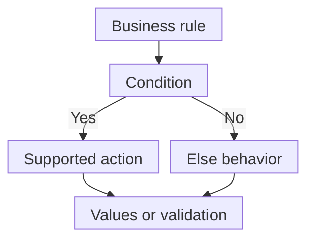

**Prerequisites:** Parts 09-11 and the project solution from Part 08.

**Planned topics:**

- **Mechanism choice:** business rules apply supported conditions and validation; Part 13 guides users through process stages; Part 14 automates background operations. Reserve code for requirements these mechanisms cannot satisfy.
- **Conditions and actions:** comparisons, multiple conditions, set/clear values, defaults, and validation messages.
- **Form behavior:** supported requirement-level changes, show/hide, enable/disable, and recommendations.
- **Scope and limitations:** table, all-form, and specific-form scope; client/server behavior, supported column types, and grid/control limitations. Do not assume every action runs through every entry point.
- **Lifecycle:** create inside the solution, validate, activate/deactivate, and test both condition branches.
- **Safety and troubleshooting:** hiding a column is not security; inspect missing form columns, inactive rules, scope mismatches, and conflicting logic.

#### Start here

Business rules apply supported conditions and actions without requiring a script. This part separates **form guidance** from **table-level validation** so the visible form is not mistaken for a universal enforcement boundary.

Work only in the approved solution/table/form scope. Rule activation can affect real operations; test with synthetic records and approved personas, and review existing rules before changing anything.

#### Step 1 - Choose the correct mechanism

| Need | Mechanism to consider | Boundary |
|---|---|---|
| Supported conditions, values, or validation | Business rule | Check action, scope, column, and control support |
| Guide users through stages | Business process flow, Part 13 | Stage guidance is not every background operation |
| Notifications, approvals, connected actions | Cloud flow, Part 14 | Flow execution is not form layout |
| Requirements beyond supported configuration | Justified supported code in later development parts | Do not add code before checking simpler mechanisms |

Authorization belongs to the Part 11 security model; a rule hiding/locking a control is not a replacement for row or column security.

**Expected result:** a justified business-rule requirement that fits supported actions and keeps process/automation/security concerns separate.

**Microsoft Learn:** [Dataverse business-rule capabilities](https://learn.microsoft.com/en-us/power-apps/maker/data-platform/data-platform-create-business-rule); [Form actions and scope](https://learn.microsoft.com/en-us/power-apps/maker/model-driven-apps/create-business-rules-recommendations-apply-logic-form).

#### Step 2 - Prepare actual fields and acceptance criteria

Do not assume the custom request table's system Status has a Resolved value. Inspect the actual schema/product lifecycle first.

For this **custom learning** example, reuse suitable existing fields or obtain approval to add:

| Field | Example definition | Role in the rule |
|---|---|---|
| Request Stage | Single Choice: Open, In Progress, Resolved | The example business state, not a business-process-flow stage |
| Resolution Summary | Supported text/multiline text, optional in the agreed base design | Required/validated when Request Stage is Resolved |

Include the referenced columns on the intended form and in the solution. If using a licensed standard case process instead, follow its actual supported state/field semantics rather than replacing it with this example.

Agree the rule: **a resolved request must have a summary; other states must not erase an existing summary**. Decide whether whitespace-only text is acceptable; a basic no-value check is not automatically a meaningful-text policy.

**Expected result:** actual supported columns, intended form, approved scope, and testable criteria—not invented status labels.

**Microsoft Learn:** [Column definitions](https://learn.microsoft.com/en-us/power-apps/maker/data-platform/create-edit-field-portal); [Form configuration](https://learn.microsoft.com/en-us/power-apps/maker/model-driven-apps/create-design-forms); [Supported rule types](https://learn.microsoft.com/en-us/power-apps/maker/data-platform/data-platform-create-business-rule).

#### Step 3 - Design conditions, branches, and scope

| Input | Intended rule behavior |
|---|---|
| Resolved and summary absent | Form requires the summary; validation rule returns an error |
| Resolved with a valid summary | These rules do not block the otherwise permitted valid save |
| Open/In Progress | Restore only the agreed form requirement level; preserve existing summary data |

| Scope | Meaning |
|---|---|
| Specific form | Apply supported client form behavior only to that form |
| All Forms | Apply supported form behavior across the table's forms |
| Table / Entity | Apply table-level and relevant form execution; client-only actions are not server-side enforcement |

Set/clear/default values, error messages, show/hide, enable/disable, requirement levels, and recommendations have different support. Do not use a form-only action as proof of API/import validation.

**Expected result:** explicit true/false branches and action scopes with no unintended clearing or weakening of existing requirements.

**Microsoft Learn:** [Action/scope comparison](https://learn.microsoft.com/en-us/power-apps/maker/model-driven-apps/create-business-rules-recommendations-apply-logic-form); [Dataverse rule limitations](https://learn.microsoft.com/en-us/power-apps/maker/data-platform/data-platform-create-business-rule).

#### Step 4 - Create the form-guidance rule

1. Open the approved solution/table's business-rule experience and create a meaningfully named rule, such as Resolution Summary Required - Form.
2. Set the scope to the intended main form, unless a wider tested scope is explicitly required.
3. Configure the condition **Request Stage equals Resolved**.
4. On the true branch, set Resolution Summary to the supported Business Required form requirement.
5. On the false branch, restore the agreed base requirement only if appropriate; do not downgrade a separately required field or clear entered text.
6. Apply properties and inspect the generated condition/action logic.

All referenced columns must be available in the intended form context. A rule that is inactive, scoped elsewhere, or missing fields does not become correct by hiding the failing control.

**Expected result:** a prepared form-guidance definition with explicit scope and safe branches, ready for Step 6 saving/activation, not a claim of universal validation.

**Microsoft Learn:** [Create a model-driven form business rule](https://learn.microsoft.com/en-us/power-apps/maker/model-driven-apps/create-business-rules-recommendations-apply-logic-form).

#### Step 5 - Add supported table validation when required

For the approved cross-entry-point requirement, create a separate clearly named rule, such as Resolved Request Validation - Table.

1. Set the intended Table/Entity scope.
2. Build the condition **Request Stage equals Resolved AND Resolution Summary does not contain data** using supported operators.
3. Add **Show Error Message**, associated with the appropriate field, with clear guidance such as "Enter a resolution summary before resolving this request."
4. Leave valid/nonmatching paths unchanged; do not fill an artificial summary just to make the save succeed.
5. Verify action/type support and actual enforcement through each required entry point.

The supported error action can return validation to server callers; form-only requirement/visibility actions are ignored server-side. Table scope affects the table across applications/callers, not just one named app.

Do not assume a null check rejects whitespace-only summaries, unsupported controls behave identically, or every business policy can be implemented by this rule. Record gaps and choose supported additional enforcement where required.

**Expected result:** a justified table-validation definition and a clear distinction between its error action and form-only guidance.

**Microsoft Learn:** [Server/form action behavior](https://learn.microsoft.com/en-us/power-apps/maker/model-driven-apps/create-business-rules-recommendations-apply-logic-form); [Table business rules](https://learn.microsoft.com/en-us/power-apps/maker/data-platform/data-platform-create-business-rule).

#### Step 6 - Validate, save, activate, and verify lifecycle

Use **Validate** to check the definition, then **Save**. Activate the approved saved rule using the supported table/solution command; the current designer may require activation outside its editing window.

Refresh/reopen the actual intended app/form after the appropriate component changes are saved/published. Do not run environment-wide Publish all or deactivate unrelated rules as a blanket troubleshooting step.

Existing active rules must be deactivated before approved edits where required. Review conflicts and impact before reactivation; deactivation can remove validation for other users.

**Expected result:** actual saved/active state for the intended rules and form, with scope, conflicts, and deployment context documented.

**Microsoft Learn:** [Rule designer and activation](https://learn.microsoft.com/en-us/power-apps/maker/model-driven-apps/create-business-rules-recommendations-apply-logic-form); [Dataverse rule lifecycle](https://learn.microsoft.com/en-us/power-apps/maker/data-platform/data-platform-create-business-rule).

#### Step 7 - Test normal, negative, and alternate-entry behavior

| Test | Expected evidence |
|---|---|
| Open with no summary | These rules do not add a resolved-state error; other requirements still apply |
| Resolved with no summary | Save blocked with the expected guidance/error |
| Resolved with valid summary | Otherwise authorized/valid save succeeds and stored values match |
| Resolved changed back to another state | Agreed form requirement restored without erasing summary |
| Whitespace-only summary | Explicit policy tested; basic no-value logic is not assumed to reject it |
| Another form, import, or authorized API operation | Actual supported scope/enforcement verified per entry point |
| Grid/subgrid or unsupported column/control | Support limitations and real result recorded, not assumed equivalent |

Use genuine approved user access and synthetic data. A permission denial is not proof the business rule validated the input; a rule error is not proof the security model is correct.

Business rules do not support every type/control; for example, multiselect Choices and File columns are not suitable substitutes for this single-Choice/text example. Editable subgrids and dataset experiences have limitations.

Unavailable API/import tests stay unverified/Blocked as appropriate; do not claim all entry points are enforced based only on a form test. Keep sanitized expected/actual evidence and a clear owner for unresolved gaps.

**Expected result:** verified supported paths and explicit gaps, including both condition branches, blank/valid input, preserved data, and actual required entry points.

**Microsoft Learn:** [Type/control limitations](https://learn.microsoft.com/en-us/power-apps/maker/data-platform/data-platform-create-business-rule); [Scope and validation behavior](https://learn.microsoft.com/en-us/power-apps/maker/model-driven-apps/create-business-rules-recommendations-apply-logic-form); [Import entry points](https://learn.microsoft.com/en-us/power-apps/maker/data-platform/data-platform-import-export).

#### Step 8 - Complete the eight-item rule evidence pack

1. Approved business requirement and configuration-versus-other-mechanism choice.
2. Actual table/columns/options and the intended form context.
3. Rule names, conditions, true/false actions, and scope.
4. Form-guidance versus table-validation responsibilities.
5. Actual validate/save/activate state and reviewed conflicts.
6. Normal/negative/reversal/whitespace results with expected and actual outcomes.
7. Form/import/API/grid coverage, limitations, and explicitly unverified tests.
8. Permissions distinction, sanitized evidence, open gaps/owners, and Ready/Blocked status.

**Expected result:** tested, appropriately scoped business behavior with no invented universal enforcement, data-clearing shortcut, or security claim based on a hidden control.

**Microsoft Learn:** [Business-rule actions/scopes](https://learn.microsoft.com/en-us/power-apps/maker/model-driven-apps/create-business-rules-recommendations-apply-logic-form); [Dataverse business rules](https://learn.microsoft.com/en-us/power-apps/maker/data-platform/data-platform-create-business-rule).

#### Official references for this part

- [Dataverse table business rules](https://learn.microsoft.com/en-us/power-apps/maker/data-platform/data-platform-create-business-rule)
- [Model-driven form actions, scope, validation and activation](https://learn.microsoft.com/en-us/power-apps/maker/model-driven-apps/create-business-rules-recommendations-apply-logic-form)
- [Column creation](https://learn.microsoft.com/en-us/power-apps/maker/data-platform/create-edit-field-portal)
- [Form configuration](https://learn.microsoft.com/en-us/power-apps/maker/model-driven-apps/create-design-forms)
- [Import behavior](https://learn.microsoft.com/en-us/power-apps/maker/data-platform/data-platform-import-export)

**Practice goal:** implement/test the approved form-guidance and table-error examples using actual supported fields, then complete the eight-item evidence pack with explicit coverage limitations.

**Readiness check:** verify conditions/branches, blank/valid/reversal behavior and supported entry points as an approved user; separate field presentation, table validation and authorization. Preserve user data and report unsupported/unverified behavior instead of claiming universal enforcement.

### 13 - Business process flows

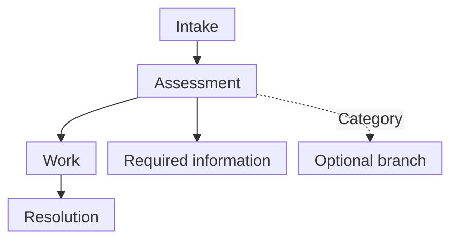

**Prerequisites:** Parts 08-11, agreed process requirements, and appropriate process-design permissions.

**Planned topics:**

- **Purpose:** guide users through a consistent process; distinguish a process instance and active stage from the request's status.
- **Design:** stages, categories, steps, required information, supported tables, and branching conditions.
- **Application experience:** add the process to the app, validate/activate it, and inspect it on a request.
- **Access:** process availability, security-role access, process-table privileges, and underlying record permissions.
- **User actions:** move forward/backward, complete required steps, follow branches, and resume a saved process.
- **Boundaries:** a required process step controls stage progression, not universal data validation. A process diagram does not by itself perform every approval or background action; use Part 14 for cloud-flow automation.

#### Start here

A business process flow provides **guided stages and steps on a record**. It is not the same as a cloud flow, a record's system Status, or the custom Request Stage field used in Part 12.

Use the approved learning solution/table, process-use rights, and administrator-supported permissions. Creating/activating a process changes available behavior; do not enable it on a shared or production table merely to follow an example.

#### Step 1 - Define the process and its boundaries

Agree the business path: receive a request, assess it, perform the work, and document resolution.

| Concept | Meaning |
|---|---|
| Process definition | The configured stages, steps, branching, and properties |
| Process instance | One run of that process associated with business record(s) |
| Active stage | Where that instance currently is |
| Record status/business state | Separate table data or lifecycle behavior |

Process completion does not automatically approve an external request, resolve a case, or set Request Stage to Resolved. Define any required data changes or automation separately.

**Expected result:** a written process goal and clear separation between guided progress, record state, validation, and background work.

**Microsoft Learn:** [Business process flow overview](https://learn.microsoft.com/en-us/power-automate/business-process-flows-overview); [Create a process and prerequisites](https://learn.microsoft.com/en-us/power-automate/create-business-process-flow).

#### Step 2 - Prepare supported table and field context

Use the actual approved Service Request table or the agreed product's supported equivalent. Verify process support before enabling table capabilities; some enabling choices cannot be undone.

| Field | Source/design intent | Process use |
|---|---|---|
| Request Title | Existing request primary/text value | Identify the work |
| Customer | Existing approved lookup | Confirm context |
| Assessment Summary | Approved text field where needed | Required assessment information |
| Service Route | Approved single Choice: Standard/Specialist | A supported branch driver |
| Resolution Summary | Reuse the Part 12 field or an approved equivalent | Resolution information |

In this example, the assessor chooses Service Route based on the actual request/category. That is not a claim that a lookup display name or stage category automatically creates routing logic.

Include required/business-required fields on the relevant form and verify data permissions. Avoid making a Yes/No step required when No is a valid answer: a required two-option BPF step expects Yes/true for progression.

**Expected result:** actual supported fields and a branch driver, with missing setup/access explicitly Blocked.

**Microsoft Learn:** [Process table/field support](https://learn.microsoft.com/en-us/power-automate/business-process-flows-overview); [Create/edit columns](https://learn.microsoft.com/en-us/power-apps/maker/data-platform/create-edit-field-portal); [Form context](https://learn.microsoft.com/en-us/power-apps/maker/model-driven-apps/create-design-forms).

#### Step 3 - Create the definition and stage sequence inside the solution

1. Open the approved solution through the supported Power Apps/Power Automate solution experience.
2. Select **New > Automation > Process > Business process flow**.
3. Enter the approved display/unique names, choose the actual table, and select **Create**.
4. Add stages, configure their properties, and apply the changes.

| Stage | Purpose | Example steps |
|---|---|---|
| Intake | Establish the request and customer context | Title, customer |
| Assessment | Understand and classify the work | Assessment Summary, Service Route |
| Specialist Review (optional) | Handle the justified specialist path | Approved assessment/review information |
| Work | Perform and track the agreed task | Relevant supported work information |
| Resolution | Document the outcome | Resolution Summary |

The four main stages remain Intake, Assessment, Work, and Resolution; the specialist review is the optional branch. Stage categories such as Qualify/Develop are process metadata, not the request's category record.

Do not use obsolete standalone process-creation instructions outside the solution context or assume a saved draft is active.

**Expected result:** a saved process design with real fields, understood stage metadata, and the approved main/optional paths.

**Microsoft Learn:** [Solution-contained process creation](https://learn.microsoft.com/en-us/power-automate/create-business-process-flow); [Stages and steps](https://learn.microsoft.com/en-us/power-automate/business-process-flows-overview).

#### Step 4 - Configure required steps and one justified branch

Mark the agreed assessment/resolution information required where appropriate. This controls supported stage progression; it does not replace all table/API validation.

| Route | Intended path |
|---|---|
| Standard | Assessment -> Work -> Resolution |
| Specialist | Assessment -> Specialist Review -> Work -> Resolution |

Use a supported condition such as **Service Route equals Specialist** after Assessment, and include that driver as a step in the immediately preceding stage. Apply the condition and inspect both branches.

Merge peer branches into the same agreed Work stage. Do not leave one peer ending while another merges, invent unsupported lookup/string comparisons, or assume every combined AND/OR expression is supported.

**Expected result:** required-step behavior and two understandable paths with a verified supported branch condition.

**Microsoft Learn:** [Branching rules and merge constraints](https://learn.microsoft.com/en-us/power-automate/enhance-business-process-flows-branching); [Required-step behavior](https://learn.microsoft.com/en-us/power-automate/create-business-process-flow).

#### Step 5 - Validate, activate, and configure actual process access

Validate the definition, save it, and activate only within approved scope. Ensure the intended active process is available in the configured app/table experience.

| Access layer | What to verify |
|---|---|
| Application | The persona can open the intended model-driven app |
| Process definition/availability | Appropriate roles can use the intended active process |
| Process-instance table | Actual Create/Read/Write and other necessary process privileges |
| Underlying business record | Required record/column operations are permitted |

Inspect the process's actual table/ownership and security requirements rather than copying the request table's access levels blindly. Use the supported process security-role commands with authorized administrator help.

System Administrator/System Customizer visibility is not proof an ordinary persona can use the process. Missing instance-table rights or inactive definitions must remain a reported issue.

**Expected result:** active/app-available process and tested access for the approved personas, not merely a successful designer save.

**Microsoft Learn:** [Activation and process security](https://learn.microsoft.com/en-us/power-automate/create-business-process-flow); [Process privileges](https://learn.microsoft.com/en-us/power-automate/business-process-flows-overview); [Model-driven app access](https://learn.microsoft.com/en-us/power-apps/maker/model-driven-apps/share-model-driven-app).

#### Step 6 - Run the same sample record through the guided experience

1. Open the approved synthetic request and identify its process instance and active stage.
2. Inspect Intake information and move forward through the supported stage controls.
3. Attempt the agreed incomplete assessment step and verify the actual gate behavior.
4. Complete the approved fields and follow Standard or Specialist routing.
5. Move backward/reopen where supported and confirm saved process progress.
6. Inspect Resolution information and verify business record state separately.

Required, disabled, hidden, and two-option step behavior can differ; test the actual configured form/process. Mobile does not expose every desktop flyout/side-pane behavior identically.

Do not add a stage-exit workflow or assume finishing the final stage automatically fires every desired action. Any such integration needs an explicitly designed/tested trigger.

**Expected result:** observable guided progression and resumed state, without confusing process completion with business resolution or approvals.

**Microsoft Learn:** [User process experience and limits](https://learn.microsoft.com/en-us/power-automate/business-process-flows-overview); [Model-driven navigation](https://learn.microsoft.com/en-us/power-apps/user/navigation).

#### Step 7 - Test both paths, gates, and permission boundaries

| Test | Expected evidence |
|---|---|
| Required assessment information missing | Actual stage-gate behavior observed, not assumed |
| Valid Standard route | Expected main path and saved steps |
| Valid Specialist route | Specialist review followed by the common Work stage |
| Backward navigation/reopening | Supported progression and stored instance verified |
| Approved editing persona | Can perform the agreed process/record actions |
| Review-only or denied persona | No unauthorized progression or data modification |
| Completion versus record state | Status/Request Stage and automation outcomes verified separately |

Record the actual definition/instance, field values, user, path, and expected/actual result. A denied operation is not proof that required steps were validated; an editable process is not proof that all business data is permitted.

**Expected result:** evidence for both branches, incomplete steps, resuming, and allowed/denied process use.

**Microsoft Learn:** [Branching behavior](https://learn.microsoft.com/en-us/power-automate/enhance-business-process-flows-branching); [Process security and gates](https://learn.microsoft.com/en-us/power-automate/create-business-process-flow).

#### Step 8 - Complete the eight-item process evidence record

1. Approved process purpose, environment/solution/table, and use/configuration rights.
2. Actual fields, form context, and required-step decisions.
3. Process display/unique names, main stages, and optional stage/category metadata.
4. Branch driver, preceding-stage placement, and merge design.
5. Actual validate/save/activate state and app availability.
6. Definition/instance-table/business-record permission results.
7. Both paths, gates, backward/reopen/mobile observations and instance identity.
8. Separate business-state/automation checks, issues/owners, and Ready/Blocked status.

**Expected result:** a verified guided process and evidence pack, without invented universal validation or implied automatic business completion.

**Microsoft Learn:** [Create and secure a business process flow](https://learn.microsoft.com/en-us/power-automate/create-business-process-flow); [Process concepts](https://learn.microsoft.com/en-us/power-automate/business-process-flows-overview).

#### Official references for this part

- [Process overview, supported tables, gates and privileges](https://learn.microsoft.com/en-us/power-automate/business-process-flows-overview)
- [Create, validate, activate and secure a process](https://learn.microsoft.com/en-us/power-automate/create-business-process-flow)
- [Branching and merge constraints](https://learn.microsoft.com/en-us/power-automate/enhance-business-process-flows-branching)
- [Column configuration](https://learn.microsoft.com/en-us/power-apps/maker/data-platform/create-edit-field-portal)
- [Form configuration](https://learn.microsoft.com/en-us/power-apps/maker/model-driven-apps/create-design-forms)
- [App sharing/access](https://learn.microsoft.com/en-us/power-apps/maker/model-driven-apps/share-model-driven-app)
- [User navigation](https://learn.microsoft.com/en-us/power-apps/user/navigation)

**Practice goal:** implement/test the approved four-stage request process with required assessment information and a justified category-informed route, then verify the eight evidence items.

**Readiness check:** verify both paths, actual gate behavior, saved process progress and non-admin access; distinguish process availability/instance permissions from record status, table validation and background automation.

### 14 - Power Automate cloud flows

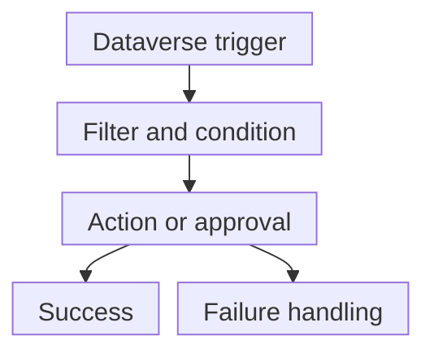

**Prerequisites:** Parts 08-11, agreed automation requirements, approved connections, and appropriate Power Automate access. Part 13 is needed only when the flow depends on process-stage data.

**Planned topics:**

- **Flow foundations:** automated, instant, and scheduled cloud flows; choose an appropriate trigger for the business event.
- **Dataverse automation:** row-change triggers, filtering columns/rows, conditions, expressions, and related-record actions.
- **Business actions:** request assignment, notifications, approvals, and explicit approval/rejection paths.
- **Connections and identity:** connections, connection references, ownership, execution permissions, least privilege, and solution-aware flows.
- **Reliable execution:** loop prevention, duplicate processing, repeated updates, concurrency considerations, retries, and timeouts.
- **Failure handling:** scopes, run-after behavior, meaningful failure notifications, run history, monitoring, and safe recovery.

#### Start here

Cloud flows run **background automation through configured identities and connections**. This part uses a bounded, approved request-approval example, not an automatic production deployment or a guarantee of exactly-once processing.

Connections, flow activation, data changes, assignment, and approval notifications need explicit approval and test recipients. Saving a connected automated flow can make it runnable; prepare the guard conditions and isolated synthetic fixture before saving/enabling side effects.

#### Step 1 - Define the event, outcome, and flow type

| Flow type | Typical event | Example consideration |
|---|---|---|
| Automated | A supported system/data event | A request becomes eligible for approval |
| Instant | An approved manual/app invocation | Validate supplied input and caller/connection behavior |
| Scheduled | A defined time/recurrence | Review a bounded set of eligible work |

Choose an automated row-modified example only when it fits. Agree what triggers approval, who may request it, who can approve, the allowed assignee, and which states represent approval, rejection, failure, and timeout.

Approval does not automatically resolve the business request or grant data permissions. A notification alone is not a completed operation.

**Expected result:** a defined input event, approved outcome/actions, and justified flow type.

**Microsoft Learn:** [Cloud flow types](https://learn.microsoft.com/en-us/power-automate/flow-types); [Approval workflow concepts](https://learn.microsoft.com/en-us/power-automate/modern-approvals).

#### Step 2 - Prepare controlled state and stable attempt identity

Reuse suitable actual fields, or obtain approval for the following learning controls:

| Control | Example type/purpose | Ownership/validation requirement |
|---|---|---|
| Approval State | Single Choice: Draft, Requested, Processing, Approved, Rejected, Failed, Timed Out | Define and protect allowed state transitions |
| Approval Attempt ID | Text identifying one authorized submission | Stable for repeated events; a new authorized attempt uses a new ID |
| Processing Attempt ID | Text tracking the attempt already claimed | Workflow-controlled; do not expose arbitrary resets |
| Approval ID | Text storing the connector-returned approval identifier | Enables correlation and approved recovery |
| Approval Comments | Relevant decision information | Synthetic/permitted content only |

A sample attempt label such as `LEARN-001-A1` is not a Dataverse record GUID. Do not generate a different attempt ID for every duplicate trigger or reuse an old ID to bypass processing controls.

Agree the trusted submission mechanism and protect workflow-owned values. Filters and an app button do not authorize arbitrary state updates. If state ownership or competing writers cannot be controlled, use a reviewed durable atomic-claim/idempotency design before claiming reliability.

**Expected result:** actual state/identity definitions and authorization assumptions that distinguish a new request from a repeated event.

**Microsoft Learn:** [Column types](https://learn.microsoft.com/en-us/power-apps/maker/data-platform/types-of-fields); [Dataverse trigger behavior](https://learn.microsoft.com/en-us/power-automate/dataverse/create-update-delete-trigger); [Trigger/concurrency design](https://learn.microsoft.com/en-us/power-automate/guidance/coding-guidelines/optimize-power-automate-triggers).

#### Step 3 - Create a solution-aware flow with approved connections

1. Open the Part 08 project solution in the supported Power Automate solution experience.
2. Select **New > Automation > Cloud flow > Automated**.
3. Name the flow meaningfully and select the supported Dataverse row-change trigger.
4. Review each connector, connection reference, owner/run identity, data permission, entitlement, and environment policy.
5. Obtain activation/notification approval before saving/enabling the completed guarded flow.

Dataverse trigger registration has Callback Registration permissions distinct from deleting business requests. Have the administrator verify the documented minimum registration/data privileges, not grant broad business-record Delete access.

A connection reference points to a connection; it is not an exported password or proof the target environment has consent. Dataverse Run As/impersonation has specific requirements; do not enable delegation casually or assume actions always run as the person who changed the row.

**Expected result:** a solution-contained flow definition and reviewed identities/references, with missing consent/permissions explicitly Blocked.

**Microsoft Learn:** [Create a solution-aware flow](https://learn.microsoft.com/en-us/power-automate/create-flow-solution); [Connection references](https://learn.microsoft.com/en-us/power-apps/maker/data-platform/create-connection-reference); [Dataverse registration and Run As](https://learn.microsoft.com/en-us/power-automate/dataverse/create-update-delete-trigger).

#### Step 4 - Filter, re-read, and claim before creating side effects

For the bounded example, configure **Modified**, the actual request table, and the narrowest approved scope. Use actual scalar logical column names in Select columns; lookup columns are not supported by that filter.

Configure eligibility using the stored field types/values, not English Choice labels pasted into an OData expression. Select columns is not a "value changed" guarantee: repeated updates containing the same value can still cause events.

Before approval creation:

1. Re-read the current row by its actual identifier.
2. Confirm authorized Requested state, nonblank attempt ID, and a match between current and triggering attempt.
3. Skip stale/ineligible/already-claimed attempts explicitly; do not label them newly approved.
4. Persist Processing state and the current Processing Attempt ID before external notifications.

For a small single-owner learning flow, reviewed trigger concurrency of one plus a fresh-state check can serialize its own runs. This serializes the whole flow, including approval waits, and is not a production-throughput or cross-flow exactly-once guarantee.

Multiple active workers, external resets, or uncertain write outcomes require a durable atomic claim/recovery strategy. Do not claim filtering or a plain read-then-write alone solves those races.

**Expected result:** no side effect before eligibility/claim checks, explicit duplicate/stale handling, and understood concurrency assumptions.

**Microsoft Learn:** [Scalar filters and repeated Dataverse updates](https://learn.microsoft.com/en-us/power-automate/dataverse/create-update-delete-trigger); [Concurrency/trigger optimization](https://learn.microsoft.com/en-us/power-automate/guidance/coding-guidelines/optimize-power-automate-triggers); [Flow limits](https://learn.microsoft.com/en-us/power-automate/limits-and-config).

#### Step 5 - Create, track, and wait for the approval

Use the documented **Create an approval** action, persist its returned Approval ID, then **Wait for an approval** with that identifier. This separates creation from waiting so the approved recovery procedure can identify pending work.

For this learning example, configure one approved test manager, a supported approve/reject type, and permitted details. Map the actual case-sensitive connector result; multi-approver/custom-response designs need separate response/array semantics:

| Result | Business handling |
|---|---|
| `Approve` | Set Approved after any required allowed assignment/update succeeds and is verified |
| `Reject` | Record Rejected and the relevant decision information; do not treat it as technical failure |
| Unexpected response | Stop/report for review; never default to approval |
| Still waiting | Remain Processing with correlated approval identity; not a completed business outcome |

Use a validated configured assignee, not arbitrary user-supplied ownership or role data. Assignment is a separate authorized operation and does not grant a security role.

If approval creation or its identifier write has an uncertain outcome, investigate existing approvals/run evidence before retrying creation. A failed response is not proof no approval was sent.

**Expected result:** one correlated approval for the eligible attempt and explicit verified approval/rejection handling, without duplicate creation or automatic privilege/business-resolution claims.

**Microsoft Learn:** [Create/Wait actions and exact outcomes](https://learn.microsoft.com/en-us/connectors/approvals/); [Approval workflow guidance](https://learn.microsoft.com/en-us/power-automate/modern-approvals); [Update a Dataverse row](https://learn.microsoft.com/en-us/power-automate/dataverse/update).

#### Step 6 - Design failure, timeout, and recovery paths explicitly

| Handling area | Design |
|---|---|
| Try | Guarded reads/claims, approval actions, and verified business updates |
| Catch / Run after | Handle actual failures/timeouts, capture sanitized run/attempt/error information, and notify the approved owner |
| Final outcome | Technical failure remains failed, such as a supported Terminate - Failed outcome; do not return business success after failed work |

Attempt a Failed/Timed Out state update only where safe; if that write or notification fails, preserve the failure in run history/monitoring rather than inventing a saved state.

Use approved wait timeouts within current run/connector limits. Timing out the wait does not automatically prove the separate approval request was canceled; resolve outstanding approval IDs through the authorized recovery procedure.

Retries are appropriate only for safe/idempotent operations with known outcomes. Do not blindly retry approval creation, assignment, non-idempotent external actions, or reset Processing to Requested on every error.

**Expected result:** observable technical failures and timeout ownership, with bounded safe retries and recovery that does not duplicate or conceal work.

**Microsoft Learn:** [Run after, errors and retries](https://learn.microsoft.com/en-us/power-automate/guidance/coding-guidelines/error-handling); [Run/wait limits](https://learn.microsoft.com/en-us/power-automate/limits-and-config); [Approval action behavior](https://learn.microsoft.com/en-us/connectors/approvals/).

#### Step 7 - Test outcomes, repeats, and failures on approved fixtures

| Test | Required observation |
|---|---|
| New valid attempt approved | One correlated approval and verified permitted final update/assignment |
| New valid attempt rejected | Rejected business outcome, no unintended approval/assignment |
| Missing connection/input/permission | Explicit blocked/failed work, not a fake success |
| Wait timeout | Timed-out handling and identified outstanding-approval recovery |
| Unrelated row update | No unintended approval side effect |
| Repeated update for the same attempt | No duplicate approval/notification work |
| Two queued/concurrent events for one attempt | Claim/state assumptions tested, not inferred from run count |
| Recovery after an uncertain external result | Existing approval checked before any new creation |
| Explicit new approved attempt | New stable identity and correct handling without replaying stale work |

Verify approval records, saved values/owner, run IDs, attempt IDs, and failure evidence—not just a green flow-run icon. Built-in request and final-outcome messages are different from unintended duplicate requests.

Saving/enabling/testing can send real messages or mutate data. If approved recipients or isolation are unavailable, keep the tests explicitly unperformed/Blocked.

**Expected result:** verified success/rejection/failure/repeat behavior within the stated assumptions, with no unexplained loops or duplicate side effects.

**Microsoft Learn:** [Approval testing](https://learn.microsoft.com/en-us/power-automate/modern-approvals); [Trigger/repeat behavior](https://learn.microsoft.com/en-us/power-automate/dataverse/create-update-delete-trigger); [Failure evidence](https://learn.microsoft.com/en-us/power-automate/guidance/coding-guidelines/error-handling).

#### Step 8 - Complete the eight-item automation evidence pack

1. Approved business event, flow type, outcomes, recipients, and allowed mutations.
2. Actual control fields, stable attempt identity, trusted submission/state ownership.
3. Solution/flow name, connection references, owner/Run As, licenses/policies and privileges.
4. Trigger scope/scalar filters, fresh-state/claim logic, and concurrency/atomicity assumptions.
5. Approval ID correlation, exact outcome branches and verified allowed final updates.
6. Failure/timeout/retry/recovery design and actual observed evidence.
7. Normal, rejection, unrelated, repeat, race, timeout, and uncertain-outcome tests.
8. Run/attempt records, remaining gaps/owners, and Ready or Blocked status.

**Expected result:** an explained and tested learning automation, without undocumented activation, unsafe retries, guessed identities, or unverified exactly-once claims.

**Microsoft Learn:** [Solution-aware flow creation](https://learn.microsoft.com/en-us/power-automate/create-flow-solution); [Reliable error handling](https://learn.microsoft.com/en-us/power-automate/guidance/coding-guidelines/error-handling); [Trigger design](https://learn.microsoft.com/en-us/power-automate/guidance/coding-guidelines/optimize-power-automate-triggers).

#### Official references for this part

- [Flow types](https://learn.microsoft.com/en-us/power-automate/flow-types)
- [Solution-aware flows](https://learn.microsoft.com/en-us/power-automate/create-flow-solution)
- [Dataverse triggers, scalar filters, registration and Run As](https://learn.microsoft.com/en-us/power-automate/dataverse/create-update-delete-trigger)
- [Connection references](https://learn.microsoft.com/en-us/power-apps/maker/data-platform/create-connection-reference)
- [Trigger and concurrency optimization](https://learn.microsoft.com/en-us/power-automate/guidance/coding-guidelines/optimize-power-automate-triggers)
- [Approval workflow](https://learn.microsoft.com/en-us/power-automate/modern-approvals)
- [Approvals connector actions](https://learn.microsoft.com/en-us/connectors/approvals/)
- [Dataverse updates](https://learn.microsoft.com/en-us/power-automate/dataverse/update)
- [Error handling and retries](https://learn.microsoft.com/en-us/power-automate/guidance/coding-guidelines/error-handling)
- [Flow limits](https://learn.microsoft.com/en-us/power-automate/limits-and-config)
- [Column types](https://learn.microsoft.com/en-us/power-apps/maker/data-platform/types-of-fields)

**Practice goal:** implement/test the approved request approval and permitted assignment workflow, then complete the eight evidence items with explicit identity, repeat, failure and recovery checks.

**Readiness check:** verify approval/rejection, saved updates, permissions, failures/timeouts and repeated events under documented concurrency/claim assumptions. Do not assume filters, retrying everything, green run history, or approval messages prove safe completed work.

## Stage 2 completion exercise

Use the approved learning environment, synthetic data, and agent/manager personas. Keep changes in the project solution; do not make production changes or broaden privileges merely to make a test pass.

1. Identify the publisher, prefix, solution, and included components.
2. Verify the data model and reconcile a small sample-data import.
3. Create and find a request through the configured forms and views.
4. Record allowed/denied actions for both personas, including protected columns.
5. Demonstrate a business rule's two condition branches and explain its scope.
6. Follow the business process flow, including incomplete steps and a category branch.
7. Run the assignment/approval flow and demonstrate approval, rejection, a failed action, and a repeated update.

**Completion evidence:** a working solution-contained application, a component inventory, and expected/actual test results. Explain why each rule, process, and cloud flow was chosen before moving to Stage 3 coding.

## 3 - Develop and Integrate

Choose the language and tools needed for your selected extensions, then build and test justified client/server logic and integrations. Compare PCF, Canvas/custom pages, and standard configuration rather than treating every technology as a compulsory build.

### 15 - Programming foundations

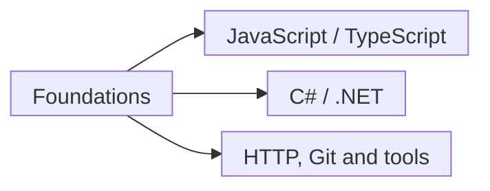

**Prerequisites:** shared platform foundations; no prior programming is assumed.

**Planned topics:**

- **Choose your path:** JavaScript/TypeScript for client/PCF work, C#/.NET for plug-ins/custom APIs, and HTTP/JSON for the selected client.
- **Core concepts:** values, functions, models/collections, events, type contracts, asynchronous work, and explicit errors.
- **Local workflow:** approved tools/versions, debugging, tests, Git, and safe configuration/credentials before later Dynamics operations. Full explanations follow below.

#### Start here

Programming turns an agreed requirement into **input, validation, a decision, and an observable result**. First learn those ideas in a small local program; connecting to Dynamics 365 is a separate step.

This walkthrough uses fictional request `LEARN-001`. Its `reference` is a learning label, **not a Dataverse row GUID**. `Normal`, `High`, `Queue`, and `Review` are local example strings, not assumed stored Choice values or application states.

The toy rule is: review a valid request when priority is High **or** hours open is at least 8; otherwise queue it. It does not save a row, assign an owner, enforce platform security, or replace an approved business requirement. No environment access, tenant login, app registration, deployment, or real customer data is needed.

#### Step 1 - Choose the next extension and the language it needs

| Selected next topic | Foundation to practice now | Do not assume |
|---|---|---|
| Part 16 client customization | JavaScript functions, events, objects, and asynchronous work | Browser code runs on every data-entry path or grants access |
| Parts 17-18 plug-ins/custom APIs | C# types, methods, classes, validation, and exceptions | A modern console project's target is a supported plug-in target |
| Part 19 integration | HTTP/JSON, identity/access concepts, and the selected client's language | A successful sign-in proves permission for an operation |
| Part 20 PCF | JavaScript foundations, TypeScript contracts/compiler feedback, and supported tooling | Every component needs its own framework or service |
| Part 21 Canvas/custom pages | Shared logic/data/security vocabulary, then relevant Power Fx/app guidance | Every app maker must first finish C#, PCF, and JavaScript |

1. Name the actual task you want to implement later.
2. Explain why standard configuration, a rule, or a flow is insufficient before choosing code.
3. Select the relevant language checkpoint. C# learners may use the C# equivalents below without first completing the JavaScript track.
4. Keep HTTP, debugging, source review, and safe handling of input/errors as shared foundations.

**Expected result:** a justified next module and language path, without treating every technology as a compulsory build.

**Microsoft Learn:** [Power Platform development choices](https://learn.microsoft.com/en-us/training/modules/get-started-power-platform-development/); [Plug-in development and target framework](https://learn.microsoft.com/en-us/power-apps/developer/data-platform/write-plug-in); [PCF project prerequisites](https://learn.microsoft.com/en-us/power-apps/developer/component-framework/create-custom-controls-using-pcf).

#### Step 2 - Prepare a safe local workspace and record the tools

Use an approved, user-owned learning folder, not a production solution or the website's source folder. Create only the small files needed for the selected path.

| Tool | Purpose | Evidence to record |
|---|---|---|
| VS Code and approved extensions | Edit, inspect diagnostics, and debug | Editor/extension versions and relevant license/policy approval |
| Node.js, when using the JavaScript example | Run local JavaScript and built-in tests | Installed version and the target project's supported version |
| Local TypeScript compiler, when selected | Check types before emitting JavaScript | Project/compiler version and type-check command |
| .NET SDK, when using C# | Build/run the local console example | Installed SDK and console target framework |
| Git | Review and track permitted source | Repository location, ignored files, and reviewed changes |
| Power Platform CLI, only when later work needs it | Supported project/solution tooling | Version and relevant extension/project requirements |

The editor edits source, a compiler checks/translates it, and a runtime executes the program. An SDK bundles development tools; its version is not the same thing as the target framework's supported APIs/runtime.

In a Windows terminal, inspect only the tools you need: `node --version`, `npm.cmd --version`, `dotnet --info`, `git --version`, or `pac --version`. A version check is not a reason to install everything or log into a tenant.

Current PCF setup guidance specifies Node.js LTS and Power Platform CLI tooling. Current plug-in guidance targets **.NET Framework**; recheck the supported target when starting Part 17. The C# console example here is a language exercise, not a plug-in project or deployment template.

Use approved installers/package sources and existing project conventions. Do not install an unknown package just because a command is missing. Keep credentials out of source, fixtures, terminal recordings, and screenshots. An ignore rule does not remove a secret already tracked by Git.

A .NET SDK's first run can initialize local tooling, including an HTTPS development certificate. This console exercise needs no web server or certificate trust; do not trust a certificate or change other settings merely to complete it.

**Expected result:** a reproducible local tool record, with missing tools/policies explicitly Blocked and no unapproved environment changes.

**Microsoft Learn:** [Node.js on Windows](https://learn.microsoft.com/en-us/windows/dev-environment/javascript/nodejs-on-windows); [.NET CLI](https://learn.microsoft.com/en-us/dotnet/core/tools/dotnet); [Development certificate behavior](https://learn.microsoft.com/en-us/dotnet/core/tools/dotnet-dev-certs); [Power Platform CLI](https://learn.microsoft.com/en-us/power-platform/developer/cli/introduction); [Git foundations](https://learn.microsoft.com/en-us/training/modules/intro-to-git/).

#### Step 3 - Recognize values, types, objects, and collections

Start with this JavaScript fixture in `foundations.test.cjs`:

```javascript
const request = {
  reference: "LEARN-001",
  priority: "Normal",
  hoursOpen: 5
};
```

| Concept | Beginner meaning | Example/check |
|---|---|---|
| Variable | A name referring to a value | `request` refers to the fixture |
| String | Text, not a number merely because it contains digits | `"5"` is different from `5` |
| Number | A numeric value used in calculations/comparisons | `hoursOpen` is 5 |
| Boolean | True or false | Whether priority equals `"High"` |
| Object/class instance | Related named values | Reference, priority, hours open |
| Array/collection | A group of values/records; arrays and lists preserve order, but not every collection guarantees it | Several synthetic requests to inspect in a loop |
| Missing/null value | No usable value has been supplied | Must be distinguished from a valid zero |
| Event | A notification that an action/change occurred | A form load or field change in Part 16; no handler is registered here |

In JavaScript, `const` prevents reassigning the variable; it does not make the object's properties immutable. Prefer strict comparisons and deliberately validate external values rather than relying on automatic conversion.

In C#, distinguish `string`, `bool`, and numeric types such as `int`/`double`. The C# model in Step 4 uses `double?` for hours: `null` means missing, while `0` is an actual numeric value. A class defines a shape; an instance holds the particular request's values.

Write down each field's required type and allowed values. Predict the result before running it: numeric `5 + 3` is 8; JavaScript string `"5" + 3` is `"53"`. Neither a type name nor a field's display label supplies business validation.

**Expected result:** a three-field synthetic fixture and an explained distinction between text/numbers, collections, and missing/zero values.

**Microsoft Learn:** [JavaScript variables, types, and arrays](https://learn.microsoft.com/en-us/shows/beginners-series-to-javascript/); [First C# code and variables](https://learn.microsoft.com/en-us/training/paths/get-started-c-sharp-part-1/); [C# type system](https://learn.microsoft.com/en-us/dotnet/csharp/fundamentals/types/).

#### Step 4 - Build one small function with explicit validation

A function or method receives input, performs a defined operation, and returns a result or reports a failure. Keep this decision separate from file, network, or Dataverse writes.

Add this function beneath the JavaScript fixture:

```javascript
function getRoute(input) {
  if (input === null || typeof input !== "object" || Array.isArray(input)) {
    throw new TypeError("request must be an object");
  }
  if (typeof input.reference !== "string" || input.reference.trim() === "") {
    throw new TypeError("reference must be nonblank text");
  }
  if (input.priority !== "Normal" && input.priority !== "High") {
    throw new TypeError("priority must be Normal or High");
  }
  if (typeof input.hoursOpen !== "number" ||
      !Number.isFinite(input.hoursOpen) || input.hoursOpen < 0) {
    throw new TypeError("hoursOpen must be a finite nonnegative number");
  }
  return input.priority === "High" || input.hoursOpen >= 8 ? "Review" : "Queue";
}
```

Call `getRoute(request)` and explain why it returns `Queue`. High priority with 5 hours returns `Review`; Normal priority at exactly 8 hours also returns `Review`. Values below 8 are not the same boundary case as exactly 8.

For the C# path, use an approved local console project and replace its program with this equivalent. Do not put it into a plug-in assembly:

```csharp
using System;

public class LearningRequest
{
    public string Reference { get; set; } = "";
    public string Priority { get; set; } = "";
    public double? HoursOpen { get; set; }
}

public static class Program
{
    public static void Main()
    {
        var request = new LearningRequest
        {
            Reference = "LEARN-001", Priority = "Normal", HoursOpen = 5
        };
        Console.WriteLine(GetRoute(request));
    }

    public static string GetRoute(LearningRequest? request)
    {
        if (request is null)
            throw new ArgumentNullException(nameof(request));
        if (string.IsNullOrWhiteSpace(request.Reference))
            throw new ArgumentException("reference must be nonblank text");
        if (request.Priority != "Normal" && request.Priority != "High")
            throw new ArgumentException("priority must be Normal or High");
        if (!request.HoursOpen.HasValue)
            throw new ArgumentException("hoursOpen is required");
        double hours = request.HoursOpen.Value;
        if (double.IsNaN(hours) || double.IsInfinity(hours) || hours < 0)
            throw new ArgumentException("hoursOpen must be a finite nonnegative number");
        return request.Priority == "High" || hours >= 8 ? "Review" : "Queue";
    }
}
```

This console prints `Queue`. For either language, test more than one fixture with an array/collection and a loop. Reject blank references, unsupported priority strings, and invalid hours; do not silently turn them into valid defaults.

**Expected result:** a reusable local decision function with the three specified successful outcomes and explicit invalid-input errors.

**Microsoft Learn:** [JavaScript functions, logic, and loops](https://learn.microsoft.com/en-us/shows/beginners-series-to-javascript/); [C# methods](https://learn.microsoft.com/en-us/dotnet/csharp/methods); [C# classes and instances](https://learn.microsoft.com/en-us/dotnet/csharp/fundamentals/types/classes).

#### Step 5 - Add type contracts and understand their limits

For the TypeScript path, describe the same fixture in a separate TypeScript file:

```typescript
interface LearningRequest {
  reference: string;
  priority: "Normal" | "High";
  hoursOpen: number;
}

const typedRequest: LearningRequest = {
  reference: "LEARN-001",
  priority: "Normal",
  hoursOpen: 5
};

console.log(typedRequest.reference);
```

1. Run the configured local type-check command.
2. Change `hoursOpen: 5` to `hoursOpen: "5"` and confirm the compiler reports an incompatible type.
3. Restore the number and confirm the type check succeeds.
4. Explain why negative numbers and blank strings still need runtime/business validation: the declared types alone allow them.

An interface describes a contract; it does not fetch data or validate JSON at runtime. Do not use `any` or a cast to disguise invalid input. Validate unknown external data before treating it as the declared shape.

For the C# path, temporarily change the console fixture's `HoursOpen = 5` to `HoursOpen = "5"` and build. Confirm the incompatible-assignment diagnostic, restore the number, and rebuild successfully. Explain the model's properties, the nullable hours value, and the method's parameter/return types. Read how an interface can define methods/properties implemented by a class; the small static console example does not need another abstraction merely to demonstrate the decision.

Learn how modules/imports or C# namespaces/dependencies organize code. Keep reusable logic separate from an event handler: later, the handler should call the logic, not duplicate it. This part does not yet wire form events or PCF lifecycle methods.

**Expected result:** a demonstrated compiler error and successful correction on the selected path, plus runtime guards that are not replaced by type declarations.

**Microsoft Learn:** [PCF TypeScript implementation context](https://learn.microsoft.com/en-us/power-apps/developer/component-framework/implementing-controls-using-typescript); [C# interfaces](https://learn.microsoft.com/en-us/dotnet/csharp/fundamentals/types/interfaces).

**Official language reference:** [TypeScript everyday types and interfaces](https://www.typescriptlang.org/docs/handbook/2/everyday-types.html).

#### Step 6 - Debug a failure and await asynchronous work

First reproduce one precise runtime failure: whitespace-only reference text in either language, or string hours `"5"` in JavaScript. Put a breakpoint at the relevant validation check, inspect the value/type, step through the branch, and record the error location and call stack. Correct the fixture, then rerun the same case. In C#, a string hours assignment fails compilation, while a string in JSON can fail binding before the decision method is reached.

For JavaScript, add this **local-only** asynchronous stub beneath `getRoute`:

```javascript
async function readLocalRequest(shouldReject) {
  if (shouldReject) {
    throw new Error("Synthetic read failed");
  }
  return { ...request };
}
```

An `async` function returns a Promise. Awaiting the false case yields the fixture; awaiting the true case throws the declared failure. Use the Step 8 test runner to await both, including the rejection, rather than leaving an unobserved Promise. The stub performs no HTTP request.

For C#, add this class in a separate `LocalReads.cs` file in the local console/test project:

```csharp
using System;
using System.Threading.Tasks;

public static class LocalReads
{
    public static async Task<LearningRequest> ReadAsync(bool shouldReject)
    {
        await Task.Yield();
        if (shouldReject)
            throw new InvalidOperationException("Synthetic read failed");
        return new LearningRequest
        {
            Reference = "LEARN-001", Priority = "Normal", HoursOpen = 5
        };
    }
}
```

Await `LocalReads.ReadAsync(false)` and assert its reference; await the true case and assert the specific exception. Use an async test method, or change the console entry point to `public static async Task Main()` with the appropriate `System.Threading.Tasks` import before adding awaited calls. The earlier `void Main()` cannot contain `await`.

`Task.Yield()` introduces a scheduled continuation for this exercise; it is not a network request, delay guarantee, or retry implementation. In either language, do not treat unfinished work as a completed result or replace a failed read with an empty successful request.

In either language, distinguish input failure, missing configuration, and an external operation failure. Catch a specific failure only where it can be handled meaningfully; otherwise let it reach a boundary that reports a failed operation/test. Record sanitized diagnostic evidence, not tokens or complete real payloads.

**Expected result:** one reproduced/debugged input failure, one awaited success, and one explicitly observed asynchronous failure.

**Microsoft Learn:** [JavaScript asynchronous concepts](https://learn.microsoft.com/en-us/shows/beginners-series-to-javascript/); [Edge JavaScript debugging](https://learn.microsoft.com/en-us/microsoft-edge/devtools/javascript/); [C# debugging in VS Code](https://learn.microsoft.com/en-us/dotnet/core/tutorials/debugging-with-visual-studio-code); [C# asynchronous programming](https://learn.microsoft.com/en-us/dotnet/csharp/asynchronous-programming/); [Exceptions and handling](https://learn.microsoft.com/en-us/dotnet/csharp/fundamentals/exceptions/).

#### Step 7 - Read an HTTP/JSON contract without calling a tenant

An HTTP request has a method, a target URL, headers, and sometimes a body. A response has a status, headers, and usually a body. JSON is a text format; a JavaScript object or C# instance is an in-memory value. REST is an API architectural style involving resources and operations, not another name for JSON or an authentication mechanism.

Use this saved **fictional response fixture**, not a live Dataverse URL:

```http
HTTP/1.1 200 OK
Content-Type: application/json

{"reference":"LEARN-001","priority":"Normal","hoursOpen":5}
```

1. Identify status and content type separately from the body.
2. Parse only the JSON body, not the HTTP status/header lines.
3. Validate required values and types, then run the local decision: `Queue`.
4. Try malformed JSON, a missing hours value, and a numeric string instead of a number. Record parsing/binding versus business-validation failures separately.

JavaScript parsing does not prove the object meets the contract. For this C# fixture, use `JsonSerializer.Deserialize<LearningRequest>` with a new `JsonSerializerOptions` setting `PropertyNameCaseInsensitive = true` to map its camel-case names, then validate the result through `GetRoute`. A class alone does not prove required values were supplied; the nullable hours property prevents confusing missing hours with valid zero. Leave numeric handling strict rather than enabling string-to-number coercion merely to make the negative case pass.

| Example status | What to investigate | What it does not prove |
|---|---|---|
| 200 | Successful HTTP response and the expected body contract | A valid business result or permission for another operation |
| 400 | Invalid request/input according to that API | That retrying the unchanged request will fix it |
| 401 | Missing, invalid, or unacceptable authentication credentials | That a new token will grant every data permission |
| 403 | Refusal/access policy for the requested operation | That broader privileges should be granted to bypass it |
| 429 | Throttling and documented retry guidance | That unlimited retries or duplicate writes are safe |
| 500 | Server failure and correlation/diagnostic evidence | Whether a prior side effect completed |

Authentication establishes identity; authorization determines allowed operations. Neither the response fixture nor a local routing label tests Dataverse roles. Real Web API requests use documented endpoints, identifiers, identity/access, and OData conventions in Part 19; this flat example is not a Dataverse wire contract.

**Expected result:** an explained valid response and explicit malformed/missing/wrong-type failures, with authentication and authorization kept distinct.

**Microsoft Learn:** [HTTP status codes](https://learn.microsoft.com/en-us/dotnet/api/system.net.httpstatuscode); [JSON deserialization and options](https://learn.microsoft.com/en-us/dotnet/standard/serialization/system-text-json/deserialization); [Authentication versus authorization](https://learn.microsoft.com/en-us/entra/identity-platform/authentication-vs-authorization); [Dataverse Web API conventions](https://learn.microsoft.com/en-us/power-apps/developer/data-platform/webapi/overview).

#### Step 8 - Run the checks and complete the eight-item evidence pack

For JavaScript, place this block after the fixture, `getRoute`, and `readLocalRequest` in the **same** `foundations.test.cjs` file. With the approved Node.js installation, run `node --test foundations.test.cjs`. It needs no additional test package.

```javascript
const assert = require("node:assert/strict");
const { test } = require("node:test");

test("synthetic request foundations", async () => {
  assert.equal(getRoute(request), "Queue");
  assert.equal(getRoute({ ...request, priority: "High" }), "Review");
  assert.equal(getRoute({ ...request, hoursOpen: 8 }), "Review");
  assert.throws(() => getRoute({ ...request, reference: " " }), /reference/);
  assert.throws(() => getRoute({ ...request, priority: "Other" }), /priority/);
  assert.throws(() => getRoute({ ...request, hoursOpen: -1 }), /hoursOpen/);
  assert.throws(() => getRoute({ ...request, hoursOpen: "5" }), /hoursOpen/);
  assert.equal((await readLocalRequest(false)).reference, "LEARN-001");
  await assert.rejects(readLocalRequest(true), /Synthetic read failed/);
});
```

The runner should report **one passing test containing nine checks**. Unexpected exceptions or failed assertions must produce a failed test, not a printed success label.

For C#, run equivalent successful/invalid cases with the approved project's test convention and awaited task assertions. String hours should be rejected at the JSON/type boundary, not manually converted. Add the malformed/missing JSON cases from Step 7; keep expected and actual outcomes visible.

| Required local case | Expected outcome |
|---|---|
| Normal priority, 5 hours | Queue |
| High priority, 5 hours | Review |
| Normal priority, exactly 8 hours | Review |
| Whitespace-only reference | Explicit reference error |
| Unsupported priority | Explicit priority error |
| Negative hours | Explicit hours error |
| String hours `"5"` | Type/binding/input error, not a valid number |
| Awaited local read success | LEARN-001 returned |
| Awaited local read failure | Synthetic failure observed by the test |

Finish these eight evidence items:

1. Selected next module/language and why code is appropriate.
2. Approved local tool versions, project location, and target-framework distinction.
3. Synthetic fixture, required fields, allowed values, and missing/zero semantics.
4. Reusable decision code with the exact priority/8-hour boundary.
5. Compiler diagnostics/correction and remaining runtime validation.
6. Debugging evidence plus awaited success/failure outcomes.
7. HTTP/JSON cases and the identity-versus-access explanation.
8. Test command/results, reviewed source with no credentials, and Ready or Blocked status.

The relevant language checkpoint is complete only when its tests actually run and the learner explains the outcomes. Reading the examples, a green editor icon, or another learner's test output is not completion evidence.

**Expected result:** a reproducible, explained local evidence pack, ready for the selected extension without claiming a deployment or live API test.

**Microsoft Learn:** [C# unit-testing workflow](https://learn.microsoft.com/en-us/dotnet/core/testing/unit-testing-with-mstest); [Git source review foundations](https://learn.microsoft.com/en-us/training/modules/intro-to-git/); [JavaScript learning exercises](https://learn.microsoft.com/en-us/shows/beginners-series-to-javascript/).

**Official runtime references:** [Node.js assertions](https://nodejs.org/api/assert.html); [Node.js built-in test runner](https://nodejs.org/api/test.html).

#### Official references for this part

- [Power Platform extension choices](https://learn.microsoft.com/en-us/training/modules/get-started-power-platform-development/)
- [Plug-in target/tooling guidance](https://learn.microsoft.com/en-us/power-apps/developer/data-platform/write-plug-in)
- [PCF project/tool prerequisites](https://learn.microsoft.com/en-us/power-apps/developer/component-framework/create-custom-controls-using-pcf)
- [Node.js on Windows](https://learn.microsoft.com/en-us/windows/dev-environment/javascript/nodejs-on-windows)
- [.NET CLI](https://learn.microsoft.com/en-us/dotnet/core/tools/dotnet)
- [Development certificate behavior](https://learn.microsoft.com/en-us/dotnet/core/tools/dotnet-dev-certs)
- [Power Platform CLI](https://learn.microsoft.com/en-us/power-platform/developer/cli/introduction)
- [JavaScript beginner series](https://learn.microsoft.com/en-us/shows/beginners-series-to-javascript/)
- [C# first-code exercises](https://learn.microsoft.com/en-us/training/paths/get-started-c-sharp-part-1/)
- [C# types](https://learn.microsoft.com/en-us/dotnet/csharp/fundamentals/types/)
- [C# methods](https://learn.microsoft.com/en-us/dotnet/csharp/methods)
- [C# classes](https://learn.microsoft.com/en-us/dotnet/csharp/fundamentals/types/classes)
- [PCF TypeScript context](https://learn.microsoft.com/en-us/power-apps/developer/component-framework/implementing-controls-using-typescript)
- [C# interfaces](https://learn.microsoft.com/en-us/dotnet/csharp/fundamentals/types/interfaces)
- [TypeScript Handbook - official language documentation](https://www.typescriptlang.org/docs/handbook/2/everyday-types.html)
- [JavaScript debugging](https://learn.microsoft.com/en-us/microsoft-edge/devtools/javascript/)
- [C# debugging](https://learn.microsoft.com/en-us/dotnet/core/tutorials/debugging-with-visual-studio-code)
- [C# asynchronous programming](https://learn.microsoft.com/en-us/dotnet/csharp/asynchronous-programming/)
- [C# exceptions](https://learn.microsoft.com/en-us/dotnet/csharp/fundamentals/exceptions/)
- [HTTP status codes](https://learn.microsoft.com/en-us/dotnet/api/system.net.httpstatuscode)
- [JSON deserialization](https://learn.microsoft.com/en-us/dotnet/standard/serialization/system-text-json/deserialization)
- [Authentication versus authorization](https://learn.microsoft.com/en-us/entra/identity-platform/authentication-vs-authorization)
- [Dataverse Web API](https://learn.microsoft.com/en-us/power-apps/developer/data-platform/webapi/overview)
- [Git foundations](https://learn.microsoft.com/en-us/training/modules/intro-to-git/)
- [C# unit testing](https://learn.microsoft.com/en-us/dotnet/core/testing/unit-testing-with-mstest)
- [Node.js assertions - official runtime documentation](https://nodejs.org/api/assert.html)
- [Node.js test runner - official runtime documentation](https://nodejs.org/api/test.html)

**Practice goal:** complete the selected language's local decision, type/debugging, asynchronous, HTTP/JSON, and test exercises, then assemble the eight evidence items.

**Readiness check:** explain and test the valid/invalid cases and the exact 8-hour boundary; observe failures explicitly, distinguish identity from access, review credential-free source, and record any gaps. A C# learner need not complete every JavaScript exercise first. Live connections, form events, plug-in registration, and PCF deployment require their separate later labs and approval.

### 16 - Client-side customization

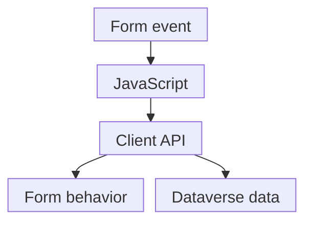

**Prerequisites:** JavaScript foundations, app configuration, and security concepts.

**Planned topics:**

- Web resources, registration, execution context, and form context.
- Form events, attributes, controls, and notifications.
- Supported data APIs, asynchronous behavior, and meaningful errors.
- Navigation, dialogs, commands, and Power Fx where appropriate.
- Script organization, browser testing, and unsupported patterns to avoid.
- **Configuration versus code:** check standard forms, quick views, business rules, and commands before introducing a script.
- **Working/failing examples:** retrieve permitted customer context asynchronously for a request; handle a missing lookup, denied access, or failed request with meaningful feedback.
- **Debugging and tests:** browser breakpoints, asynchronous errors, helper-function tests, form tests, and permission-aware data access.

**Practice goal:** add justified request-form guidance and command behavior using supported APIs.

**Readiness check:** test normal, missing-data, denied-access, and failure cases, and record the expected user feedback. Do not rely on browser code for security or cross-entry-point validation.

### 17 - Plug-ins and server-side logic

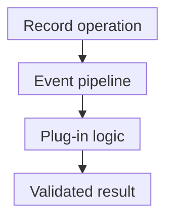

**Prerequisites:** C# foundations, Dataverse modeling, security, and solutions. JavaScript completion is not required.

**Planned topics:**

- Execution pipeline, stages, transactions, and synchronous/asynchronous processing.
- Plug-in creation, registration, filtering attributes, and pre/post images.
- Related data, execution identity, privileges, recursion, and duplicate execution.
- Tracing, exceptions, debugging, automated tests, and performance limits.
- **Configuration versus code:** choose a plug-in only when supported configuration/automation cannot meet the required validation, transaction, or event-processing behavior. Custom business-operation APIs are covered separately in Part 18.
- **Working/failing examples:** allow a resolved request with a resolution summary and reject an invalid resolution through forms, imports, and API operations.
- **Verification:** developer tests, registration checks, execution-identity tests, trace/correlation evidence, and bounded performance. Distinguish synchronous transaction behavior from asynchronous processing.

**Practice goal:** enforce a rule across forms, imports, and API operations.

**Readiness check:** prove consistent valid/invalid behavior through each tested entry point, verify permissions and trace output, and test repeated execution without recursion or duplicate side effects.

### 18 - Custom APIs and business operations

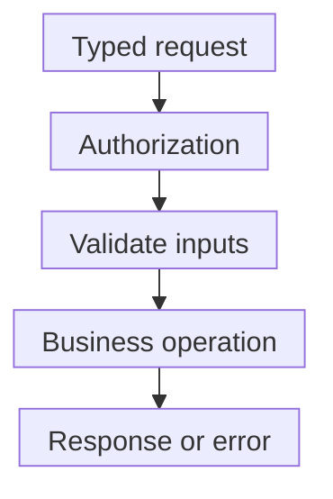

**Prerequisites:** Part 15 C#/HTTP foundations, Part 17 pipeline/registration knowledge for plug-in-backed operations, Part 08 solutions, and Part 11 security.

**Planned topics:**

- **Purpose and choice:** define a reusable business operation instead of duplicating logic across callers; use standard Dataverse operations or supported configuration when they already satisfy the requirement.
- **API contract:** unique names, actions versus functions, typed request parameters, response properties, and global/table/collection bindings.
- **Implementation:** plug-in-backed business logic where needed, validation, execution context, transactions, and allowed extension points. Business-event-only APIs are an advanced variation, not a requirement for this lab.
- **Authorization:** execution privileges, caller identity, row/table permissions, and business-policy checks. Do not treat API visibility as a security boundary.
- **Invocation:** call the operation through an appropriate Web API/SDK client; use an action when the scenario needs invocation from Power Automate.
- **Working/failing examples:** resolve a sample request through a defined action; reject missing input, unauthorized access, and invalid request state.
- **Debugging and tests:** trace the operation, test its contract and repeated calls, and version/package the definition with its solution.

**Practice goal:** define and call a justified Resolve Request operation with an explicit request/response contract and authorization checks.

**Readiness check:** demonstrate valid, missing-input, denied-access, invalid-state, and repeated-call behavior. Verify the stored result rather than treating a returned message as proof of success.

### 19 - Dataverse APIs and external integration

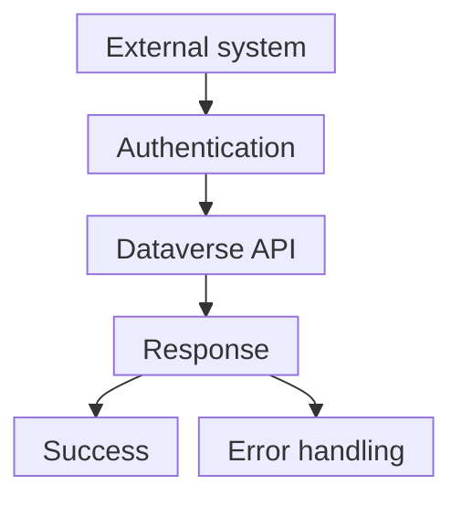

**Prerequisites:** Part 15 HTTP/JSON/authentication foundations, data modeling, and security. Exercises invoking the custom operation built earlier also need Part 18.

**Planned topics:**

- Web API/SDK options, application users, and least-privilege access.
- CRUD, related data, OData, FetchXML, pagination, and batching.
- Concurrency, service-protection limits, retries, and idempotency.
- Custom connectors, webhooks, Azure Functions, and messaging where justified.
- Secret storage, logging, monitoring, and integration tests.
- **Architecture choice:** use supported connectors for straightforward needs; justify direct API calls, webhooks, Azure Functions, or messaging by the requirements.
- **Working/failing examples:** synchronize an approved sample request with an external service; inspect an expired/invalid credential, a rejected operation, and a transient downstream failure.
- **Developer verification:** test request/response mapping, record permissions, pagination, repeat delivery, retry limits, and sanitized diagnostic logs. Full release/deployment testing remains in Stage 4.

**Practice goal:** connect the project to a small external service.

**Readiness check:** test authentication failure, denied access, pagination, repeated delivery, and a transient downstream failure. Verify final data and retry behavior without hardcoded secrets or unexplained duplicate work.

### 20 - PCF components

```mermaid
---
config:
  htmlLabels: false
  flowchart: {nodeSpacing: 12, rankSpacing: 24, padding: 8}
---
flowchart TD
    accTitle: PCF component inputs and outputs
    PROPERTIES["Properties"] --> CONTROL["PCF control"]
    CONTROL --> UI["Render UI"]
    CONTROL --> CHANGE["Notify changes"]
```

**Prerequisites:** Part 15 JavaScript/TypeScript foundations, relevant client/data API knowledge, the project solution, and supported Node.js/npm and Power Platform CLI tooling.

**Planned topics:**

- **Choice:** use standard controls when they suffice; build a PCF component only for a justified reusable UI requirement. Canvas apps and custom pages are covered separately in Part 21.
- PCF manifests, properties, lifecycle, field components, and dataset fundamentals.
- Input/output binding, change notifications, rendering, cleanup, and dataset behavior.
- Local/platform tests, accessibility, and performance.
- Packaging, deployment, and maintenance.
- **Working/failing examples:** a useful request-status component with valid input, missing/invalid input, and an unavailable-data case.
- **Verification:** test component logic, inspect browser diagnostics, validate keyboard behavior and binding, and check the supported host and user permissions.

**Practice goal:** build a justified reusable request component, or document why a standard control is the better choice.

**Readiness check:** verify its purpose, input/output behavior, error feedback, accessibility, performance, and packaging. A PCF build is scenario-dependent, not mandatory when configuration already solves the requirement.

### 21 - Canvas apps and custom pages

```mermaid
---
config:
  htmlLabels: false
  flowchart: {nodeSpacing: 12, rankSpacing: 24, padding: 8}
---
flowchart LR
    accTitle: Choosing an additional app surface
    NEED["User task"] --> CANVAS["Canvas app"]
    NEED --> PAGE["Custom page"]
    CANVAS --> DATA["Permitted data"]
    PAGE --> DATA
```

**Prerequisites:** Parts 08-11, appropriate Power Apps access/connections, a defined user task, and the model-driven app for a custom-page exercise. Introduce Power Fx here; PCF or C# completion is not required.

**Planned topics:**

- **Choice:** standard model-driven pages, a standalone canvas app, or a custom page inside a model-driven app. Prefer existing forms/views when they already support the task.
- **Canvas foundations:** screens, controls, properties, Power Fx formulas, variables, data connections, and data operations.
- **Data and permissions:** Dataverse access, connection identity, delegation/query limits, validation, and meaningful error feedback. Hiding a control does not secure the underlying data.
- **Custom pages:** solution components, navigation parameters, record context, page/dialog/pane experiences, and host limitations.
- **Working/failing examples:** a justified request-triage experience with valid input, missing context, denied access, and a failed data operation.
- **Debugging and tests:** inspect app diagnostics, verify formulas and permissions, test keyboard/mobile behavior, and package the selected app surface. Full release gates remain in Stage 4.

**Practice goal:** build a justified request-triage canvas app or custom page, or explain why the existing model-driven interface should remain.

**Readiness check:** verify navigation/context, data operations, permissions, failure feedback, accessibility, and mobile behavior. Additional UI is scenario-dependent; do not build both surfaces merely to demonstrate the technology.

## Stage 3 completion exercise

Use approved learning environments, synthetic data, and the project solution. Select role-appropriate development modules; application specializations and AI topics are not mandatory prerequisites.

1. Pass the language/tool checkpoints needed by the selected extensions.
2. Record why configuration is insufficient for each proposed code change.
3. Demonstrate a supported client extension where justified, with missing-data and failed-call feedback.
4. Verify selected server-side validation through its intended entry points, including denied/invalid cases and traces.
5. Call a justified custom business operation and test its inputs, authorization, result, and repeated invocation.
6. Demonstrate a reliable integration, including pagination, repeated delivery, and a downstream failure.
7. Select PCF, an additional app surface, or existing configuration based on the business task; verify any chosen extension without requiring every UI technology.
8. Save the developer test results, sanitized diagnostics, component inventory, and configuration-versus-code decisions.

**Completion evidence:** working selected extensions, positive/negative test results, documented permissions and failure behavior, and a justified UI decision. Stage 4 adds full release/deployment validation; do not defer all developer tests until then.

## 4 - Test, Deploy and Design Solutions

Basic requirements and design began earlier in the project. Start this stage with an advanced architecture review before migration and release. Developer tests already belong in Stage 3; this stage adds complete solution acceptance, delivery, and operational evidence.

### 22 - Solution architecture and design

```mermaid
---
config:
  htmlLabels: false
  flowchart: {nodeSpacing: 12, rankSpacing: 24, padding: 8}
---
flowchart TD
    accTitle: Review architecture before delivery
    REQUIREMENTS["Requirements"] --> CHOICES["Design choices"]
    CHOICES --> RISKS["Risks and constraints"]
    RISKS --> REVIEW["Design review"]
```

**Prerequisites:** shared foundations, written business requirements, the project's current design, and the development/integration modules relevant to the chosen solution. Deployment experience is not required before this review.

**Planned topics:**

- **Requirements:** business outcomes, acceptance criteria, user personas, scope, and traceability from needs to components.
- **Architecture:** data, application, automation, integration, reporting, and environment design; reuse standard capabilities before adding code or custom UI.
- **Constraints:** expected volume, performance, scale, platform limits, capacity, licensing, and deployment-specific dependencies.
- **Governance and security:** development/test/production responsibilities, identity, least privilege, DLP, privacy, and data handling.
- **Decision evidence:** configuration-versus-code choices, alternatives, diagrams, assumptions, unresolved risks, and operational ownership.
- **Review example:** assess whether the service-request app needs a plug-in, custom API, integration, or additional UI, and explain the trade-offs rather than using every technology.

**Practice goal:** review and document the project's architecture before data migration and release.

**Readiness check:** connect each component to a business requirement, identify dependencies and risks, explain permission/environment choices, and record measurable acceptance and performance targets.

### 23 - Data migration and data quality

```mermaid
---
config:
  htmlLabels: false
  flowchart: {nodeSpacing: 12, rankSpacing: 24, padding: 8}
---
flowchart TD
    accTitle: Reconcile accepted and rejected migration records
    SOURCE["Source data"] --> MAP["Map and transform"]
    MAP --> IMPORT["Import"]
    IMPORT --> VERIFY["Reconcile"]
    IMPORT --> REJECT["Rejected rows"]
```

**Prerequisites:** Part 22's design review, Parts 09 and 11, approved source data, and an appropriate learning/test target environment.

**Planned topics:**

- **Preparation:** inspect source quality, ownership, duplicates, missing values, status, and permitted data use.
- **Mapping:** transformations, identifiers/keys, choices, lookups, relationship sequencing, and target validation.
- **Execution:** choose appropriate import/migration tools, plan batches and bulk processing, and account for rejected records.
- **Reconciliation:** compare source/target totals, values, relationships, duplicates, and rejected rows; correct causes rather than hiding failures.
- **Cutover planning:** source freeze, load order, validation, business approval, contingencies, and a rehearsed recovery approach.
- **Working/failing examples:** import a small synthetic customer/request dataset, then inspect a broken lookup, invalid value, or duplicate scenario.
- **Safety:** auditing, privacy, retention, and approved cleanup. Do not delete production data or perform destructive bulk changes as an assumed migration step.

**Practice goal:** rehearse a sample migration with mapping, accepted/rejected totals, and a documented cutover checklist.

**Readiness check:** reconcile counts, key values, and relationships; account for every rejected record; test a repeat/recovery scenario and explain the approved cutover decisions.

### 24 - Reporting and analytics

```mermaid
---
config:
  htmlLabels: false
  flowchart: {nodeSpacing: 12, rankSpacing: 24, padding: 8}
---
flowchart TD
    accTitle: Verify reporting accuracy and audience access
    DATA["Validated data"] --> REPORT["Report or dashboard"]
    REPORT --> ACCURACY["Accuracy"]
    REPORT --> ACCESS["Audience access"]
```

**Prerequisites:** data modeling, Part 11 security, agreed reporting questions, and appropriate reporting access. Part 23 is needed when the report uses the migrated training dataset.

**Planned topics:**

- **Operational reporting:** model-driven charts, dashboards, views, and Excel/Word templates where appropriate.
- **Analytics:** Power BI data/semantic-model basics, relationships, measures, refresh, and deployment/access requirements for the selected connection method.
- **Accuracy:** reconcile report totals against validated records; check filters, status definitions, date/time behavior, and refresh freshness.
- **Security:** audience/workspace access and row-level security where applicable. Application restrictions must not be assumed to carry automatically into imported/exported reporting data.
- **Permission tests:** distinguish report consumers from editors/admins. Power BI RLS testing only as a workspace administrator is insufficient.
- **Working/failing examples:** report on open/resolved requests, then inspect an incorrect filter, stale refresh, or unintended audience exposure.

**Practice goal:** build and verify an operational service report/dashboard; add Power BI only with approved access and a justified reporting need.

**Readiness check:** match report results to source data, demonstrate refresh and filters, verify allowed/denied audience access, and document any separate reporting security rules.

### 25 - Testing and quality assurance

```mermaid
---
config:
  htmlLabels: false
  flowchart: {nodeSpacing: 12, rankSpacing: 24, padding: 8}
---
flowchart TD
    accTitle: Evidence-based solution acceptance
    CRITERIA["Acceptance criteria"] --> CASES["Test cases"]
    CASES --> RESULTS["Actual results"]
    RESULTS --> DECISION["Release decision"]
```

**Prerequisites:** the components being tested, approved test personas/data, and measurable acceptance criteria from Part 22.

**Planned topics:**

- **Test planning:** map business requirements to repeatable cases, expected results, datasets, personas, and ownership.
- **Functional coverage:** positive/negative paths, UI, business rules, flows, selected plug-ins/custom APIs, integration, migration, and reporting.
- **Quality checks:** security, regression, end-to-end behavior, performance targets, accessibility, and mobile behavior.
- **User acceptance:** business-user walkthroughs, documented UAT results, defects, retesting, and approval decisions.
- **Evidence:** expected/actual results, sanitized diagnostics, defect reproduction, traceability, and release readiness. Reuse Stage 3 developer tests rather than postponing or duplicating them.
- **Failure cases:** denied access, rejected approvals, missing data, failed connections, repeated events, and a downstream outage.

**Practice goal:** execute and record a solution-level test/UAT pack for the service-request project.

**Readiness check:** pass the defined criteria across relevant personas and entry points, account for unresolved defects, and record an explicit approved or blocked release decision.

### 26 - ALM, deployment, and releases

```mermaid
---
config:
  htmlLabels: false
  flowchart: {nodeSpacing: 12, rankSpacing: 24, padding: 8}
---
flowchart TD
    accTitle: Versioned solution delivery and approval
    DEV["Development"] --> TESTS["Tests"]
    TESTS --> SOLUTION["Solution package"]
    SOLUTION --> TEST["Test environment"]
    TEST --> APPROVAL["Approval"]
    APPROVAL --> RELEASE["Approved release"]
```

**Prerequisites:** Part 08 solutions, Part 11 security, reviewed architecture, Part 25's test evidence, the components being released, and a second approved environment.

**Planned topics:**

- **Lifecycle:** development/test/production responsibilities, component inventory, versioning, source control, solution unpacking, and automated checks.
- **Packaging:** managed solutions, layers, dependencies, upgrades, patches, and the appropriate update strategy.
- **Configuration:** environment variables, connection references, execution identities, permissions, and environment-specific values.
- **Release process:** choose appropriate pipelines/tooling, enforce approval and test gates, validate imports, and perform target-environment smoke tests.
- **Working/failing examples:** deploy a versioned project to an approved test environment; diagnose a missing dependency, connection, or permission instead of reporting success.
- **Recovery:** document contingencies and backup/recovery responsibilities. Do not assume every solution update has a simple rollback or use destructive uninstallation as a default recovery step.
- **Safety:** production releases, billing changes, and destructive operations require separate explicit approval.

**Practice goal:** deploy to another approved environment without manually recreating components or hardcoding environment-specific values.

**Readiness check:** verify package/version, dependencies, identities, permissions, connections, configuration, and end-to-end behavior in the target; retain release approval and an appropriate recovery plan.

### 27 - Operations, monitoring, and support

```mermaid
---
config:
  htmlLabels: false
  flowchart: {nodeSpacing: 12, rankSpacing: 24, padding: 8}
---
flowchart TD
    accTitle: Diagnose and recover with approved operational procedures
    MONITOR["Monitor"] --> ALERT["Detect failure"]
    ALERT --> DIAGNOSE["Diagnose"]
    DIAGNOSE --> RECOVER["Approved recovery"]
    RECOVER --> VERIFY["Verify and document"]
```

**Prerequisites:** knowledge of the deployed components, Part 26 delivery evidence, approved diagnostic access, and identified support/admin owners. Actual backup/restore exercises additionally need an eligible approved environment and authorized administrator participation.

**Planned topics:**

- **Monitoring:** flow history, plug-in traces, integration logs, app diagnostics, alerts, and correlation across the selected components.
- **Incident handling:** reproduce symptoms, distinguish permissions/configuration/data failures, collect sanitized evidence, escalate, and communicate service impact.
- **Operational governance:** capacity, service limits, connection/identity maintenance, licensing, auditing, retention, and appropriate access.
- **Recovery planning:** backup/restore responsibilities, environment-type limitations, approvals, and validation after recovery. Do not assume every trial/learning environment supports the same backup features.
- **Recovery objectives:** RTO is the acceptable recovery time; RPO is the acceptable data-loss window. Define realistic targets and owners rather than promising automatic recovery.
- **Working/failing examples:** diagnose a failed flow or integration in the approved test environment and follow a documented runbook or recovery rehearsal.
- **Support ownership:** incident procedures, known limitations, routine maintenance, and tested handoff to the responsible team.

**Practice goal:** prepare a support runbook and rehearse diagnosis/recovery for a controlled sample failure.

**Readiness check:** locate useful diagnostics, explain the failure, record authorized recovery and verification steps, and identify owners, escalation, and backup limitations. Do not perform unapproved production restores.

### 28 - Capstone, documentation, and handover

```mermaid
---
config:
  htmlLabels: false
  flowchart: {nodeSpacing: 12, rankSpacing: 24, padding: 8}
---
flowchart TD
    accTitle: Demonstrate, verify, explain, and hand over the project
    DEMO["Demonstrate"] --> EVIDENCE["Verify evidence"]
    EVIDENCE --> EXPLAIN["Defend choices"]
    EXPLAIN --> HANDOVER["Handover"]
```

**Prerequisites:** the relevant core modules, Parts 22-27 delivery evidence, and a defined capstone scope. Optional application/AI branches and every UI technology are not mandatory.

**Planned topics:**

- **Demonstration:** complete the customer/request lifecycle with the selected configuration, automation, code, integration, and reporting.
- **Acceptance evidence:** migration reconciliation, allowed/denied access, success/rejection/failure paths, repeated processing, test/UAT results, and approved target-environment delivery.
- **Design explanation:** requirements, diagrams, trade-offs, component dependencies, and why each customization is necessary.
- **Documentation:** user guidance, technical setup, release/configuration notes, test evidence, known limitations, and sanitized operational instructions.
- **Handover:** support ownership, monitoring/runbooks, recovery responsibilities, training, and an agreed improvement backlog.

**Practice goal:** complete and defend the shared project, then hand over a usable documentation and support pack.

**Readiness check:** demonstrate the business workflow, verify the recorded evidence, explain design choices, and show that another authorized person can operate and support the solution without relying on undocumented knowledge.

## Stage 4 completion exercise

Use approved environments and synthetic data. Real production releases, destructive migration changes, and restores require separate approval.

1. Review architecture and connect each component to a requirement and owner.
2. Reconcile a rehearsed migration, including rejected records and relationships.
3. Verify reporting accuracy, refresh, and audience/row access.
4. Complete solution tests and UAT, with expected/actual results and defect decisions.
5. Deploy a versioned solution to an approved target and validate configuration, permissions, and end-to-end behavior.
6. Rehearse a controlled incident and document authorized recovery, escalation, and limitations.
7. Demonstrate the capstone and hand over user, technical, release, and operational documentation.

**Completion evidence:** a reviewed design, reconciled data, validated reports, test/UAT decisions, target-environment release evidence, and a usable handover/runbook. Completion means build, verify, explain, and maintain, not simply finish reading.

## Application specializations

These are **six planned independent branches**, not required gates for the developer sequence. Customer Insights groups Data and Journeys as child modules. Membership in the Dynamics 365 family does not mean every application is included in one license or environment; each lab requires its relevant installed/provisioned application, entitlements, and approved permissions.

### Dynamics 365 Sales

```mermaid
---
config:
  htmlLabels: false
  flowchart: {nodeSpacing: 12, rankSpacing: 24, padding: 8}
---
flowchart TD
    accTitle: Sales customer and commercial lifecycle
    LEAD["Lead"] --> OPPORTUNITY["Opportunity"]
    OPPORTUNITY --> QUOTE["Quote"]
    QUOTE --> ORDER["Order"]
    ORDER --> INVOICE["Invoice"]
```

**Prerequisites:** Parts 08-11, the installed Sales application, appropriate entitlements, and approved test users.

**Planned topics:**

- Accounts, contacts, activities, leads, qualification, opportunities, and sales stages.
- Products, units, price lists, quotes, orders, and invoices.
- Sales-process configuration, security, views, dashboards, and available forecasting.
- Extend standard application components through the project solution rather than recreating Sales.

**Practice goal:** complete and explain a lead-to-sale scenario using synthetic customers.

**Readiness check:** verify customer/opportunity relationships, commercial records, stage transitions, and permitted user actions.

### Dynamics 365 Customer Service

```mermaid
---
config:
  htmlLabels: false
  flowchart: {nodeSpacing: 12, rankSpacing: 24, padding: 8}
---
flowchart TD
    accTitle: Customer Service case lifecycle
    CASE["Case"] --> QUEUE["Queue and assignment"]
    QUEUE --> WORK["Investigate"]
    WORK --> KNOWLEDGE["Knowledge"]
    KNOWLEDGE --> RESOLVE["Resolve"]
```

**Prerequisites:** Parts 08-11, the installed Customer Service application, appropriate entitlements, and approved agent/manager personas.

**Planned topics:**

- Cases, interactions, queues, assignment, routing fundamentals, and resolution.
- Knowledge, SLAs, entitlements, agent experiences, and service reporting.
- Security and supported application configuration/customization.
- Keep case/service management here; use the Contact Center branch for channel, conversation, and contact-center operations. Reuse shared routing concepts rather than duplicating them.

**Practice goal:** receive, route, work, and resolve a sample case.

**Readiness check:** verify ownership, queue behavior, case transitions, access, and the configured service conditions.

### Dynamics 365 Field Service

```mermaid
---
config:
  htmlLabels: false
  flowchart: {nodeSpacing: 12, rankSpacing: 24, padding: 8}
---
flowchart TD
    accTitle: Field Service work execution
    WORK["Work order"] --> RESOURCE["Resource"]
    RESOURCE --> BOOK["Booking"]
    BOOK --> MOBILE["Mobile execution"]
    MOBILE --> COMPLETE["Complete"]
```

**Prerequisites:** Parts 08-11, the installed Field Service application, appropriate entitlements, and approved dispatcher/technician access.

**Planned topics:**

- Work orders, customer assets, incident types, and service tasks.
- Resources, scheduling, bookings, inspections, and mobile work.
- Agreements, recurring service, and relevant inventory/purchasing concepts.
- Security, mobile access, dependencies, and supported customization.

**Practice goal:** create, schedule, execute, and complete a sample work order.

**Readiness check:** verify its lifecycle, asset/resource/booking relationships, and required execution information.

### Dynamics 365 Customer Insights

```mermaid
---
config:
  htmlLabels: false
  flowchart: {nodeSpacing: 12, rankSpacing: 24, padding: 8}
---
flowchart TD
    accTitle: Customer Insights Data and Journeys modules
    INSIGHTS["Customer Insights"] --> DATA["Data"]
    INSIGHTS --> JOURNEYS["Journeys"]
    DATA --> PROFILES["Unified profiles"]
    PROFILES --> MEASURES["Measures and segments"]
    JOURNEYS --> CONSENT["Consent and audiences"]
    CONSENT --> ENGAGE["Triggered engagement"]
```

**Prerequisites:** Parts 08-11, provisioned Customer Insights applications/environments, appropriate entitlements, and approved data connections. Data is a customer data platform, not simply another Dataverse table-configuration lesson.

**Planned topics:**

#### Customer Insights - Data

- Data ingestion, source mapping, matching, unification, and customer profiles.
- Relationships, measures, segments, enrichment, refreshes, and downstream use.
- Data quality, privacy, consent considerations, access, and connector limitations.

#### Customer Insights - Journeys

- Audiences, segments, consent, marketing forms, and message content.
- Real-time journeys, triggers, personalization, test audiences, and performance.
- Connections to customer data and sales processes without assuming every feature is available.

**Practice goal:** unify two small synthetic datasets in Data, then test an appropriate audience and journey in Journeys. Use approved test recipients only.

**Readiness check:** reconcile unified profiles, explain match decisions, verify segment membership and consent exclusions, and inspect a test journey's results without contacting real customers.

### Dynamics 365 Contact Center

```mermaid
---
config:
  htmlLabels: false
  flowchart: {nodeSpacing: 12, rankSpacing: 24, padding: 8}
---
flowchart TD
    accTitle: Contact Center conversation routing
    CHANNEL["Voice or digital channel"] --> ROUTE["Unified routing"]
    ROUTE --> AGENT["Agent experience"]
    AGENT --> CRM["CRM context"]
    AGENT --> REPORT["Operational insights"]
```

**Prerequisites:** Parts 08-11, provisioned Contact Center capabilities, appropriate entitlements, approved agent access, and a safe test channel. Review Customer Service concepts if that is the connected CRM.

**Planned topics:**

- Voice/digital channels, conversations, workstreams, queues, and unified routing.
- Agent experiences, CRM context, self-service, and available AI assistance.
- Supervisor operations, operational reporting, recording/privacy considerations, and access.
- Distinguish channel/conversation operations from Customer Service case management; Contact Center can connect to a chosen CRM.

**Practice goal:** route an approved test conversation to an agent and inspect its CRM context.

**Readiness check:** verify routing, agent access, conversation context, and operational results. Do not provision chargeable telephony resources or contact live customers without approval.

### Dynamics 365 Project Operations

```mermaid
---
config:
  htmlLabels: false
  flowchart: {nodeSpacing: 12, rankSpacing: 24, padding: 8}
---
flowchart TD
    accTitle: Project Operations delivery and financial concepts
    SALES["Project sales"] --> CONTRACT["Contract"]
    CONTRACT --> PLAN["Plan and resources"]
    PLAN --> TIME["Time and expenses"]
    TIME --> BILL["Billing concepts"]
```

**Prerequisites:** Parts 08-11, an approved Project Operations deployment, appropriate entitlements, and project/resource personas. Integrated finance exercises additionally require the relevant ERP knowledge and environment.

**Planned topics:**

- Project opportunities, quotes, contracts, planning, tasks, and resource assignments.
- Time, expenses, pricing/costing, billing concepts, and project performance.
- Security, approvals, supported customization, and deployment-specific capabilities.
- Treat this as an advanced CRM-to-finance bridge, not proof that every learner needs Finance or every deployment includes integrated financial operations.

**Practice goal:** plan a synthetic customer project, assign a resource, and inspect sample time/cost and billing information in the selected deployment.

**Readiness check:** explain contract/project/resource relationships and which financial features are available. Do not post real financial transactions.

## Copilot and AI agents

These are **optional learning topics**, not extra numbered core parts. Start with application-specific Copilot experiences, then learn agent creation and the controls around execution. The harness topic distinguishes the three currently documented Copilot Studio runtime choices from the Copilot products/experiences that use them; it is not a separate Dynamics 365 application or a full SDK course.

### Dynamics 365 Copilot

```mermaid
---
config:
  htmlLabels: false
  flowchart: {nodeSpacing: 12, rankSpacing: 24, padding: 8}
---
flowchart TD
    accTitle: Review grounded Copilot assistance
    CONTEXT["Permitted business data"] --> COPILOT["Copilot assistance"]
    COPILOT --> DRAFT["Summary or draft"]
    DRAFT --> REVIEW["Human review"]
    REVIEW --> WORK["Approved business work"]
```

**Prerequisites:** platform/security foundations, the relevant application branch, approved Copilot availability/settings, and synthetic business data.

**Planned topics:**

- Built-in Copilot assistance, application-specific AI agents, and the difference from building an agent in Copilot Studio.
- Available summaries, drafting, knowledge assistance, and guided actions; check app, release, region, language, and licensing requirements before promising features.
- Grounding, permitted data, privacy, human review, hallucinations, and limitations.
- Administration, enablement, responsible use, and evaluating a useful business outcome.

**Practice goal:** review one available summary or draft against the approved sample record and correct unsupported statements.

**Readiness check:** explain the source data, permissions, limitations, and human approval boundary. AI-generated text is not proof that a business action succeeded.

### Copilot Studio

```mermaid
---
config:
  htmlLabels: false
  flowchart: {nodeSpacing: 12, rankSpacing: 24, padding: 8}
---
flowchart TD
    accTitle: Build and validate a connected agent
    AGENT["Agent instructions"] --> KNOWLEDGE["Approved knowledge"]
    AGENT --> TOOLS["Authorized tools"]
    KNOWLEDGE --> TEST["Test and evaluate"]
    TOOLS --> TEST
    TEST --> PUBLISH["Approved channel"]
```

**Prerequisites:** Parts 08-11, appropriate Copilot Studio access, approved knowledge sources/connections, and a defined business scenario.

**Planned topics:**

- Agent instructions, topics, knowledge, generative orchestration, and channel selection.
- Tools, connectors, agent flows, Dataverse operations, and authentication/authorization.
- Agent testing/evaluation, safe fallback, human handoff, analytics, and solution-aware delivery.
- Reuse the existing [Copilot Studio Guide](#/learn/copilot-studio) for full lessons rather than duplicating that course in this roadmap.

**Practice goal:** build a read-first service-request assistant with approved knowledge and one permission-checked tool.

**Readiness check:** demonstrate an answered question, unavailable knowledge, denied access, and a failed tool call before publishing to an approved test channel.

### AI agent harness

```mermaid
---
config:
  htmlLabels: false
  flowchart: {nodeSpacing: 12, rankSpacing: 24, padding: 8}
---
flowchart TD
    accTitle: Copilot experience, harness, model, and authorized tools
    EXPERIENCE["Copilot experience"] --> HARNESS["Agent harness"]
    HARNESS --> MODEL["AI model"]
    HARNESS --> TOOLS["Authorized tools"]
```

**Prerequisites:** Copilot Studio fundamentals or an approved equivalent agent platform, security concepts, and the automation/integration knowledge needed for the selected tools.

**Planned topics:**

- **Meaning:** a harness is the runtime/orchestration layer around an agent/model. It manages instructions, context, tools, identity, execution state, and controls; it is not the AI model or the user-facing Copilot app.
- **Tools and permissions:** input/output contracts, connection identity, user authorization, least privilege, and validation outside the model.
- **Orchestration:** tool selection, conversation context, grounded knowledge, state/memory boundaries, handoff, and limits on steps/time/cost.
- **Approvals and safety:** enforce confirmation for consequential writes, separate retrieved content from trusted instructions, redact sensitive logs, and stop explicitly on denied or failed actions.
- **Reliability:** timeouts, retries where safe, duplicate/loop prevention, correlation IDs, and traces that distinguish proposed actions from completed operations.
- **Evaluation and monitoring:** expected-result cases, denied-access tests, misleading/untrusted content, approval rejection, tool failures, and human escalation.

#### Documented Copilot Studio harness choices

- **Standard harness:** structured topics, rule-based agents, and repeatable agent flows; suitable for well-defined requests with explicit paths.
- **Microsoft Copilot harness:** longer reasoning-heavy work, multiple tools, files, skills/memory, and coordinated tasks; justify the extra scale and operating cost for the scenario.
- **Customer Conversation harness:** voice/chat customer interactions, service conversations, and escalation to human representatives.
- **No invented fourth type:** the [current harness overview](https://learn.microsoft.com/en-us/microsoft-copilot-studio/harnesses-overview) lists these three. Availability, channels, features, and billing must be checked against the selected environment and current release.

#### Copilot experiences are not harness types

| Experience | What the learner should distinguish |
|---|---|
| Microsoft Copilot | General assistance; personal and organizational sign-in experiences have different grounding, protections, and capabilities |
| Microsoft 365 Copilot | Assistance in Microsoft 365 with permitted work context, according to access, configuration, and licensing |
| GitHub Copilot | Developer assistance in IDEs, CLI, and GitHub workflows; the authoring assistant is not automatically the runtime of the agent being built |
| Copilot Studio | The platform for authoring, configuring, testing, and publishing business agents using supported runtime options |

#### Naming, scenarios, and operating boundaries

- **Naming transition:** Microsoft [announced the shared Microsoft Copilot harness](https://aka.ms/copilot-harness/announce), built from GitHub's harness. Older GitHub harness/SDK names can appear during the transition; do not count the shared engine twice or label Microsoft 365 Copilot as a separate Studio harness choice.
- **Scenario comparison:** consider Standard for a bounded help-desk request, Customer Conversation for customer voice/chat with handoff, and Microsoft Copilot for a longer multi-tool document/process task. Validate the actual required features before selecting one.
- **Identity and approval:** check the runtime's connection/user authorization and enforce consequential-write approvals outside model-generated suggestions. A product name does not prove permissions or sandbox isolation.
- **Availability and billing:** verify provisioned experiences, channels, regions, entitlements, Copilot Credits/usage rules, time/cost limits, and administrator approvals before a lab.

**Practice goal:** compare the three documented harness choices for a service scenario, then trace an approved assistant from an authorized read through a proposed update, enforced approval, tool execution, and verified result.

**Readiness check:** distinguish experience, harness, model, and tools; justify the selected documented runtime; verify access/billing prerequisites; and prove that denied access/rejected approval prevents writes, failed tools report failure, and repeated requests do not duplicate work.

## Further tracks and extensions

Finance, Supply Chain Management, Commerce, Human Resources, and Business Central belong in separate business-operations/ERP learning paths. Their development models, environments, and prerequisites are not interchangeable with this CRM path.

Later extensions can cover Power Pages, advanced application features, enterprise integration, and modernization. Define their scope and prerequisites separately rather than adding mandatory core stages.

## Before hands-on learning

- **Account and environment:** a work/school account and an approved Dataverse learning environment.
- **Permissions:** appropriate maker/customizer access; administrator help only when necessary.
- **Application access:** Dynamics-specific labs need the relevant installed product and entitlements. A Power Apps developer environment does not provide installable Dynamics 365 apps.
- **Security testing:** approved agent/manager personas with appropriate access.
- **Tools introduced when needed:** VS Code, Git, browser developer tools, supported C#/.NET tooling, Power Platform CLI, Node.js/npm, and an API-testing client.
- **Additional resources:** a second environment for deployment; reporting/Azure access only for the exercises that require it.
- **Optional branches:** verify Customer Insights, Contact Center, Project Operations, and Copilot/Copilot Studio provisioning, entitlements, approved connections, and any additional capacity before their labs.
- **Safe operation:** synthetic data, no shared passwords/authentication codes, documented changes, and explicit approval for production, billing, or destructive operations.

Environment creation and licensing rules change. Check the [current Developer Plan guidance](https://learn.microsoft.com/en-us/power-platform/developer/plan) rather than assuming a free, automatically created environment includes every required capability.

## The project and final milestone

Build a **Customer Onboarding and Service-Request App** throughout the core path:

1. Requirements, publisher, and solution.
2. Customer/contact relationships and request data model.
3. Forms, views, navigation, and dashboard.
4. Agent/manager security, business rules, guided process stages, and assignment/approval automation.
5. Justified client/server extensions, a reusable business operation, and a scenario-appropriate UI choice.
6. Reviewed architecture, reliable integration, rehearsed migration, and validated reporting.
7. Solution tests/UAT and approved target-environment deployment evidence.
8. Capstone demonstration, recovery/support runbooks, and user/technical/operational handover.

This custom app teaches the platform; it does not replace licensed Dynamics 365 application capabilities. The optional application branches use their standard applications, and AI extensions remain separately scoped and approved.

**Completion means build, verify, explain, and maintain** - not simply finish reading. Individual lessons will include exact steps, expected results, positive/negative tests, troubleshooting, and cleanup when they are published.

## Official starting references

- [Dynamics 365 developer resources](https://learn.microsoft.com/en-us/dynamics365/get-started/developers)
- [Dynamics 365 documentation](https://learn.microsoft.com/en-us/dynamics365/)
- [Model-driven app learning](https://learn.microsoft.com/en-us/training/paths/create-app-models-business-processes/)
- [Power Platform developer training](https://learn.microsoft.com/en-us/training/courses/pl-400t00)
- [Power Apps Developer Plan](https://learn.microsoft.com/en-us/power-platform/developer/plan)
- [Power Apps: model-driven and canvas app types](https://learn.microsoft.com/en-us/power-apps/powerapps-overview)
- [Power Pages overview](https://learn.microsoft.com/en-us/power-pages/introduction)
- [Dataverse custom APIs](https://learn.microsoft.com/en-us/power-apps/developer/data-platform/custom-api)
- [Custom pages in model-driven apps](https://learn.microsoft.com/en-us/power-apps/maker/model-driven-apps/model-app-page-overview)
- [Power BI row-level security](https://learn.microsoft.com/en-us/fabric/security/service-admin-row-level-security)
- [Power Platform backup and restore](https://learn.microsoft.com/en-us/power-platform/admin/backup-restore-environments)
- [Customer Insights: Data and Journeys](https://learn.microsoft.com/en-us/dynamics365/customer-insights/overview)
- [Contact Center overview](https://learn.microsoft.com/en-us/dynamics365/contact-center/implement/overview-contact-center)
- [Project Operations documentation](https://learn.microsoft.com/en-us/dynamics365/project-operations/)
- [Agents, Copilot, and AI in Dynamics 365](https://learn.microsoft.com/en-us/dynamics365/copilot/ai-get-started)
- [Copilot Studio overview](https://learn.microsoft.com/en-us/microsoft-copilot-studio/fundamentals-what-is-copilot-studio)
- [Copilot Studio harness overview](https://learn.microsoft.com/en-us/microsoft-copilot-studio/harnesses-overview)
- [Choosing a Copilot Studio harness](https://learn.microsoft.com/en-us/microsoft-copilot-studio/guidance/choose-harness)
- [Shared Microsoft Copilot harness announcement](https://aka.ms/copilot-harness/announce)
