## Roadmap

Start with how a business uses CRM. Learn to configure a secure application before writing code, then progress to development, integration, architecture review, and verified delivery.

**This first path covers Dynamics 365 CRM/customer-engagement apps, Dataverse, and Power Platform.** Finance, Supply Chain Management, Commerce, Human Resources, and Business Central will need separate paths. All lesson topics and practice goals below are planned; this page is the roadmap, not the finished course.

All 28 core parts stay visible below the overview, grouped by stage. Choose a numbered diagram box to jump to that part, or read straight through. Each part and stage completion exercise has a **Back to roadmap** link that preserves the current zoom.

The nine optional application and AI topics remain click-to-show below the diagram. Select the same optional topic again, use **Close**, or press **Escape** in its details to collapse it.

The main diagram starts with Stage 1 centered. Use **Zoom in** or **Zoom out** to resize it; **Reset view** restores 100% and centers Stage 1 again. Scroll inside the diagram to explore other branches. The controls do not resize the focused diagrams below.

The roadmap keeps the original top-to-bottom diagram style. First understand the platform, then configure and automate, develop and integrate, and finally test and deliver a solution. Build the shared Customer Onboarding and Service-Request App as you learn, and prove each milestone rather than simply finishing the reading.

The optional application and AI groups sit side by side to the right of the main learning path. Cards stay vertical inside each group to keep the diagram compact. Dashed arrows branch from the same configuration foundation; their placement does not make the application tracks prerequisites for AI learning.

```mermaid
---
config:
  flowchart: {nodeSpacing: 20, rankSpacing: 30, curve: stepBefore}
---
flowchart TD
    accTitle: Microsoft Dynamics 365 beginner-to-advanced roadmap
    accDescr: Four learning stages each contain seven always-visible parts, giving twenty-eight core parts below this diagram. Stage one includes Types of Apps: model-driven, canvas, and Power Pages websites. Select a numbered box to jump to its part. Six application branches and three AI topics remain optional and open one topic at a time.

    subgraph CORE_PATH[" "]
        direction TB
        subgraph FOUNDATION["Stage 1 - Understand CRM and the Platform"]
            direction LR
            B01["01 - What is CRM?"]
            B02["02 - Dynamics 365<br/>and Power Platform"]
            BAPP03["03 - Types of apps"]
            B03["04 - Accounts<br/>and environments"]
            B04["05 - What is Dataverse?"]
            B05["06 - Data components"]
            B06["07 - Application components"]
            B01 --> B02 --> BAPP03 --> B03 --> B04 --> B05 --> B06
        end
        subgraph CONFIGURATION["Stage 2 - Configure, Secure and Automate"]
            direction LR
            C["08 - Solutions and<br/>customization foundations"]
            D["09 - Dataverse<br/>data modeling"]
            E["10 - Model-driven<br/>application configuration"]
            F["11 - Security<br/>and administration"]
            G["12 - Business rules<br/>and validation"]
            P["13 - Business<br/>process flows"]
            Q["14 - Power Automate<br/>cloud flows"]
            C --> D --> E --> F --> G --> P --> Q
        end
        subgraph DEVELOPMENT["Stage 3 - Develop and Integrate"]
            direction LR
            H["15 - Programming<br/>foundations"]
            I["16 - Client-side<br/>customization"]
            J["17 - Plug-ins and<br/>server-side logic"]
            R["18 - Custom APIs and<br/>business operations"]
            K["19 - Dataverse APIs and<br/>external integration"]
            L["20 - PCF<br/>components"]
            S["21 - Canvas apps<br/>and custom pages"]
            H --> I --> J --> R --> K --> L --> S
        end
        subgraph DELIVERY["Stage 4 - Test, Deploy and Design Solutions"]
            direction LR
            M["22 - Solution architecture<br/>and design"]
            U["23 - Data migration<br/>and quality"]
            V["24 - Reporting<br/>and analytics"]
            N["25 - Testing<br/>and quality assurance"]
            W["26 - ALM, deployment<br/>and releases"]
            X["27 - Operations<br/>and support"]
            O["28 - Capstone<br/>and handover"]
            M --> U --> V --> N --> W --> X --> O
        end
        FOUNDATION --> CONFIGURATION
        CONFIGURATION --> DEVELOPMENT
        DEVELOPMENT --> DELIVERY
    end
    subgraph OPTIONAL_PATH[" "]
        direction TB
        OPTIONAL_BRANCH(["Optional learning"])
        subgraph SPECIALIZATIONS["Application specializations<br/>- separate branches"]
            direction TB
            SALES["Dynamics 365 Sales"]
            SERVICE["Dynamics 365<br/>Customer Service"]
            FIELD["Dynamics 365<br/>Field Service"]
            INSIGHTS["Dynamics 365<br/>Customer Insights"]
            CONTACT["Dynamics 365<br/>Contact Center"]
            PROJECT["Dynamics 365<br/>Project Operations"]
            %% Layout only: these application tracks are independent.
            SALES ~~~ SERVICE ~~~ FIELD ~~~ INSIGHTS ~~~ CONTACT ~~~ PROJECT
        end
        subgraph AI_LEARNING["Copilot and AI agents<br/>- optional branch"]
            direction TB
            COPILOT["Dynamics 365 Copilot"]
            STUDIO["Copilot Studio"]
            HARNESS["AI agent harness"]
            %% Layout only: the prerequisite notes define the learning dependencies.
            COPILOT ~~~ STUDIO ~~~ HARNESS
        end
        OPTIONAL_BRANCH -. Application track .-> SPECIALIZATIONS
        OPTIONAL_BRANCH -. AI learning .-> AI_LEARNING
    end

    CONFIGURATION OPTIONAL_ROUTE@-.-> OPTIONAL_BRANCH
    OPTIONAL_ROUTE@{ curve: stepAfter }

    classDef foundation fill:#E8F1FF,stroke:#2563EB,color:#172554;
    classDef configuration fill:#E0F2F1,stroke:#0F766E,color:#134E4A;
    classDef development fill:#EDE9FE,stroke:#7C3AED,color:#4C1D95;
    classDef delivery fill:#FEF3C7,stroke:#B45309,color:#78350F;
    classDef optional fill:#F3F4F6,stroke:#64748B,color:#1F2937;
    class B01,B02,BAPP03,B03,B04,B05,B06 foundation;
    class C,D,E,F,G,P,Q configuration;
    class H,I,J,R,K,L,S development;
    class M,U,V,N,W,X,O delivery;
    class SALES,SERVICE,FIELD,INSIGHTS,CONTACT,PROJECT,COPILOT,STUDIO,HARNESS,OPTIONAL_BRANCH optional;
    style FOUNDATION fill:#F8FAFC,stroke:#94A3B8,color:#0F172A
    style CONFIGURATION fill:#F0FDFA,stroke:#5EEAD4,color:#134E4A
    style DEVELOPMENT fill:#FAF5FF,stroke:#C4B5FD,color:#4C1D95
    style DELIVERY fill:#FFFBEB,stroke:#FCD34D,color:#78350F
    style SPECIALIZATIONS fill:#F8FAFC,stroke:#94A3B8,color:#0F172A
    style AI_LEARNING fill:#F8FAFC,stroke:#94A3B8,color:#0F172A
    %% Transparent containers control placement; they are not extra learning stages.
    style CORE_PATH fill:none,stroke:none
    style OPTIONAL_PATH fill:none,stroke:none
```

Select a numbered box to jump to an always-visible core part, or an optional box to show its details. On narrower screens, scroll the diagram sideways. Optional branches are separate from the 28 core parts and are not mandatory gates before development; each topic's prerequisites define the actual dependencies.

## 1 - Understand CRM and the Platform

Understand the customer lifecycle, platform responsibilities, app/site types, and the difference between data and application components. Finish by inspecting an approved sample application and explaining what you observe, without making configuration changes.

### 01 - What is CRM?

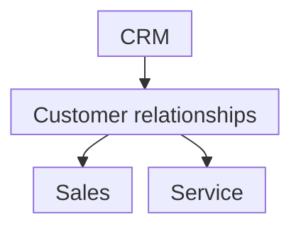

**Prerequisites:** basic computer skills. No Dynamics or programming experience is assumed.

**Planned topics:**

- CRM means Customer Relationship Management: its purpose and the customer lifecycle of enquiry, sale, onboarding, and support.
- Customers, organizations, contacts, communication history, sales opportunities, and support requests.
- Why businesses need shared information instead of disconnected spreadsheets.
- Sales, service, and manager responsibilities.
- **Business example:** Contoso Ltd enquires about a product, buys it, and later requests support. Sales and service employees need one shared customer history.
- **Follow the lifecycle:** record the enquiry, track the potential sale, keep onboarding information, then connect support requests to the same customer and contact.
- **Understanding check:** explain what would go wrong if each employee kept a separate spreadsheet or lost the previous conversation.

**Practice goal:** describe a simple customer-management scenario.

**Readiness check:** explain the business problem and customer lifecycle without relying on technical terminology.

### 02 - Dynamics 365 and Power Platform

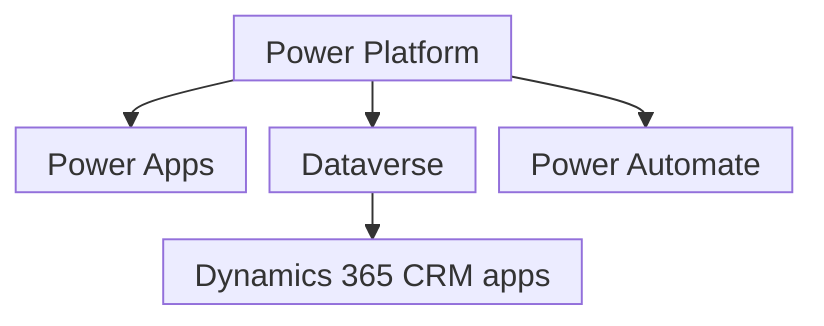

**Prerequisites:** Part 01.

**Planned topics:**

- Dynamics 365 as a family of business applications.
- Sales, Customer Service, and Field Service; CRM versus ERP scope.
- Power Apps, Power Automate, Power BI, and Power Pages.
- How Dynamics 365 CRM apps, Dataverse, and model-driven apps relate.
- Standard functionality versus configuration, customization, and development.
- Identify the app/interface layer; compare model-driven, canvas, and Power Pages experiences in Part 03.
- **Responsibilities example:** Dynamics 365 Sales supplies a sales process; Dataverse stores and secures the business data; a model-driven app presents forms and views; Power Automate can assign work or notify users.
- **What each component is not:** Dataverse is not the form, a view is not a separate database, and Power Automate is not the application's user interface.
- **Understanding check:** match "store a customer", "edit a request", "send an approval", and "analyse service performance" to the appropriate platform component.

**Practice goal:** identify the platform component that solves each business need.

**Readiness check:** distinguish the business application, data platform, user interface, and automation tools.

### 03 - Types of Apps

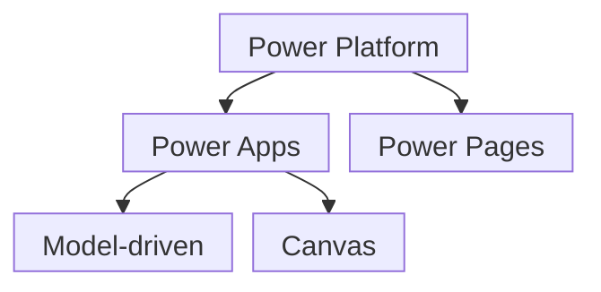

**Prerequisites:** Parts 01-02. No app creation, programming, or environment changes are required for this comparison.

**Planned topics:**

- **Model-driven apps:** start with Dataverse data and processes; configure forms, views, navigation, and business behavior. Dynamics 365 CRM apps use this model.
- **Canvas apps:** design screens and controls for a task, use Power Fx, and connect to Dataverse or other supported data sources. A canvas app does not have to use Dataverse.
- **Power Pages:** build business websites for browser-based audiences, including external users, with Dataverse integration and separate site authentication/authorization.
- **Correct terminology:** Power Apps has two app types, model-driven and canvas. Power Pages is a separate Power Platform website product, not a third Power Apps app type.
- **Business examples:** a service agent manages requests in a model-driven app; a technician uses a focused canvas screen; a customer uses an approved Power Pages website to submit or view a request.
- **Choosing an experience:** compare audience, task, data, layout, access, and licensing. Several experiences can use related business data without sharing identical permissions.
- **Security awareness:** app sharing, Dataverse roles, connection identity, and Power Pages web roles/table permissions are different controls. Hiding a field or page does not grant or deny underlying data access.

**Practice goal:** match three sample business tasks to a model-driven app, canvas app, or Power Pages website and explain the choice.

**Readiness check:** distinguish the two Power Apps app types from Power Pages, identify the intended audience, and explain where permissions must be checked. Do not build every app/site to pass this introductory part.

### 04 - Accounts and environments

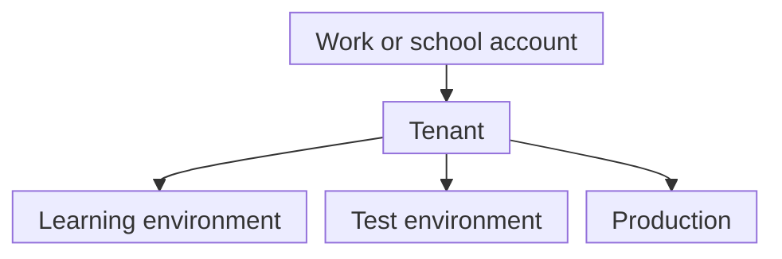

**Prerequisites:** Parts 01-02 and an approved access arrangement.

**Planned topics:**

- Work/school accounts, tenants, environments, and applications.
- Learning, development, test, and production purposes.
- Environment selection and checking where changes will happen.
- Licensing versus permissions; installed application availability.
- Maker, customizer, administrator, and ordinary user responsibilities.
- Maker/admin portals and access troubleshooting.
- **Access checklist:**
  - Confirm the work/school account and correct tenant.
  - Record the learning environment's name and purpose; check that it is not production.
  - Confirm Dataverse and the required application are available.
  - Check both licensing and permissions; neither automatically supplies the other.
  - Identify which actions are allowed and which require administrator assistance.
  - Stop and request help for missing access instead of granting blanket administrator rights.
- **Example:** a user may be able to sign in and open an app but still lack permission to create a table or read another owner's records.

**Practice goal:** identify the approved learning environment and open an available application.

**Readiness check:** confirm the environment's purpose and required access; never assume licensing grants every permission.

### 05 - What is Dataverse?

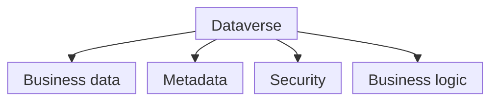

**Prerequisites:** Parts 01-04.

**Planned topics:**

- Dataverse as a managed platform for business data, metadata, relationships, security, and logic.
- Business data versus metadata.
- How applications and automation use shared data.
- Dataverse versus an app, spreadsheet, or solution.
- Standard/custom tables, ownership, auditing, and APIs at an introductory level.
- Older terminology: entity/table and attribute/column.
- **Data example:** a service-request record contains a customer reference, a title, and a current priority such as High.
- **Metadata example:** the Service Request table definition, its column types, the allowed Priority choices, and its relationship to a customer describe the structure rather than one customer's values.
- **Component comparison:** forms display records, apps organize the working experience, and solutions primarily package configuration. A solution is not a general backup of customer records.
- **Understanding check:** classify a request's current priority as data, and the permitted priority choices as metadata.

**Practice goal:** connect a business requirement to the data and services Dataverse provides.

**Readiness check:** explain where data lives and why a form, app, and solution are not the database.

### 06 - Data components

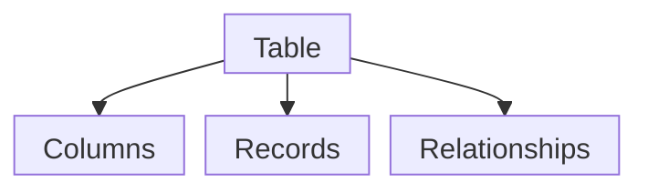

**Prerequisites:** Part 05.

**Planned topics:**

- **Tables:** structured kinds of information; standard versus custom tables.
- **Columns:** attributes, data types, required values, defaults, choices, and lookups.
- **Records:** individual rows and values; identifiers, ownership, and status.
- **Relationships:** one-to-many, many-to-one, many-to-many, and related-record references.
- Display names versus schema/logical names.
- Introductory keys, duplicate prevention, date/time behavior, and data quality.
- **Table / column / record:** Contact is a table, Email is a column, and one particular person's contact entry is a record.
- **Choice / lookup:** High is a Priority choice; the Customer lookup references an existing customer record.
- **Display / technical names:** users see a friendly label; developers use stable schema/logical identifiers. These names have different purposes.
- **Primary name / record identifier:** a readable name helps users recognize a record and is not necessarily unique; the record identifier distinguishes that individual entry.
- **Relationship example:** one customer can have many service requests, so each request references its customer instead of copying the entire customer profile.

**Practice goal:** sketch a customer, contact, and service-request data model without customizing the environment.

**Readiness check:** distinguish a table, column, record, choice, and lookup; choose an appropriate relationship.

### 07 - Application components

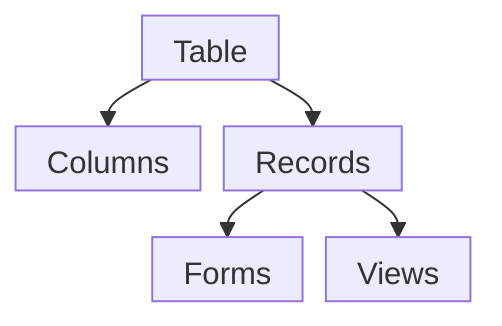

**Prerequisites:** Parts 01-06 and access to a model-driven application.

**Planned topics:**

- **Data fundamentals:** what tables, columns, records, relationships, and lookups mean.
- **Application fundamentals:** how forms, views, grids, navigation, commands, charts, and dashboards present shared data.
- Navigation, record creation, editing, deactivation, and status changes.
- Search, filtering, sorting, and views.
- Accounts, contacts, lookups, and related records.
- Activities, timelines, notes, and attachments.
- Ownership, assignment, permission errors, and everyday user responsibilities.
- **Same-record walkthrough:** inspect one sample service request on its form, locate it in an Open Requests view, and inspect related records through a subgrid or timeline.
- **Form / view comparison:** a form presents one record; a view selects records and columns for a list. They use the same underlying data rather than independent copies.
- **Security awareness:** hiding a column on a form is not a security rule, and different users may have different access to the same underlying records.
- **Understanding check:** identify the interface component and the data component separately when navigating the sample app.

**Practice goal:** complete a customer-record workflow using synthetic data.

**Readiness check:** find the records again and verify relationships, ownership, and status.

## Stage 1 beginner glossary

- **CRM:** Customer Relationship Management, a business approach supported by software.
- **Account:** usually a business organization in CRM; not the same as a Microsoft sign-in account.
- **Contact:** an individual person associated with customer information.
- **Tenant:** the organization's Microsoft identity/service boundary.
- **Environment:** a workspace that can contain applications, configuration, and Dataverse data.
- **Dataverse:** the managed business-data platform and its associated metadata, security, relationships, and logic.
- **Application:** the interface and navigation through which users perform work.
- **Model-driven app:** a Power Apps experience driven by Dataverse data, forms, views, and processes.
- **Canvas app:** a Power Apps experience designed through screens, controls, and Power Fx.
- **Power Pages:** a separate Power Platform product for business websites, not a third Power Apps app type.
- **Solution:** a package primarily containing configuration and customization components.
- **Table / entity:** a structured kind of information.
- **Column / attribute:** an attribute stored for that kind of information.
- **Record / row:** an individual entry with its own values and identifier.
- **Choice:** a defined set of selectable values.
- **Lookup:** a column referencing another record.
- **Relationship:** the defined connection between tables.
- **Form:** an interface for an individual record.
- **View:** a definition of a record list, its columns, and its filters.
- **Grid / subgrid:** a record-list display, either in a main list or within another record's form.
- **Primary name / record identifier:** a readable label versus the identifier of an individual record.
- **Security role:** a set of privileges and access levels, not merely a job title.

## Stage 1 completion exercise

Use an approved sample application and synthetic data. This exercise is an inspection task: do not create custom tables, change security, automate processes, or work in production.

1. Confirm and record the correct account, tenant, and learning environment.
2. Find an existing sample customer/contact and an associated service request.
3. Identify the table, three columns, the individual record, and one lookup or relationship.
4. Inspect the same record on a form and in a view; explain why they are not separate copies.
5. Identify a subgrid, timeline, navigation area, or command available in the sample app.
6. Classify one stored value as data and one structural definition as metadata.
7. Explain where the data lives, which interface displays it, and why another user may have different access.
8. Describe the enquiry-to-sale-to-support business story and match its needs to Dynamics 365, Dataverse, Power Apps, and Power Automate.
9. Match an agent workspace, a focused technician screen, and an external customer website to model-driven, canvas, and Power Pages experiences; explain their access differences.

**Completion evidence:** a short observation log listing each concept, the sample observation, and any unresolved access issue. Explain the observations in your own words before proceeding to Stage 2 configuration.

## 2 - Configure, Secure and Automate

Build the solution-contained service-request application, model its data, configure its interface, and prove agent/manager access. Learn which business rules, guided processes, and cloud flows fit each need, with explicit success and failure checks.

### 08 - Solutions and customization foundations

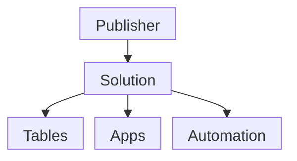

**Prerequisites:** Stage 1 (Parts 01-07) and appropriate customization permissions.

**Planned topics:**

- Publishers, prefixes, naming conventions, and component descriptions.
- Create a named unmanaged solution before substantial customization.
- Create and add components inside the intended solution.
- Dependencies, saving, and publishing.
- Managed versus unmanaged solutions, versioning, and solution layers.

**Practice goal:** create the solution used throughout the project.

**Readiness check:** identify the publisher, prefix, solution version, and location of each new component.

### 09 - Dataverse data modeling

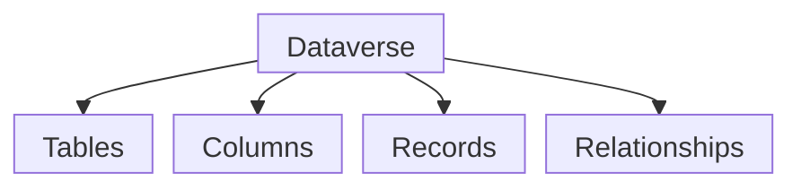

**Prerequisites:** Part 08 and the project's business scenario.

**Planned topics:**

- **Tables**
  - Standard/custom tables, ownership, primary columns, and identifiers.
  - Alternate keys, display/schema names, and duplicate prevention.
- **Columns**
  - Text, numbers, currency, yes/no, date/time, files, and images.
  - Required values, defaults, choices, and lookup columns.
  - Formula, calculated, and rollup columns, including their limitations.
  - Date/time behavior and time zones.
- **Records**
  - Rows, values, ownership, and status.
  - Map sample-data imports, resolve lookup references, and reconcile accepted/rejected records.
  - Correct invalid values and inspect duplicates without introducing advanced migration tooling.
- **Relationships**
  - One-to-many, many-to-one, and many-to-many.
  - Lookup references, related records, and cascading behavior.

**Practice goal:** model customers, contacts, service requests, and request categories.

**Readiness check:** verify relationships and test required values, invalid inputs, and a duplicate scenario. Reconcile a small sample import, including rejected records.

### 10 - Model-driven application configuration

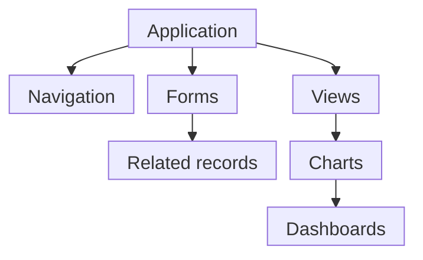

**Prerequisites:** Part 09 and the project solution.

**Planned topics:**

- **Application:** app designer, navigation, and selecting relevant components.
- **Forms:** main, quick-create, and quick-view forms; tabs, sections, and controls.
- **Related records:** subgrids, timelines, and related-record experiences.
- **Views and grids:** public/personal views, filters, and displayed columns.
- **Visualization:** charts and dashboards.
- **Commands and publishing:** supported commands, saving, publishing, and checking the application as a user. Business-rule logic is covered separately in Part 12.
- **Usability:** accessibility and mobile behavior.

**Practice goal:** deliver the first usable service-request app.

**Readiness check:** a user can create, find, and work on a request without developer assistance.

### 11 - Security and administration

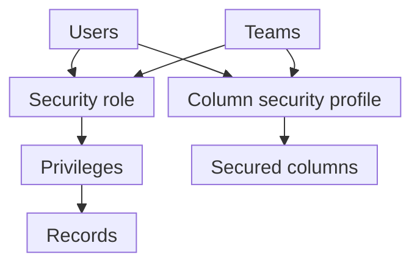

**Prerequisites:** Parts 09-10 and approved test personas with the necessary entitlements.

**Planned topics:**

- **Users and teams:** business units, owner teams, access teams, and approved test personas.
- **Roles and privileges:** access levels, least privilege, and separation of duties.
- **Record access:** ownership, assignment, sharing, and team-based access.
- **App and column access:** distinguish application access from table/record privileges; configure column-security profiles for users or teams where needed.
- **Administration and verification:** auditing, allowed/denied permission tests, and access-denied troubleshooting.

**Practice goal:** implement agent and manager access.

**Readiness check:** record allowed and denied actions for both personas, including restricted records and protected columns. Testing only as an administrator does not pass.

### 12 - Business rules and validation

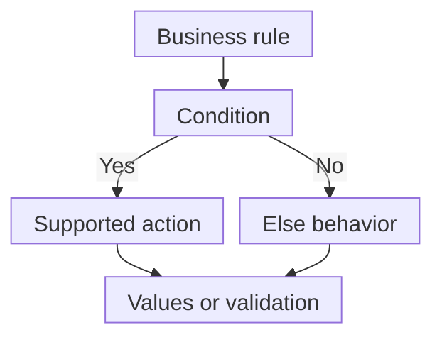

**Prerequisites:** Parts 09-11 and the project solution from Part 08.

**Planned topics:**

- **Mechanism choice:** business rules apply supported conditions and validation; Part 13 guides users through process stages; Part 14 automates background operations. Reserve code for requirements these mechanisms cannot satisfy.
- **Conditions and actions:** comparisons, multiple conditions, set/clear values, defaults, and validation messages.
- **Form behavior:** supported requirement-level changes, show/hide, enable/disable, and recommendations.
- **Scope and limitations:** table, all-form, and specific-form scope; client/server behavior, supported column types, and grid/control limitations. Do not assume every action runs through every entry point.
- **Lifecycle:** create inside the solution, validate, activate/deactivate, and test both condition branches.
- **Safety and troubleshooting:** hiding a column is not security; inspect missing form columns, inactive rules, scope mismatches, and conflicting logic.

**Practice goal:** require a resolution summary on the request form when a request is resolved, and demonstrate a supported validation message.

**Readiness check:** test matching/non-matching conditions, blank/valid values, and the intended forms as an agent. Record the rule's scope and which behavior is form-only; do not claim universal validation without testing other entry points.

### 13 - Business process flows

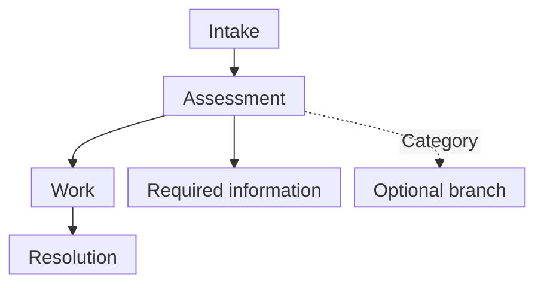

**Prerequisites:** Parts 08-11, agreed process requirements, and appropriate process-design permissions.

**Planned topics:**

- **Purpose:** guide users through a consistent process; distinguish a process instance and active stage from the request's status.
- **Design:** stages, categories, steps, required information, supported tables, and branching conditions.
- **Application experience:** add the process to the app, validate/activate it, and inspect it on a request.
- **Access:** process availability, security-role access, process-table privileges, and underlying record permissions.
- **User actions:** move forward/backward, complete required steps, follow branches, and resume a saved process.
- **Boundaries:** a required process step controls stage progression, not universal data validation. A process diagram does not by itself perform every approval or background action; use Part 14 for cloud-flow automation.

**Practice goal:** guide a service request through Intake, Assessment, Work, and Resolution, with a required assessment step and a justified category branch.

**Readiness check:** demonstrate incomplete-step blocking, valid progression, branching, resuming a process, and allowed/denied access for the approved personas. Verify the request's status separately.

### 14 - Power Automate cloud flows

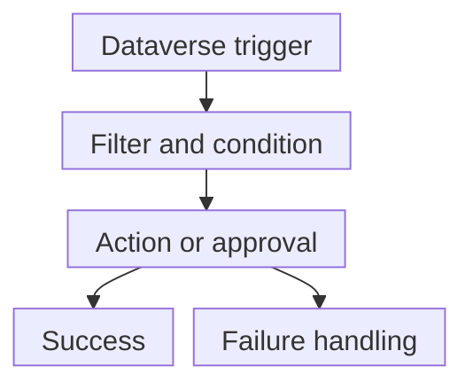

**Prerequisites:** Parts 08-11, agreed automation requirements, approved connections, and appropriate Power Automate access. Part 13 is needed only when the flow depends on process-stage data.

**Planned topics:**

- **Flow foundations:** automated, instant, and scheduled cloud flows; choose an appropriate trigger for the business event.
- **Dataverse automation:** row-change triggers, filtering columns/rows, conditions, expressions, and related-record actions.
- **Business actions:** request assignment, notifications, approvals, and explicit approval/rejection paths.
- **Connections and identity:** connections, connection references, ownership, execution permissions, least privilege, and solution-aware flows.
- **Reliable execution:** loop prevention, duplicate processing, repeated updates, concurrency considerations, retries, and timeouts.
- **Failure handling:** scopes, run-after behavior, meaningful failure notifications, run history, monitoring, and safe recovery.

**Practice goal:** assign a request and run a manager approval.

**Readiness check:** demonstrate success, rejection, failure, and repeated-trigger behavior without unexplained loops or duplicate notifications.

## Stage 2 completion exercise

Use the approved learning environment, synthetic data, and agent/manager personas. Keep changes in the project solution; do not make production changes or broaden privileges merely to make a test pass.

1. Identify the publisher, prefix, solution, and included components.
2. Verify the data model and reconcile a small sample-data import.
3. Create and find a request through the configured forms and views.
4. Record allowed/denied actions for both personas, including protected columns.
5. Demonstrate a business rule's two condition branches and explain its scope.
6. Follow the business process flow, including incomplete steps and a category branch.
7. Run the assignment/approval flow and demonstrate approval, rejection, a failed action, and a repeated update.

**Completion evidence:** a working solution-contained application, a component inventory, and expected/actual test results. Explain why each rule, process, and cloud flow was chosen before moving to Stage 3 coding.

## 3 - Develop and Integrate

Choose the language and tools needed for your selected extensions, then build and test justified client/server logic and integrations. Compare PCF, Canvas/custom pages, and standard configuration rather than treating every technology as a compulsory build.

### 15 - Programming foundations

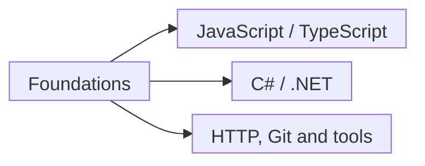

**Prerequisites:** shared platform foundations; no prior programming is assumed.

**Planned topics:**

- **JavaScript / TypeScript path:** variables, types, functions, objects, arrays, events, promises, asynchronous errors, modules, type annotations, and browser debugging.
- **C# / .NET path:** types, classes, interfaces, collections, exceptions, validation, dependencies, debugging, and the supported SDK/toolchain for the selected platform extension. Do not assume every Dynamics extension targets the latest .NET runtime.
- **Web and tools path:** HTTP, JSON, REST, authentication versus authorization, VS Code, Git, configuration, secret handling, logs, and an API-testing client. Introduce Node.js/npm and Power Platform CLI before exercises needing them.
- **Choosing a path:** JavaScript supports client customization; TypeScript supports PCF; C# supports plug-in logic. Pass the relevant checkpoint without requiring every language before the next selected module.
- **Working/failing examples:** a small validated data transformation, a successful HTTP response, an invalid input, and a rejected asynchronous request.
- **Verification:** step through a failure, read a stack trace, write a small automated test, and document the development environment.

**Practice goal:** complete the language and HTTP exercises needed for the selected extension, with a working case and an explicitly handled failure.

**Readiness check:** pass the relevant language checkpoint, debug a failure, run its tests, handle invalid input explicitly, and keep credentials out of source control. A server-side learner does not need to finish every JavaScript exercise first.

### 16 - Client-side customization

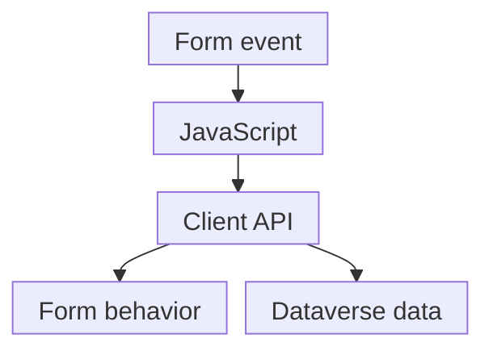

**Prerequisites:** JavaScript foundations, app configuration, and security concepts.

**Planned topics:**

- Web resources, registration, execution context, and form context.
- Form events, attributes, controls, and notifications.
- Supported data APIs, asynchronous behavior, and meaningful errors.
- Navigation, dialogs, commands, and Power Fx where appropriate.
- Script organization, browser testing, and unsupported patterns to avoid.
- **Configuration versus code:** check standard forms, quick views, business rules, and commands before introducing a script.
- **Working/failing examples:** retrieve permitted customer context asynchronously for a request; handle a missing lookup, denied access, or failed request with meaningful feedback.
- **Debugging and tests:** browser breakpoints, asynchronous errors, helper-function tests, form tests, and permission-aware data access.

**Practice goal:** add justified request-form guidance and command behavior using supported APIs.

**Readiness check:** test normal, missing-data, denied-access, and failure cases, and record the expected user feedback. Do not rely on browser code for security or cross-entry-point validation.

### 17 - Plug-ins and server-side logic

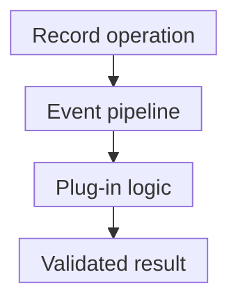

**Prerequisites:** C# foundations, Dataverse modeling, security, and solutions. JavaScript completion is not required.

**Planned topics:**

- Execution pipeline, stages, transactions, and synchronous/asynchronous processing.
- Plug-in creation, registration, filtering attributes, and pre/post images.
- Related data, execution identity, privileges, recursion, and duplicate execution.
- Tracing, exceptions, debugging, automated tests, and performance limits.
- **Configuration versus code:** choose a plug-in only when supported configuration/automation cannot meet the required validation, transaction, or event-processing behavior. Custom business-operation APIs are covered separately in Part 18.
- **Working/failing examples:** allow a resolved request with a resolution summary and reject an invalid resolution through forms, imports, and API operations.
- **Verification:** developer tests, registration checks, execution-identity tests, trace/correlation evidence, and bounded performance. Distinguish synchronous transaction behavior from asynchronous processing.

**Practice goal:** enforce a rule across forms, imports, and API operations.

**Readiness check:** prove consistent valid/invalid behavior through each tested entry point, verify permissions and trace output, and test repeated execution without recursion or duplicate side effects.

### 18 - Custom APIs and business operations

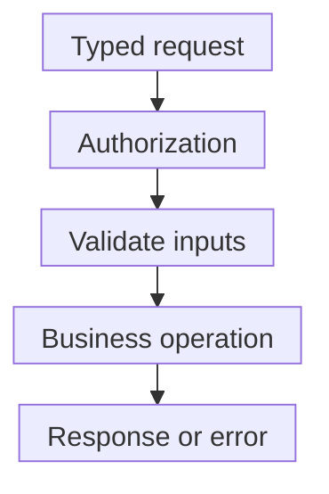

**Prerequisites:** Part 15 C#/HTTP foundations, Part 17 pipeline/registration knowledge for plug-in-backed operations, Part 08 solutions, and Part 11 security.

**Planned topics:**

- **Purpose and choice:** define a reusable business operation instead of duplicating logic across callers; use standard Dataverse operations or supported configuration when they already satisfy the requirement.
- **API contract:** unique names, actions versus functions, typed request parameters, response properties, and global/table/collection bindings.
- **Implementation:** plug-in-backed business logic where needed, validation, execution context, transactions, and allowed extension points. Business-event-only APIs are an advanced variation, not a requirement for this lab.
- **Authorization:** execution privileges, caller identity, row/table permissions, and business-policy checks. Do not treat API visibility as a security boundary.
- **Invocation:** call the operation through an appropriate Web API/SDK client; use an action when the scenario needs invocation from Power Automate.
- **Working/failing examples:** resolve a sample request through a defined action; reject missing input, unauthorized access, and invalid request state.
- **Debugging and tests:** trace the operation, test its contract and repeated calls, and version/package the definition with its solution.

**Practice goal:** define and call a justified Resolve Request operation with an explicit request/response contract and authorization checks.

**Readiness check:** demonstrate valid, missing-input, denied-access, invalid-state, and repeated-call behavior. Verify the stored result rather than treating a returned message as proof of success.

### 19 - Dataverse APIs and external integration

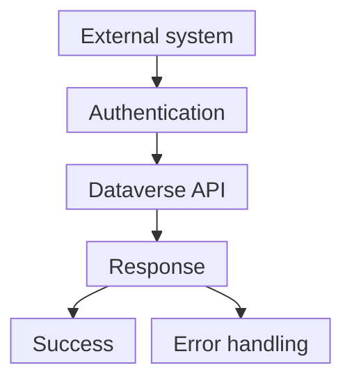

**Prerequisites:** Part 15 HTTP/JSON/authentication foundations, data modeling, and security. Exercises invoking the custom operation built earlier also need Part 18.

**Planned topics:**

- Web API/SDK options, application users, and least-privilege access.
- CRUD, related data, OData, FetchXML, pagination, and batching.
- Concurrency, service-protection limits, retries, and idempotency.
- Custom connectors, webhooks, Azure Functions, and messaging where justified.
- Secret storage, logging, monitoring, and integration tests.
- **Architecture choice:** use supported connectors for straightforward needs; justify direct API calls, webhooks, Azure Functions, or messaging by the requirements.
- **Working/failing examples:** synchronize an approved sample request with an external service; inspect an expired/invalid credential, a rejected operation, and a transient downstream failure.
- **Developer verification:** test request/response mapping, record permissions, pagination, repeat delivery, retry limits, and sanitized diagnostic logs. Full release/deployment testing remains in Stage 4.

**Practice goal:** connect the project to a small external service.

**Readiness check:** test authentication failure, denied access, pagination, repeated delivery, and a transient downstream failure. Verify final data and retry behavior without hardcoded secrets or unexplained duplicate work.

### 20 - PCF components

```mermaid
---
config:
  htmlLabels: false
  flowchart: {nodeSpacing: 12, rankSpacing: 24, padding: 8}
---
flowchart TD
    accTitle: PCF component inputs and outputs
    PROPERTIES["Properties"] --> CONTROL["PCF control"]
    CONTROL --> UI["Render UI"]
    CONTROL --> CHANGE["Notify changes"]
```

**Prerequisites:** Part 15 JavaScript/TypeScript foundations, relevant client/data API knowledge, the project solution, and supported Node.js/npm and Power Platform CLI tooling.

**Planned topics:**

- **Choice:** use standard controls when they suffice; build a PCF component only for a justified reusable UI requirement. Canvas apps and custom pages are covered separately in Part 21.
- PCF manifests, properties, lifecycle, field components, and dataset fundamentals.
- Input/output binding, change notifications, rendering, cleanup, and dataset behavior.
- Local/platform tests, accessibility, and performance.
- Packaging, deployment, and maintenance.
- **Working/failing examples:** a useful request-status component with valid input, missing/invalid input, and an unavailable-data case.
- **Verification:** test component logic, inspect browser diagnostics, validate keyboard behavior and binding, and check the supported host and user permissions.

**Practice goal:** build a justified reusable request component, or document why a standard control is the better choice.

**Readiness check:** verify its purpose, input/output behavior, error feedback, accessibility, performance, and packaging. A PCF build is scenario-dependent, not mandatory when configuration already solves the requirement.

### 21 - Canvas apps and custom pages

```mermaid
---
config:
  htmlLabels: false
  flowchart: {nodeSpacing: 12, rankSpacing: 24, padding: 8}
---
flowchart LR
    accTitle: Choosing an additional app surface
    NEED["User task"] --> CANVAS["Canvas app"]
    NEED --> PAGE["Custom page"]
    CANVAS --> DATA["Permitted data"]
    PAGE --> DATA
```

**Prerequisites:** Parts 08-11, appropriate Power Apps access/connections, a defined user task, and the model-driven app for a custom-page exercise. Introduce Power Fx here; PCF or C# completion is not required.

**Planned topics:**

- **Choice:** standard model-driven pages, a standalone canvas app, or a custom page inside a model-driven app. Prefer existing forms/views when they already support the task.
- **Canvas foundations:** screens, controls, properties, Power Fx formulas, variables, data connections, and data operations.
- **Data and permissions:** Dataverse access, connection identity, delegation/query limits, validation, and meaningful error feedback. Hiding a control does not secure the underlying data.
- **Custom pages:** solution components, navigation parameters, record context, page/dialog/pane experiences, and host limitations.
- **Working/failing examples:** a justified request-triage experience with valid input, missing context, denied access, and a failed data operation.
- **Debugging and tests:** inspect app diagnostics, verify formulas and permissions, test keyboard/mobile behavior, and package the selected app surface. Full release gates remain in Stage 4.

**Practice goal:** build a justified request-triage canvas app or custom page, or explain why the existing model-driven interface should remain.

**Readiness check:** verify navigation/context, data operations, permissions, failure feedback, accessibility, and mobile behavior. Additional UI is scenario-dependent; do not build both surfaces merely to demonstrate the technology.

## Stage 3 completion exercise

Use approved learning environments, synthetic data, and the project solution. Select role-appropriate development modules; application specializations and AI topics are not mandatory prerequisites.

1. Pass the language/tool checkpoints needed by the selected extensions.
2. Record why configuration is insufficient for each proposed code change.
3. Demonstrate a supported client extension where justified, with missing-data and failed-call feedback.
4. Verify selected server-side validation through its intended entry points, including denied/invalid cases and traces.
5. Call a justified custom business operation and test its inputs, authorization, result, and repeated invocation.
6. Demonstrate a reliable integration, including pagination, repeated delivery, and a downstream failure.
7. Select PCF, an additional app surface, or existing configuration based on the business task; verify any chosen extension without requiring every UI technology.
8. Save the developer test results, sanitized diagnostics, component inventory, and configuration-versus-code decisions.

**Completion evidence:** working selected extensions, positive/negative test results, documented permissions and failure behavior, and a justified UI decision. Stage 4 adds full release/deployment validation; do not defer all developer tests until then.

## 4 - Test, Deploy and Design Solutions

Basic requirements and design began earlier in the project. Start this stage with an advanced architecture review before migration and release. Developer tests already belong in Stage 3; this stage adds complete solution acceptance, delivery, and operational evidence.

### 22 - Solution architecture and design

```mermaid
---
config:
  htmlLabels: false
  flowchart: {nodeSpacing: 12, rankSpacing: 24, padding: 8}
---
flowchart TD
    accTitle: Review architecture before delivery
    REQUIREMENTS["Requirements"] --> CHOICES["Design choices"]
    CHOICES --> RISKS["Risks and constraints"]
    RISKS --> REVIEW["Design review"]
```

**Prerequisites:** shared foundations, written business requirements, the project's current design, and the development/integration modules relevant to the chosen solution. Deployment experience is not required before this review.

**Planned topics:**

- **Requirements:** business outcomes, acceptance criteria, user personas, scope, and traceability from needs to components.
- **Architecture:** data, application, automation, integration, reporting, and environment design; reuse standard capabilities before adding code or custom UI.
- **Constraints:** expected volume, performance, scale, platform limits, capacity, licensing, and deployment-specific dependencies.
- **Governance and security:** development/test/production responsibilities, identity, least privilege, DLP, privacy, and data handling.
- **Decision evidence:** configuration-versus-code choices, alternatives, diagrams, assumptions, unresolved risks, and operational ownership.
- **Review example:** assess whether the service-request app needs a plug-in, custom API, integration, or additional UI, and explain the trade-offs rather than using every technology.

**Practice goal:** review and document the project's architecture before data migration and release.

**Readiness check:** connect each component to a business requirement, identify dependencies and risks, explain permission/environment choices, and record measurable acceptance and performance targets.

### 23 - Data migration and data quality

```mermaid
---
config:
  htmlLabels: false
  flowchart: {nodeSpacing: 12, rankSpacing: 24, padding: 8}
---
flowchart TD
    accTitle: Reconcile accepted and rejected migration records
    SOURCE["Source data"] --> MAP["Map and transform"]
    MAP --> IMPORT["Import"]
    IMPORT --> VERIFY["Reconcile"]
    IMPORT --> REJECT["Rejected rows"]
```

**Prerequisites:** Part 22's design review, Parts 09 and 11, approved source data, and an appropriate learning/test target environment.

**Planned topics:**

- **Preparation:** inspect source quality, ownership, duplicates, missing values, status, and permitted data use.
- **Mapping:** transformations, identifiers/keys, choices, lookups, relationship sequencing, and target validation.
- **Execution:** choose appropriate import/migration tools, plan batches and bulk processing, and account for rejected records.
- **Reconciliation:** compare source/target totals, values, relationships, duplicates, and rejected rows; correct causes rather than hiding failures.
- **Cutover planning:** source freeze, load order, validation, business approval, contingencies, and a rehearsed recovery approach.
- **Working/failing examples:** import a small synthetic customer/request dataset, then inspect a broken lookup, invalid value, or duplicate scenario.
- **Safety:** auditing, privacy, retention, and approved cleanup. Do not delete production data or perform destructive bulk changes as an assumed migration step.

**Practice goal:** rehearse a sample migration with mapping, accepted/rejected totals, and a documented cutover checklist.

**Readiness check:** reconcile counts, key values, and relationships; account for every rejected record; test a repeat/recovery scenario and explain the approved cutover decisions.

### 24 - Reporting and analytics

```mermaid
---
config:
  htmlLabels: false
  flowchart: {nodeSpacing: 12, rankSpacing: 24, padding: 8}
---
flowchart TD
    accTitle: Verify reporting accuracy and audience access
    DATA["Validated data"] --> REPORT["Report or dashboard"]
    REPORT --> ACCURACY["Accuracy"]
    REPORT --> ACCESS["Audience access"]
```

**Prerequisites:** data modeling, Part 11 security, agreed reporting questions, and appropriate reporting access. Part 23 is needed when the report uses the migrated training dataset.

**Planned topics:**

- **Operational reporting:** model-driven charts, dashboards, views, and Excel/Word templates where appropriate.
- **Analytics:** Power BI data/semantic-model basics, relationships, measures, refresh, and deployment/access requirements for the selected connection method.
- **Accuracy:** reconcile report totals against validated records; check filters, status definitions, date/time behavior, and refresh freshness.
- **Security:** audience/workspace access and row-level security where applicable. Application restrictions must not be assumed to carry automatically into imported/exported reporting data.
- **Permission tests:** distinguish report consumers from editors/admins. Power BI RLS testing only as a workspace administrator is insufficient.
- **Working/failing examples:** report on open/resolved requests, then inspect an incorrect filter, stale refresh, or unintended audience exposure.

**Practice goal:** build and verify an operational service report/dashboard; add Power BI only with approved access and a justified reporting need.

**Readiness check:** match report results to source data, demonstrate refresh and filters, verify allowed/denied audience access, and document any separate reporting security rules.

### 25 - Testing and quality assurance

```mermaid
---
config:
  htmlLabels: false
  flowchart: {nodeSpacing: 12, rankSpacing: 24, padding: 8}
---
flowchart TD
    accTitle: Evidence-based solution acceptance
    CRITERIA["Acceptance criteria"] --> CASES["Test cases"]
    CASES --> RESULTS["Actual results"]
    RESULTS --> DECISION["Release decision"]
```

**Prerequisites:** the components being tested, approved test personas/data, and measurable acceptance criteria from Part 22.

**Planned topics:**

- **Test planning:** map business requirements to repeatable cases, expected results, datasets, personas, and ownership.
- **Functional coverage:** positive/negative paths, UI, business rules, flows, selected plug-ins/custom APIs, integration, migration, and reporting.
- **Quality checks:** security, regression, end-to-end behavior, performance targets, accessibility, and mobile behavior.
- **User acceptance:** business-user walkthroughs, documented UAT results, defects, retesting, and approval decisions.
- **Evidence:** expected/actual results, sanitized diagnostics, defect reproduction, traceability, and release readiness. Reuse Stage 3 developer tests rather than postponing or duplicating them.
- **Failure cases:** denied access, rejected approvals, missing data, failed connections, repeated events, and a downstream outage.

**Practice goal:** execute and record a solution-level test/UAT pack for the service-request project.

**Readiness check:** pass the defined criteria across relevant personas and entry points, account for unresolved defects, and record an explicit approved or blocked release decision.

### 26 - ALM, deployment, and releases

```mermaid
---
config:
  htmlLabels: false
  flowchart: {nodeSpacing: 12, rankSpacing: 24, padding: 8}
---
flowchart TD
    accTitle: Versioned solution delivery and approval
    DEV["Development"] --> TESTS["Tests"]
    TESTS --> SOLUTION["Solution package"]
    SOLUTION --> TEST["Test environment"]
    TEST --> APPROVAL["Approval"]
    APPROVAL --> RELEASE["Approved release"]
```

**Prerequisites:** Part 08 solutions, Part 11 security, reviewed architecture, Part 25's test evidence, the components being released, and a second approved environment.

**Planned topics:**

- **Lifecycle:** development/test/production responsibilities, component inventory, versioning, source control, solution unpacking, and automated checks.
- **Packaging:** managed solutions, layers, dependencies, upgrades, patches, and the appropriate update strategy.
- **Configuration:** environment variables, connection references, execution identities, permissions, and environment-specific values.
- **Release process:** choose appropriate pipelines/tooling, enforce approval and test gates, validate imports, and perform target-environment smoke tests.
- **Working/failing examples:** deploy a versioned project to an approved test environment; diagnose a missing dependency, connection, or permission instead of reporting success.
- **Recovery:** document contingencies and backup/recovery responsibilities. Do not assume every solution update has a simple rollback or use destructive uninstallation as a default recovery step.
- **Safety:** production releases, billing changes, and destructive operations require separate explicit approval.

**Practice goal:** deploy to another approved environment without manually recreating components or hardcoding environment-specific values.

**Readiness check:** verify package/version, dependencies, identities, permissions, connections, configuration, and end-to-end behavior in the target; retain release approval and an appropriate recovery plan.

### 27 - Operations, monitoring, and support

```mermaid
---
config:
  htmlLabels: false
  flowchart: {nodeSpacing: 12, rankSpacing: 24, padding: 8}
---
flowchart TD
    accTitle: Diagnose and recover with approved operational procedures
    MONITOR["Monitor"] --> ALERT["Detect failure"]
    ALERT --> DIAGNOSE["Diagnose"]
    DIAGNOSE --> RECOVER["Approved recovery"]
    RECOVER --> VERIFY["Verify and document"]
```

**Prerequisites:** knowledge of the deployed components, Part 26 delivery evidence, approved diagnostic access, and identified support/admin owners. Actual backup/restore exercises additionally need an eligible approved environment and authorized administrator participation.

**Planned topics:**

- **Monitoring:** flow history, plug-in traces, integration logs, app diagnostics, alerts, and correlation across the selected components.
- **Incident handling:** reproduce symptoms, distinguish permissions/configuration/data failures, collect sanitized evidence, escalate, and communicate service impact.
- **Operational governance:** capacity, service limits, connection/identity maintenance, licensing, auditing, retention, and appropriate access.
- **Recovery planning:** backup/restore responsibilities, environment-type limitations, approvals, and validation after recovery. Do not assume every trial/learning environment supports the same backup features.
- **Recovery objectives:** RTO is the acceptable recovery time; RPO is the acceptable data-loss window. Define realistic targets and owners rather than promising automatic recovery.
- **Working/failing examples:** diagnose a failed flow or integration in the approved test environment and follow a documented runbook or recovery rehearsal.
- **Support ownership:** incident procedures, known limitations, routine maintenance, and tested handoff to the responsible team.

**Practice goal:** prepare a support runbook and rehearse diagnosis/recovery for a controlled sample failure.

**Readiness check:** locate useful diagnostics, explain the failure, record authorized recovery and verification steps, and identify owners, escalation, and backup limitations. Do not perform unapproved production restores.

### 28 - Capstone, documentation, and handover

```mermaid
---
config:
  htmlLabels: false
  flowchart: {nodeSpacing: 12, rankSpacing: 24, padding: 8}
---
flowchart TD
    accTitle: Demonstrate, verify, explain, and hand over the project
    DEMO["Demonstrate"] --> EVIDENCE["Verify evidence"]
    EVIDENCE --> EXPLAIN["Defend choices"]
    EXPLAIN --> HANDOVER["Handover"]
```

**Prerequisites:** the relevant core modules, Parts 22-27 delivery evidence, and a defined capstone scope. Optional application/AI branches and every UI technology are not mandatory.

**Planned topics:**

- **Demonstration:** complete the customer/request lifecycle with the selected configuration, automation, code, integration, and reporting.
- **Acceptance evidence:** migration reconciliation, allowed/denied access, success/rejection/failure paths, repeated processing, test/UAT results, and approved target-environment delivery.
- **Design explanation:** requirements, diagrams, trade-offs, component dependencies, and why each customization is necessary.
- **Documentation:** user guidance, technical setup, release/configuration notes, test evidence, known limitations, and sanitized operational instructions.
- **Handover:** support ownership, monitoring/runbooks, recovery responsibilities, training, and an agreed improvement backlog.

**Practice goal:** complete and defend the shared project, then hand over a usable documentation and support pack.

**Readiness check:** demonstrate the business workflow, verify the recorded evidence, explain design choices, and show that another authorized person can operate and support the solution without relying on undocumented knowledge.

## Stage 4 completion exercise

Use approved environments and synthetic data. Real production releases, destructive migration changes, and restores require separate approval.

1. Review architecture and connect each component to a requirement and owner.
2. Reconcile a rehearsed migration, including rejected records and relationships.
3. Verify reporting accuracy, refresh, and audience/row access.
4. Complete solution tests and UAT, with expected/actual results and defect decisions.
5. Deploy a versioned solution to an approved target and validate configuration, permissions, and end-to-end behavior.
6. Rehearse a controlled incident and document authorized recovery, escalation, and limitations.
7. Demonstrate the capstone and hand over user, technical, release, and operational documentation.

**Completion evidence:** a reviewed design, reconciled data, validated reports, test/UAT decisions, target-environment release evidence, and a usable handover/runbook. Completion means build, verify, explain, and maintain, not simply finish reading.

## Application specializations

These are **six planned independent branches**, not required gates for the developer sequence. Customer Insights groups Data and Journeys as child modules. Membership in the Dynamics 365 family does not mean every application is included in one license or environment; each lab requires its relevant installed/provisioned application, entitlements, and approved permissions.

### Dynamics 365 Sales

```mermaid
---
config:
  htmlLabels: false
  flowchart: {nodeSpacing: 12, rankSpacing: 24, padding: 8}
---
flowchart TD
    accTitle: Sales customer and commercial lifecycle
    LEAD["Lead"] --> OPPORTUNITY["Opportunity"]
    OPPORTUNITY --> QUOTE["Quote"]
    QUOTE --> ORDER["Order"]
    ORDER --> INVOICE["Invoice"]
```

**Prerequisites:** Parts 08-11, the installed Sales application, appropriate entitlements, and approved test users.

**Planned topics:**

- Accounts, contacts, activities, leads, qualification, opportunities, and sales stages.
- Products, units, price lists, quotes, orders, and invoices.
- Sales-process configuration, security, views, dashboards, and available forecasting.
- Extend standard application components through the project solution rather than recreating Sales.

**Practice goal:** complete and explain a lead-to-sale scenario using synthetic customers.

**Readiness check:** verify customer/opportunity relationships, commercial records, stage transitions, and permitted user actions.

### Dynamics 365 Customer Service

```mermaid
---
config:
  htmlLabels: false
  flowchart: {nodeSpacing: 12, rankSpacing: 24, padding: 8}
---
flowchart TD
    accTitle: Customer Service case lifecycle
    CASE["Case"] --> QUEUE["Queue and assignment"]
    QUEUE --> WORK["Investigate"]
    WORK --> KNOWLEDGE["Knowledge"]
    KNOWLEDGE --> RESOLVE["Resolve"]
```

**Prerequisites:** Parts 08-11, the installed Customer Service application, appropriate entitlements, and approved agent/manager personas.

**Planned topics:**

- Cases, interactions, queues, assignment, routing fundamentals, and resolution.
- Knowledge, SLAs, entitlements, agent experiences, and service reporting.
- Security and supported application configuration/customization.
- Keep case/service management here; use the Contact Center branch for channel, conversation, and contact-center operations. Reuse shared routing concepts rather than duplicating them.

**Practice goal:** receive, route, work, and resolve a sample case.

**Readiness check:** verify ownership, queue behavior, case transitions, access, and the configured service conditions.

### Dynamics 365 Field Service

```mermaid
---
config:
  htmlLabels: false
  flowchart: {nodeSpacing: 12, rankSpacing: 24, padding: 8}
---
flowchart TD
    accTitle: Field Service work execution
    WORK["Work order"] --> RESOURCE["Resource"]
    RESOURCE --> BOOK["Booking"]
    BOOK --> MOBILE["Mobile execution"]
    MOBILE --> COMPLETE["Complete"]
```

**Prerequisites:** Parts 08-11, the installed Field Service application, appropriate entitlements, and approved dispatcher/technician access.

**Planned topics:**

- Work orders, customer assets, incident types, and service tasks.
- Resources, scheduling, bookings, inspections, and mobile work.
- Agreements, recurring service, and relevant inventory/purchasing concepts.
- Security, mobile access, dependencies, and supported customization.

**Practice goal:** create, schedule, execute, and complete a sample work order.

**Readiness check:** verify its lifecycle, asset/resource/booking relationships, and required execution information.

### Dynamics 365 Customer Insights

```mermaid
---
config:
  htmlLabels: false
  flowchart: {nodeSpacing: 12, rankSpacing: 24, padding: 8}
---
flowchart TD
    accTitle: Customer Insights Data and Journeys modules
    INSIGHTS["Customer Insights"] --> DATA["Data"]
    INSIGHTS --> JOURNEYS["Journeys"]
    DATA --> PROFILES["Unified profiles"]
    PROFILES --> MEASURES["Measures and segments"]
    JOURNEYS --> CONSENT["Consent and audiences"]
    CONSENT --> ENGAGE["Triggered engagement"]
```

**Prerequisites:** Parts 08-11, provisioned Customer Insights applications/environments, appropriate entitlements, and approved data connections. Data is a customer data platform, not simply another Dataverse table-configuration lesson.

**Planned topics:**

#### Customer Insights - Data

- Data ingestion, source mapping, matching, unification, and customer profiles.
- Relationships, measures, segments, enrichment, refreshes, and downstream use.
- Data quality, privacy, consent considerations, access, and connector limitations.

#### Customer Insights - Journeys

- Audiences, segments, consent, marketing forms, and message content.
- Real-time journeys, triggers, personalization, test audiences, and performance.
- Connections to customer data and sales processes without assuming every feature is available.

**Practice goal:** unify two small synthetic datasets in Data, then test an appropriate audience and journey in Journeys. Use approved test recipients only.

**Readiness check:** reconcile unified profiles, explain match decisions, verify segment membership and consent exclusions, and inspect a test journey's results without contacting real customers.

### Dynamics 365 Contact Center

```mermaid
---
config:
  htmlLabels: false
  flowchart: {nodeSpacing: 12, rankSpacing: 24, padding: 8}
---
flowchart TD
    accTitle: Contact Center conversation routing
    CHANNEL["Voice or digital channel"] --> ROUTE["Unified routing"]
    ROUTE --> AGENT["Agent experience"]
    AGENT --> CRM["CRM context"]
    AGENT --> REPORT["Operational insights"]
```

**Prerequisites:** Parts 08-11, provisioned Contact Center capabilities, appropriate entitlements, approved agent access, and a safe test channel. Review Customer Service concepts if that is the connected CRM.

**Planned topics:**

- Voice/digital channels, conversations, workstreams, queues, and unified routing.
- Agent experiences, CRM context, self-service, and available AI assistance.
- Supervisor operations, operational reporting, recording/privacy considerations, and access.
- Distinguish channel/conversation operations from Customer Service case management; Contact Center can connect to a chosen CRM.

**Practice goal:** route an approved test conversation to an agent and inspect its CRM context.

**Readiness check:** verify routing, agent access, conversation context, and operational results. Do not provision chargeable telephony resources or contact live customers without approval.

### Dynamics 365 Project Operations

```mermaid
---
config:
  htmlLabels: false
  flowchart: {nodeSpacing: 12, rankSpacing: 24, padding: 8}
---
flowchart TD
    accTitle: Project Operations delivery and financial concepts
    SALES["Project sales"] --> CONTRACT["Contract"]
    CONTRACT --> PLAN["Plan and resources"]
    PLAN --> TIME["Time and expenses"]
    TIME --> BILL["Billing concepts"]
```

**Prerequisites:** Parts 08-11, an approved Project Operations deployment, appropriate entitlements, and project/resource personas. Integrated finance exercises additionally require the relevant ERP knowledge and environment.

**Planned topics:**

- Project opportunities, quotes, contracts, planning, tasks, and resource assignments.
- Time, expenses, pricing/costing, billing concepts, and project performance.
- Security, approvals, supported customization, and deployment-specific capabilities.
- Treat this as an advanced CRM-to-finance bridge, not proof that every learner needs Finance or every deployment includes integrated financial operations.

**Practice goal:** plan a synthetic customer project, assign a resource, and inspect sample time/cost and billing information in the selected deployment.

**Readiness check:** explain contract/project/resource relationships and which financial features are available. Do not post real financial transactions.

## Copilot and AI agents

These are **optional learning topics**, not extra numbered core parts. Start with application-specific Copilot experiences, then learn agent creation and the controls around execution. The harness topic distinguishes the three currently documented Copilot Studio runtime choices from the Copilot products/experiences that use them; it is not a separate Dynamics 365 application or a full SDK course.

### Dynamics 365 Copilot

```mermaid
---
config:
  htmlLabels: false
  flowchart: {nodeSpacing: 12, rankSpacing: 24, padding: 8}
---
flowchart TD
    accTitle: Review grounded Copilot assistance
    CONTEXT["Permitted business data"] --> COPILOT["Copilot assistance"]
    COPILOT --> DRAFT["Summary or draft"]
    DRAFT --> REVIEW["Human review"]
    REVIEW --> WORK["Approved business work"]
```

**Prerequisites:** platform/security foundations, the relevant application branch, approved Copilot availability/settings, and synthetic business data.

**Planned topics:**

- Built-in Copilot assistance, application-specific AI agents, and the difference from building an agent in Copilot Studio.
- Available summaries, drafting, knowledge assistance, and guided actions; check app, release, region, language, and licensing requirements before promising features.
- Grounding, permitted data, privacy, human review, hallucinations, and limitations.
- Administration, enablement, responsible use, and evaluating a useful business outcome.

**Practice goal:** review one available summary or draft against the approved sample record and correct unsupported statements.

**Readiness check:** explain the source data, permissions, limitations, and human approval boundary. AI-generated text is not proof that a business action succeeded.

### Copilot Studio

```mermaid
---
config:
  htmlLabels: false
  flowchart: {nodeSpacing: 12, rankSpacing: 24, padding: 8}
---
flowchart TD
    accTitle: Build and validate a connected agent
    AGENT["Agent instructions"] --> KNOWLEDGE["Approved knowledge"]
    AGENT --> TOOLS["Authorized tools"]
    KNOWLEDGE --> TEST["Test and evaluate"]
    TOOLS --> TEST
    TEST --> PUBLISH["Approved channel"]
```

**Prerequisites:** Parts 08-11, appropriate Copilot Studio access, approved knowledge sources/connections, and a defined business scenario.

**Planned topics:**

- Agent instructions, topics, knowledge, generative orchestration, and channel selection.
- Tools, connectors, agent flows, Dataverse operations, and authentication/authorization.
- Agent testing/evaluation, safe fallback, human handoff, analytics, and solution-aware delivery.
- Reuse the existing [Copilot Studio Guide](#/learn/copilot-studio) for full lessons rather than duplicating that course in this roadmap.

**Practice goal:** build a read-first service-request assistant with approved knowledge and one permission-checked tool.

**Readiness check:** demonstrate an answered question, unavailable knowledge, denied access, and a failed tool call before publishing to an approved test channel.

### AI agent harness

```mermaid
---
config:
  htmlLabels: false
  flowchart: {nodeSpacing: 12, rankSpacing: 24, padding: 8}
---
flowchart TD
    accTitle: Copilot experience, harness, model, and authorized tools
    EXPERIENCE["Copilot experience"] --> HARNESS["Agent harness"]
    HARNESS --> MODEL["AI model"]
    HARNESS --> TOOLS["Authorized tools"]
```

**Prerequisites:** Copilot Studio fundamentals or an approved equivalent agent platform, security concepts, and the automation/integration knowledge needed for the selected tools.

**Planned topics:**

- **Meaning:** a harness is the runtime/orchestration layer around an agent/model. It manages instructions, context, tools, identity, execution state, and controls; it is not the AI model or the user-facing Copilot app.
- **Tools and permissions:** input/output contracts, connection identity, user authorization, least privilege, and validation outside the model.
- **Orchestration:** tool selection, conversation context, grounded knowledge, state/memory boundaries, handoff, and limits on steps/time/cost.
- **Approvals and safety:** enforce confirmation for consequential writes, separate retrieved content from trusted instructions, redact sensitive logs, and stop explicitly on denied or failed actions.
- **Reliability:** timeouts, retries where safe, duplicate/loop prevention, correlation IDs, and traces that distinguish proposed actions from completed operations.
- **Evaluation and monitoring:** expected-result cases, denied-access tests, misleading/untrusted content, approval rejection, tool failures, and human escalation.

#### Documented Copilot Studio harness choices

- **Standard harness:** structured topics, rule-based agents, and repeatable agent flows; suitable for well-defined requests with explicit paths.
- **Microsoft Copilot harness:** longer reasoning-heavy work, multiple tools, files, skills/memory, and coordinated tasks; justify the extra scale and operating cost for the scenario.
- **Customer Conversation harness:** voice/chat customer interactions, service conversations, and escalation to human representatives.
- **No invented fourth type:** the [current harness overview](https://learn.microsoft.com/en-us/microsoft-copilot-studio/harnesses-overview) lists these three. Availability, channels, features, and billing must be checked against the selected environment and current release.

#### Copilot experiences are not harness types

| Experience | What the learner should distinguish |
|---|---|
| Microsoft Copilot | General assistance; personal and organizational sign-in experiences have different grounding, protections, and capabilities |
| Microsoft 365 Copilot | Assistance in Microsoft 365 with permitted work context, according to access, configuration, and licensing |
| GitHub Copilot | Developer assistance in IDEs, CLI, and GitHub workflows; the authoring assistant is not automatically the runtime of the agent being built |
| Copilot Studio | The platform for authoring, configuring, testing, and publishing business agents using supported runtime options |

#### Naming, scenarios, and operating boundaries

- **Naming transition:** Microsoft [announced the shared Microsoft Copilot harness](https://aka.ms/copilot-harness/announce), built from GitHub's harness. Older GitHub harness/SDK names can appear during the transition; do not count the shared engine twice or label Microsoft 365 Copilot as a separate Studio harness choice.
- **Scenario comparison:** consider Standard for a bounded help-desk request, Customer Conversation for customer voice/chat with handoff, and Microsoft Copilot for a longer multi-tool document/process task. Validate the actual required features before selecting one.
- **Identity and approval:** check the runtime's connection/user authorization and enforce consequential-write approvals outside model-generated suggestions. A product name does not prove permissions or sandbox isolation.
- **Availability and billing:** verify provisioned experiences, channels, regions, entitlements, Copilot Credits/usage rules, time/cost limits, and administrator approvals before a lab.

**Practice goal:** compare the three documented harness choices for a service scenario, then trace an approved assistant from an authorized read through a proposed update, enforced approval, tool execution, and verified result.

**Readiness check:** distinguish experience, harness, model, and tools; justify the selected documented runtime; verify access/billing prerequisites; and prove that denied access/rejected approval prevents writes, failed tools report failure, and repeated requests do not duplicate work.

## Further tracks and extensions

Finance, Supply Chain Management, Commerce, Human Resources, and Business Central belong in separate business-operations/ERP learning paths. Their development models, environments, and prerequisites are not interchangeable with this CRM path.

Later extensions can cover Power Pages, advanced application features, enterprise integration, and modernization. Define their scope and prerequisites separately rather than adding mandatory core stages.

## Before hands-on learning

- **Account and environment:** a work/school account and an approved Dataverse learning environment.
- **Permissions:** appropriate maker/customizer access; administrator help only when necessary.
- **Application access:** Dynamics-specific labs need the relevant installed product and entitlements. A Power Apps developer environment does not provide installable Dynamics 365 apps.
- **Security testing:** approved agent/manager personas with appropriate access.
- **Tools introduced when needed:** VS Code, Git, browser developer tools, supported C#/.NET tooling, Power Platform CLI, Node.js/npm, and an API-testing client.
- **Additional resources:** a second environment for deployment; reporting/Azure access only for the exercises that require it.
- **Optional branches:** verify Customer Insights, Contact Center, Project Operations, and Copilot/Copilot Studio provisioning, entitlements, approved connections, and any additional capacity before their labs.
- **Safe operation:** synthetic data, no shared passwords/authentication codes, documented changes, and explicit approval for production, billing, or destructive operations.

Environment creation and licensing rules change. Check the [current Developer Plan guidance](https://learn.microsoft.com/en-us/power-platform/developer/plan) rather than assuming a free, automatically created environment includes every required capability.

## The project and final milestone

Build a **Customer Onboarding and Service-Request App** throughout the core path:

1. Requirements, publisher, and solution.
2. Customer/contact relationships and request data model.
3. Forms, views, navigation, and dashboard.
4. Agent/manager security, business rules, guided process stages, and assignment/approval automation.
5. Justified client/server extensions, a reusable business operation, and a scenario-appropriate UI choice.
6. Reviewed architecture, reliable integration, rehearsed migration, and validated reporting.
7. Solution tests/UAT and approved target-environment deployment evidence.
8. Capstone demonstration, recovery/support runbooks, and user/technical/operational handover.

This custom app teaches the platform; it does not replace licensed Dynamics 365 application capabilities. The optional application branches use their standard applications, and AI extensions remain separately scoped and approved.

**Completion means build, verify, explain, and maintain** - not simply finish reading. Individual lessons will include exact steps, expected results, positive/negative tests, troubleshooting, and cleanup when they are published.

## Official starting references

- [Dynamics 365 developer resources](https://learn.microsoft.com/en-us/dynamics365/get-started/developers)
- [Dynamics 365 documentation](https://learn.microsoft.com/en-us/dynamics365/)
- [Model-driven app learning](https://learn.microsoft.com/en-us/training/paths/create-app-models-business-processes/)
- [Power Platform developer training](https://learn.microsoft.com/en-us/training/courses/pl-400t00)
- [Power Apps Developer Plan](https://learn.microsoft.com/en-us/power-platform/developer/plan)
- [Power Apps: model-driven and canvas app types](https://learn.microsoft.com/en-us/power-apps/powerapps-overview)
- [Power Pages overview](https://learn.microsoft.com/en-us/power-pages/introduction)
- [Dataverse custom APIs](https://learn.microsoft.com/en-us/power-apps/developer/data-platform/custom-api)
- [Custom pages in model-driven apps](https://learn.microsoft.com/en-us/power-apps/maker/model-driven-apps/model-app-page-overview)
- [Power BI row-level security](https://learn.microsoft.com/en-us/fabric/security/service-admin-row-level-security)
- [Power Platform backup and restore](https://learn.microsoft.com/en-us/power-platform/admin/backup-restore-environments)
- [Customer Insights: Data and Journeys](https://learn.microsoft.com/en-us/dynamics365/customer-insights/overview)
- [Contact Center overview](https://learn.microsoft.com/en-us/dynamics365/contact-center/implement/overview-contact-center)
- [Project Operations documentation](https://learn.microsoft.com/en-us/dynamics365/project-operations/)
- [Agents, Copilot, and AI in Dynamics 365](https://learn.microsoft.com/en-us/dynamics365/copilot/ai-get-started)
- [Copilot Studio overview](https://learn.microsoft.com/en-us/microsoft-copilot-studio/fundamentals-what-is-copilot-studio)
- [Copilot Studio harness overview](https://learn.microsoft.com/en-us/microsoft-copilot-studio/harnesses-overview)
- [Choosing a Copilot Studio harness](https://learn.microsoft.com/en-us/microsoft-copilot-studio/guidance/choose-harness)
- [Shared Microsoft Copilot harness announcement](https://aka.ms/copilot-harness/announce)
